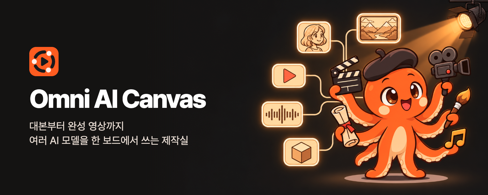
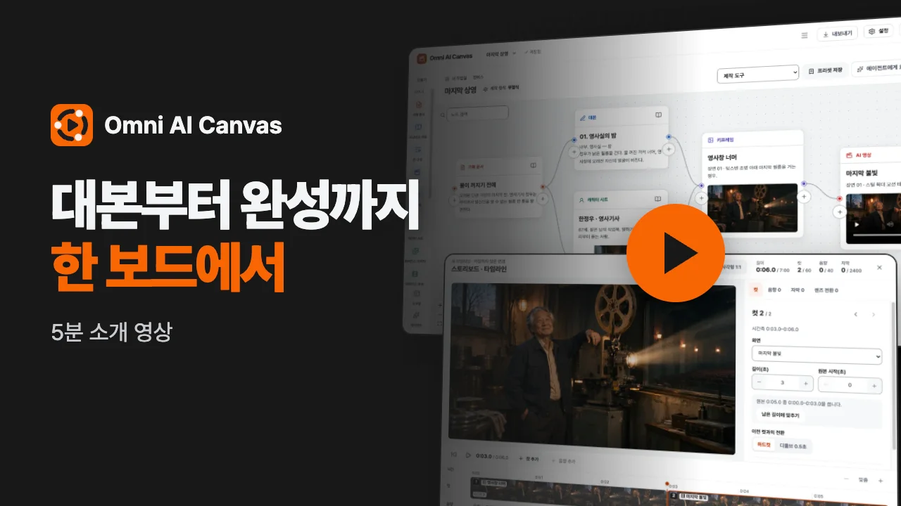
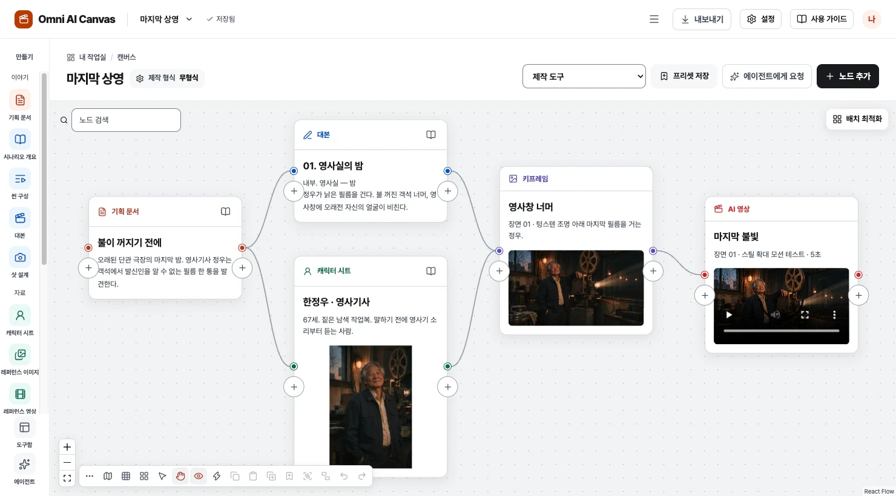
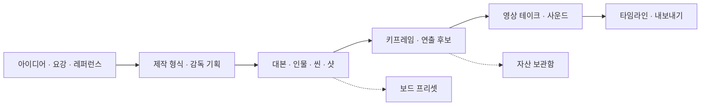
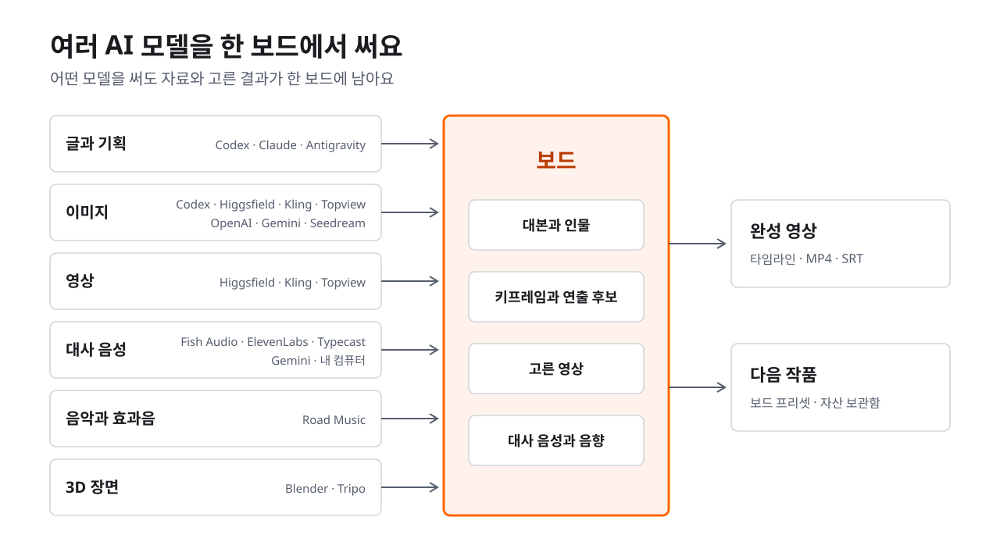
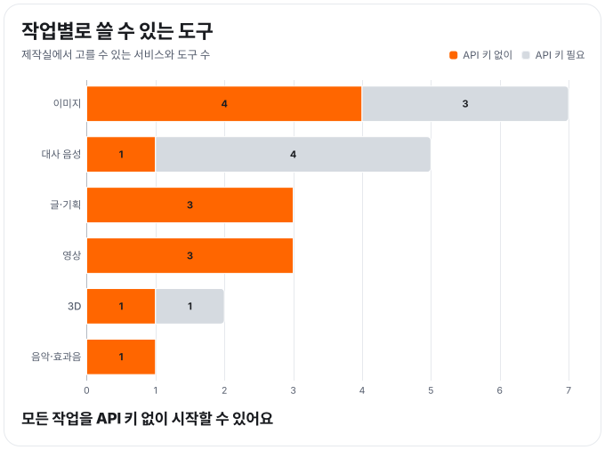
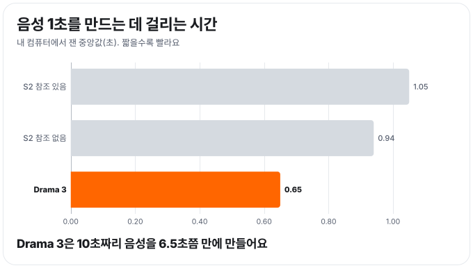

<p align="center"></p>

<h1 align="center">Omni AI Canvas</h1>

<p align="center"><strong>대본부터 완성 영상까지 여러 AI 모델을 한 보드에서 쓰는 제작실</strong></p>

<p align="center">
  <em>마음에 드는 컷을 다음 장면으로 이어 보세요. 어느 대본과 인물 참조로 만들었고 어떤 테이크를 골랐는지 보드에 남습니다.</em>
</p>

<p align="center">
  <a href="https://youtu.be/x3-nif4Fmgg"><strong>5분 소개 영상 보기 ▶</strong></a> &middot; <a href="https://roadkwonai.github.io/omni-ai-canvas/"><strong>소개 페이지 열기</strong></a> &middot; <a href="docs/user-guide.md"><strong>전체 사용 가이드 읽기 →</strong></a><br>
  <sub>설치 후에는 <a href="http://127.0.0.1:5050/">서비스 소개</a>와 <a href="http://127.0.0.1:5050/studio">제작실</a>을 내 컴퓨터에서 열 수 있습니다.</sub>
</p>

<p align="center">
  
  
  
  
  
</p>

> [!IMPORTANT]
> 제작실은 로컬에서 실행합니다. 작업 보드와 실행 이력은 자신이 설정한 Neon에, 미디어와 계정 인증은 제작자 컴퓨터에 보관합니다. 생성할 때는 선택한 계정과 모델의 이용 조건이 적용됩니다. [설치와 보관 경계](docs/release-setup.md)

<p align="center">
  <a href="#5분-소개-영상">소개 영상</a> &middot;
  <a href="#컷-하나로-시작하는-제작-흐름">제작 흐름</a> &middot;
  <a href="#제작-형식">제작 형식</a> &middot;
  <a href="#기능-한눈에-보기">기능</a> &middot;
  <a href="#실행-전에-확인하는-것">비용과 범위</a> &middot;
  <a href="#빠른-시작">빠른 시작</a> &middot;
  <a href="#계정과-로컬-도구">계정과 도구</a> &middot;
  <a href="#문서-지도">문서 지도</a>
</p>

---

## 5분 소개 영상

<p align="center"><a href="https://youtu.be/x3-nif4Fmgg"></a></p>

〈마지막 상영〉의 한 장면을 따라 기획부터 편집까지 실제 화면으로 보여 줍니다. 궁금한 장면부터 볼 수 있습니다.

| 기획과 보드 | 장면 만들기 | 마무리 |
| --- | --- | --- |
| [0:29](https://www.youtube.com/watch?v=x3-nif4Fmgg&t=29s) 제작 형식과 감독 기획 | [1:58](https://www.youtube.com/watch?v=x3-nif4Fmgg&t=118s) 디렉터 스튜디오 | [3:20](https://www.youtube.com/watch?v=x3-nif4Fmgg&t=200s) 3D와 모션그래픽 |
| [1:01](https://www.youtube.com/watch?v=x3-nif4Fmgg&t=61s) 노드와 연결 | [2:23](https://www.youtube.com/watch?v=x3-nif4Fmgg&t=143s) 영상 만들기 | [3:51](https://www.youtube.com/watch?v=x3-nif4Fmgg&t=231s) 타임라인 |
| [1:30](https://www.youtube.com/watch?v=x3-nif4Fmgg&t=90s) 이미지 연출과 인물 | [2:47](https://www.youtube.com/watch?v=x3-nif4Fmgg&t=167s) 대사와 목소리 | [4:17](https://www.youtube.com/watch?v=x3-nif4Fmgg&t=257s) 비용과 정리 |

<sub>일부 공개 영상입니다. 내레이션은 AI 음성이며 리메이크·테이크 비교·렌즈 전환·저장 충돌 장면은 설명용 그림입니다. Built with Fish Audio · 음악 Mixkit</sub>

<p align="center"><a href="docs/user-guide.md"></a></p>

## 컷 하나로 시작하는 제작 흐름

공모전 요강에서 출품안을 잡거나, 레퍼런스에서 편집 리듬을 찾아 새 작품을 시작할 수 있습니다. 대본과 인물·장소 자료를 노드로 잇고, 키프레임에서 표정과 조명을 바꿔 본 뒤 고른 테이크를 타임라인에 올립니다. 진행 중인 작품은 같은 보드에서 열고, 다음 작품에는 쓸 만했던 구조와 자산을 다시 가져옵니다.



| 〈마지막 상영〉 제작 화면 | 화면에서 할 수 있는 일 |
| --- | --- |
| [노드 보드](public/landing/canvas-board.webp) | 대본과 캐릭터 참조를 같은 키프레임에 연결합니다. 연결마다 시작 프레임, 인물·장소·소품 또는 연출 확인용 역할을 고릅니다. |
| [감정 편집기](public/landing/canvas-emotion.webp) | 원본과 기준 표정을 나란히 보고 연출을 조정합니다. 원본에 연결된 결과 후보를 비교합니다. |
| [디렉터 스튜디오](public/guide/director-studio.webp) | 카메라와 렌즈, 구도와 빛의 예제를 비교해 촬영 지시를 고릅니다. |
| [여러 화자 대화](public/guide/dialogue-studio.webp) | 대사를 화자별 줄로 나누고 목소리를 정한 뒤 한 번에 음성으로 만듭니다. |
| [타임라인](public/landing/canvas-timeline.webp) | 채택한 스틸과 영상을 시간축에 놓고, 합성하기 전에 컷과 음향, 자막의 흐름을 재생해 봅니다. |
| [5초 모션 예제](public/sample/preview.mp4) | 같은 장면의 키프레임을 천천히 확대하는 무음 예제를 재생합니다. |

## 여러 모델을 한 보드에서

<p align="center"></p>

| 작업별로 쓸 수 있는 도구 | 로컬 음성 생성 시간 |
| --- | --- |
|  |  |

음성 시간은 2026-11-24 M1 Ultra 64GB에서 모델마다 30회 잰 중앙값입니다. 왼쪽 막대는 앱에서 고를 수 있는 서비스와 도구 수이며, 쓰려면 계정을 연결하거나 프로그램을 설치해야 합니다.

## 제작 형식

새 프로젝트에서 형식을 고르면 해당 형식의 기본 노드와 추천 도구·지침을 볼 수 있습니다. 씬은 **1~12개** 또는 **자동**으로 시작합니다. **무형식**은 빈 보드로, **보드 프리셋**은 전에 저장한 노드 연결 구조로 시작하는 방법입니다.

| 이야기 | 짧은 콘텐츠와 브랜드 | 음악·시각 제작 | 출품 |
| --- | --- | --- | --- |
| 숏드라마 · 드라마 · 영화 | AI 인플루언서 · 숏폼 · 광고 | 뮤직비디오 · 모션그래픽 · 애니메이션 숏 | 공모전 |
| 갈등과 감정선, 인물과 공간의 연속성을 계획합니다. | 첫 장면의 훅, 인물의 말투, 상품 시연과 전달 문구를 잡습니다. | 곡 구간·모션·캐릭터 동작을 씬과 컷으로 나눕니다. | 요강에서 심사 기준과 제출 규격을 뽑아 후보안을 검토합니다. |

광고는 **Higgsfield 패션 광고** 흐름도 선택할 수 있습니다. 상품·인물·공간 참조와 시작 프레임을 만들고, 테이크를 엮어 렌즈 전환까지 편집합니다. [광고 워크플로우](docs/higgsfield-fashion-ad-workflow.md)

## 기능 한눈에 보기

| 만들고 싶은 것 | 제작실에서 하는 일 |
| --- | --- |
| **공모전 출품안** | 공고 URL이나 직접 입력에서 일정·심사 기준·제출 조건을 정리합니다. 후보 아이디어를 비교하고 선택안과 일정, 규격을 기획 노드로 반영합니다. |
| **나만의 영상 프리셋** | 영상 파일·공개 YouTube·프로젝트 영상의 컷 경계, 대표 화면, 자막과 화면 글자를 살펴봅니다. 훅과 전환, 편집 리듬이나 카메라·자막 스타일을 저장해 다른 소재에 적용합니다. |
| **감독 제작안과 대본** | 감독 에이전트의 시나리오·대사·씬·샷 초안을 검토해 선택 반영합니다. 프로젝트 대화에 노드·파일·링크를 연결하고, 문서형 노드는 Markdown과 PDF로 내려받습니다. |
| **캐릭터의 외형과 목소리** | 캐릭터 시트에서 Higgsfield Soul을 학습하거나 불러와 같은 인물을 이어 씁니다. 고른 목소리로 등록용 샘플을 만들어 개인 목소리로 등록하고, 마이크로 대사를 녹음합니다. 캐릭터 연출 키트로 포즈·의상·표정과 3면도, 25컷 시트를 준비합니다. |
| **이미지 연출** | 노드 위 도구에서 감정·조명·다각도·질감을 바꿔 원본과 비교합니다. 설정도와 9·4·25컷 시트를 만들어 필요한 칸만 이미지로 나눕니다. 레이어 분리, 2·4·6배 업스케일, 주석, 회전은 이 컴퓨터에서 처리합니다. |
| **영상 생성과 검수** | 씬이나 샷에서 영상 노드를 열어 모델별 시작·끝 프레임과 참조 칸을 채우고 예상 사용량을 확인합니다. 지원하는 모델에서는 리메이크와 이어쓰기를 요청하고, 외부 영상도 붙입니다. 테이크 스위치에서 후보를 비교해 채택합니다. |
| **클립 다듬기** | 구간과 속도, 비율을 바꾼 사본을 만들고 프레임, 3×3 콘택트 시트, 오디오를 뽑습니다. 이웃한 두 테이크는 안경 렌즈의 윤곽을 추적해 렌즈 전환으로 잇습니다. |
| **3D 장면과 프리비즈** | Tripo 리깅·동작 결과 또는 자신의 GLB를 가져옵니다. Blender로 배역마다 위치·포즈·표정을, 장면에 카메라와 광원을 정해 프리비즈와 최종 테이크를 렌더합니다. 단어 자막에 맞춘 입 모양 초안을 만들고, 이어서 작업할 장면 인계 ZIP을 내려받습니다. |
| **모션그래픽 영상** | 타이포, 숫자, 단계, 카드, 패럴랙스와 캐릭터 컷아웃을 장면별로 조정해 로컬 MP4로 만듭니다. |
| **촬영 기법** | 디렉터 스튜디오에서 촬영 지시 169가지를 예제로 보고 고릅니다. 카메라·렌즈·구도·카메라 이동, 색감·조명·미술, 장면 전개·장르·편집 리듬을 노드에 저장해 이미지·영상 요청에 함께 보냅니다. 감독 도구에서는 배우와 소품의 배치도를 만듭니다. |
| **대사와 목소리** | 대본을 화자별로 나눠 목소리를 정하고 한 번에 음성을 만듭니다. AI가 말투와 쉼을 줄마다 제안하고, 마음에 안 드는 줄만 다시 만듭니다. Fish Audio·ElevenLabs·Typecast·Gemini의 API나 이 컴퓨터의 모델을 씁니다. |
| **음악과 후반 편집** | Road Music으로 음악·효과음·환경음을 준비합니다. 타임라인에서 컷, 하드컷·디졸브, 음향과 단어 자막을 조정하고 확인용 프리비즈와 납품본 MP4, SRT를 만듭니다. |
| **보드와 자료 정리** | 노드 14가지를 잇고 검색·미니맵·배치 최적화·그룹·실행 취소로 정리합니다. 노드에 1~5점 평가를 남기고 프롬프트는 영문과 한국어를 함께 보관합니다. 구조는 보드 프리셋으로, 다시 쓸 미디어는 자산 보관함으로 저장합니다. 프로젝트 검색·분류·복제·보관과 JSON 내보내기도 지원합니다. |
| **제작 지침과 스킬** | 노드마다 쓸 지침과 스킬의 출처, 작업 순서를 보고 고칩니다. 에이전트의 수정안도 검토한 뒤 적용합니다. 시네마틱 단편, 광고, 숏드라마용 Higgsfield 제작 순서를 보드에 놓을 수 있습니다. |
| **외부 에이전트 연결** | 로컬 MCP로 프로젝트를 조회하거나 검토한 노드와 연결을 추가합니다. 앱 안에서도 노드 지침과 추천 제작 스킬을 선택해 작업 요청에 담을 수 있습니다. |

각 기능의 메뉴 위치, 설정, 조건과 단계는 [전체 사용 가이드](docs/user-guide.md)를 참고하세요. 제작실에서는 **사용 가이드 → 화면에서 기능 설명 보기**로 버튼마다 설명을 볼 수 있습니다.

## 실행 전에 확인하는 것

- **생성과 적용은 제작자가 정합니다.** 제안과 생성 결과는 기록에 모이고, 확인한 것만 보드에 적용합니다. 저장이 충돌하면 덮어쓰지 않고 알려 줍니다.
- **유료 이미지 API는 켠 것만 씁니다.** OpenAI·Gemini·Seedream 이미지 API는 키를 등록하고 설정에서 허용해야 고를 수 있습니다. 이미지 작업의 기본값은 ChatGPT로 로그인한 Codex입니다.
- **편집은 이 컴퓨터에서 합니다.** 타임라인, 클립, 모션그래픽, 렌즈 전환과 Blender 렌더는 생성 모델을 부르지 않습니다.
- **혼자 쓰는 로컬 앱입니다.** 로그인, 공동 편집, 서버 배포, SNS 게시는 지원하지 않습니다. [할 수 없는 일](docs/user-guide.md#할-수-없는-일)

## 빠른 시작

**Node.js 22.13 이상**과 npm, Neon 데이터베이스를 준비합니다. 영상 작업에는 PATH에서 실행되는 **FFmpeg 5.1 이상**과 `ffprobe`도 필요합니다. 프로젝트 루트에서 `.env.example`을 `.env`로 복사하고 `DATABASE_URL`과 `DATABASE_URL_UNPOOLED`를 채웁니다.

```bash
cp .env.example .env
npm ci
npm run setup:check
npm run db:migrate
npm run dev
```

1. [로컬 제작실](http://127.0.0.1:5050/studio)에서 **마지막 상영**을 열고 노드의 연결과 샘플을 확인합니다.
2. **새 프로젝트**에서 제작 형식을 정하거나 빈 보드로 시작합니다.
3. 직접 만든 파일을 가져오거나, 사용할 계정을 연결한 뒤 노드의 생성·연출 도구를 엽니다.

`npm run setup:check`는 필수 파일과 선택 도구가 있는지만 확인합니다. 설정값을 화면에 보이거나 외부 서비스를 부르지 않습니다.

<details>
<summary>API 키 없이 목소리 만들기 (Apple Silicon Mac)</summary>

[uv](https://docs.astral.sh/uv/)를 설치한 뒤 실행합니다. 모델을 처음 받을 때 S2 Pro 약 11GB, Drama 3 약 24GB를 내려받습니다. 이미 받은 S2 Pro가 있으면 폴더를 뒤에 적습니다.

```bash
npm run setup:local-tts
```

S2 Pro로 만든 음성은 연구와 비상업 용도로만 쓸 수 있고, Drama 3는 연 매출 50만 달러 미만이면 상업적으로 쓸 수 있습니다. [로컬 음성과 라이선스](docs/providers.md)

</details>

<details>
<summary>운영 모드와 검증 명령</summary>

```bash
npm run build
npm start
```

```bash
npm test
npm run lint
npm run typecheck
```

서버 중단 뒤 특정 프로젝트의 대기 작업은 `npm run worker -- --drain <프로젝트-UUID>`로 진행할 수 있습니다. DB 연결과 배포 파일, 릴리스 방법은 [새 환경 설치와 배포 준비](docs/release-setup.md)에서 확인하세요.

</details>

## 계정과 로컬 도구

| 작업 | 연결하는 계정 또는 도구 |
| --- | --- |
| **기획·텍스트** | ChatGPT로 로그인한 Codex, Claude Code 또는 설정을 켠 Antigravity 개인 CLI |
| **이미지·영상** | Codex 구독 이미지, Higgsfield·Kling CLI, Topview 공식 OAuth MCP. OpenAI·Gemini·Seedream 이미지 API는 키를 등록하고 작업실 설정에서 허용할 때 선택 |
| **대사 음성** | Fish Audio·ElevenLabs·Typecast·Gemini TTS의 API 키, 또는 이 컴퓨터에 설치한 Fish S2 Pro·Drama 3 |
| **3D·문서·분석** | Blender와 선택적 Tripo API. 기능에 따라 Swift Vision, `yt-dlp`, `whisper-cli`, `pdftotext`, Python, Chrome 또는 Chromium 사용 |
| **로컬 음악과 효과음** | [Road Music](https://github.com/roadkwonai/music-road)의 앱·CLI와 ACE-Step 또는 YuE 엔진. `ROAD_MUSIC_HOME`에 설치 폴더 지정 |

[Road Music YuE2 스킬 저장소](https://github.com/roadkwonai/music-road-music-skills)는 곡 기획, 스타일·가사 준비, 생성 전 확인과 결과 검수에 사용합니다. 이 프로젝트에는 고정 버전의 스킬이 들어 있습니다. Road Music 앱과 선택한 엔진은 별도로 준비합니다. [음향 연동](docs/road-music-integration-plan.md) · [동봉 스킬과 버전](docs/skills.md)

## 문서 지도

| 보고 싶은 내용 | 문서 |
| --- | --- |
| **처음부터 사용하기** | [전체 사용 가이드](docs/user-guide.md) · [설치와 배포 준비](docs/release-setup.md) |
| **기획과 연출** | [제작 에이전트](docs/production-agent-guide.md) · [공모전](docs/contest-workflow.md) · [영상 분석과 프리셋](docs/style-preset-workflow.md) |
| **제작 도구** | [이미지 연출](docs/image-node-editor-design.md) · [모션 레시피](docs/local-motion-recipes.md) · [3D 제작](docs/blender-tripo-production.md) · [타임라인](docs/timeline.md) |
| **대사와 음성** | [음성 제작과 과금](docs/tts-studio-design.md) · [서비스별 조건](docs/providers.md) |
| **계정과 에이전트 연결** | [서비스 연결](docs/providers.md) · [로컬 MCP](docs/mcp.md) · [프로젝트 스킬](docs/skills.md) |
| **릴리스** | [릴리스 노트](release/README.md) · [v0.1.1 타임라인 개편과 소개 영상](release/2026-11-24-timeline-and-intro.md) |
| **설계와 검증** | [프로젝트 개관](project.md) · [제품 요구사항](docs/PRD.md) · [아키텍처](docs/architecture.md) · [용어집](glossary.md) · [실행 검증](docs/verification.md) · [디자인 시스템](DESIGN.md) · [브랜드 규칙](docs/brand.md) |

## 라이선스

이 저장소의 라이선스는 아직 정하지 않았습니다. 정해지기 전에는 공개하더라도 다른 사람이 복제하거나 고쳐 쓸 권리가 따로 주어지지 않습니다. 동봉한 스킬, 글꼴, 얼굴 리그와 로컬 음성 모델에는 각자의 조건이 있습니다. [동봉 스킬과 출처](docs/skills.md) · [예제 자산 출처](docs/sample-assets.md)
