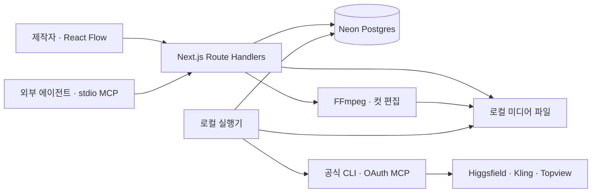
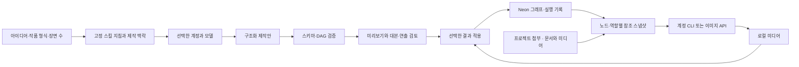

# Omni AI Canvas 아키텍처

## 시스템 경계

한 명의 제작자가 브라우저와 Next.js 서버, 로컬 실행기를 같은 컴퓨터에서 운영한다. Next.js는 루프백에 바인딩한다. 모든 데이터 API에서 요청 Host를 제한하고 변경 요청의 Origin을 확인한다. 이 모델에서 OS 계정에 접근 가능한 사용자는 제작자 권한을 갖는다. 공개 호스팅에는 별도 사용자 인증, 저장소 격리 및 로컬 실행기 페어링이 필요하다.

루트 `/`는 프로젝트 저장소와 계정 조회에 의존하지 않는 소개 페이지다. 제작실은 `/studio`에서 기존 로드 및 실패 처리 경로를 사용한다. `/?project=…` 요청은 프로젝트와 컷 분석 쿼리를 그대로 넘긴다. Topview·Higgsfield MCP 승인 완료 후에는 `/studio`로 돌아간다.

작업 지침, 제작 워크플로우, 마이그레이션과 실행기는 프로젝트에 동봉한다. `.env`와 로컬 미디어·인증·비공개 작업물은 Git과 서버 의존성 추적에서 제외한다. 선택한 로컬 엔진은 설치 경로를 명시하고 준비되지 않으면 해당 작업에서 설정 안내를 표시한다. [새 환경 설치](release-setup.md)

## 감독 에이전트와 제작 데이터 흐름

컷 분석은 원본 좌표를 유지한 시각 표본을 번호가 있는 이미지 시트로 변환한다. 실행 요청에는 실제로 전달한 컷 번호를 고정하며, 응답의 컷 해석은 그 번호 범위 안에서만 받아들인다. `attachments/range`는 프로젝트에서 읽은 원본 파일을 재사용하고 새 첨부 매니페스트를 만든다. 자동 검출본과 수동 경계 보정본의 실행 이력은 각각 유지된다.

모션 감독은 `runs.input.motionDesign`에서 주제·길이·화면비·스타일을 받아 로컬에서 해석할 수 있는 명세를 제안한다. `runs.result.motionSpec`의 장면 시간과 레시피를 검증한 뒤 편집기에 반영한다. 이미지와 캐릭터 레이어는 보드에서 고르고, 렌더 API는 해당 프로젝트 소속을 확인한다. 출력 MP4와 장면 명세는 영상 노드에 보존한다. [통합 설계와 검증](local-video-production.md)

감독안은 응답 스키마와 방향성 비순환 그래프 검증을 거쳐 미리보기로 제공한다. 사용자가 결과와 검토 의견을 선택해 반영한다. 영상 참조의 시작·끝 프레임과 인물·장소·소품 등 역할은 실행 스냅샷에 기록한다. **연출 확인용** 연결은 실행 입력 수집 단계에서 제외한다. 실행기는 선택 모델의 지원 범위를 확인하고 로컬 CLI 또는 이미지 API에 요청한다. Neon에는 그래프와 실행 이력을 저장하고 미디어 파일은 로컬에 보관한다. [제작 에이전트 사용 가이드](production-agent-guide.md)

감독안의 대사 객체는 `delivery`를 생략하면 기존 일반 대사로 읽는다. `os`는 대본에 `[OS]`와 출처를 남긴다. `narration`과 `innerMonologue`는 `[VO]`로 표기하고 `placement`의 씬 내 샷 번호·초 단위 오프셋·발화 길이를 이미 계산한 컷 시작점과 30fps 프레임으로 변환한다. 범위를 벗어나거나 전체 타임라인의 상한을 넘는 VO 계획은 편집 구간을 수정하거나 나누도록 오류를 돌려준다. 음향 큐와 시간축은 기존 그래프 형식을 재사용한다. 음성 파일을 첨부하기 전 프리비즈는 무음 경고를 표시하고, 최종 합성에는 해당 음성 파일이 필요하다.

## 실행별 첨부 경계

`/api/projects/[id]/attachments`는 프로젝트를 확인한 후 파일 또는 공개 HTTPS 본문을 처리한다. 첨부 매니페스트는 `.scene-room/attachments/<프로젝트 ID>/`에 저장하고 미디어는 로컬 자산 저장소에 둔다. 실행 시 같은 프로젝트의 첨부 ID만 확인하고 추출 텍스트와 허용된 미디어를 참조 스냅샷에 결합한다. 첨부는 요청당 8개, 미디어 참조 합계 12개·64 MiB, 참조 JSON 120,000자 이하다. 문서당 추출 텍스트는 최대 12,000자다.

텍스트 문서는 텍스트로 처리하고, 영상은 대표 프레임과 내장 자막을 로컬에서 추출한다. 음성 전사는 수행하지 않는다. Higgsfield·Kling·Topview의 모델 선택 경로에서는 원본 이미지·영상을 선택한 입력 슬롯으로 넘긴다. 공개 링크는 HTTPS·공인 주소·리다이렉트 검증 후 HTML 또는 텍스트 본문만 가져오고, 읽을 수 없는 내용은 직접 입력을 안내한다. [지원 형식과 제공자 제한](production-agent-guide.md#에이전트에-자료-첨부)

## 이미지·영상 모델 경계

씬·샷·참조 이미지에서 시작한 생성은 같은 프로젝트의 연결된 영상 노드를 열며, 아직 없으면 기존 그래프 편집과 자동 저장 경로로 만든다. 이 동작은 생성 실행과 분리된다. 사용자가 영상 생성 버튼을 누르면 현재 버전의 그래프와 첨부 ID, 모델 설정을 기존 실행 API로 보낸다. 입력 역할과 모델 슬롯이 맞지 않으면 제출 전에 사유를 표시하고 서버에서도 검증한다. 실행 기록에서 영상을 검토한 뒤 대상 노드에 적용한다.

디렉터 스튜디오의 노드별 연출은 `directorNote`에 보관한다. 이미지·영상 요청에는 대상 노드의 연출과 생성 입력으로 연결된 자료의 연출을 포함한다. ChatGPT 이미지의 `imageOutput` 값은 기존 구독형 이미지 브리지에 출력 지시로 전달한다. 다른 영상·이미지 모델에는 공급사가 공개한 옵션과 참조 역할을 사용한다.

초점 거리의 화각 미리보기는 브라우저의 비교 예제다. 적용하면 선택한 mm 값과 장면 전개·장르·편집 리듬을 기존 `directorNote` 텍스트에 기록한다. 기존 노드에서 생략된 항목은 기본 상태로 표시하고 생성 요청에는 지정한 값만 넣는다.

`directorNote`에는 기법의 이름만 저장한다. `lib/run-input.ts`가 요청을 만들 때 `directorRequestText`로 이름을 구체적인 지시로 펼치므로 저장 길이 제한이 유지되고 지시를 고치면 이미 저장한 노드에도 반영된다. 실행 요청에는 펼친 문장이 입력 스냅샷으로 남는다. 정지 이미지 요청에서는 카메라 이동·시간 표현·편집 리듬을 빼고, 제목 줄이 없는 자유 문장과 직접 입력한 값은 바꾸지 않는다.

디렉터 스튜디오의 기본 예제는 `public/director/examples/`에 두며 이미지는 구독형 `image_gen`, 움직임은 `scripts/director_moves.py`의 로컬 Blender 장면으로 만든다. 초점 거리 예제는 18mm 원본 위에 48mm·115mm 화각의 세부 이미지를 같은 좌표계로 겹쳐 함께 확대한다. 가장자리는 알파로 섞고 저주파 색은 아래 이미지에 맞춘다. 위치와 색은 `tests/node-director-focal.test.ts`, 카메라·렌즈·조리개 예제의 구별과 선명도 순서는 `tests/node-director-optics.test.ts`가 검사한다. 세부 이미지는 30mm부터 읽고, 불러오지 못하면 원본이 그대로 보인다. 제3자 예제는 `scripts/director-references.ts`로 `.scene-room/research/cineguide`에만 저장한다. 이 폴더는 Git과 빌드 추적에서 제외된다. `/api/director-references`는 로컬 요청만 받고, 목록에 있는 파일만 SHA-256을 대조해 전달한다. 목록이 없거나 파일이 바뀌면 404를 반환하고 화면은 기본 예제로 돌아간다.

작업 종류별 기본 에이전트·모델·추론 강도와 작업 공간 배치는 `drama_canvas.workspace_settings`의 단일 행에 둔다. `/api/workspace-settings`의 버전 조건으로 다른 브라우저의 변경을 덮어쓰지 않는다. 첫 저장 전에는 브라우저에 있던 기본값과 배치를 가져올 수 있다. 별도 과금 허용 목록은 저장 화면에서 선택한다. 허용된 노드별 선택은 해당 브라우저에서 우선한다. 서버는 실행 시점에 확정한 공급사와 모델의 계정·사양을 재검증한다.

이미지 기본값은 Codex 구독의 `image_gen`이다. OpenAI·Gemini·Seedream 이미지 API는 저장된 허용 목록을 견적, 작업 등록, 작업자 실행에서 확인한다. 연결 키와 허용 목록은 별도로 관리한다. 허용을 해제하면 대기 중인 작업도 실행 단계에서 차단된다.

`/api/providers/media-model`의 사양은 Higgsfield 모델 명세, Kling 계정의 CLI 선언, Topview MCP 생성 설정을 화면용 형식으로 변환한다. 브라우저는 모델·모드·옵션과 슬롯 할당만 보낸다. 프로젝트 참조와 첨부 원본을 서버에서 복원한 뒤 같은 사양으로 검증한다. 작업 실행기도 제출 전에 사양을 다시 확인한다. 명세가 바뀌어 입력을 사용할 수 없다면 기존 입력을 보존하고 작업을 실패로 표시한다.

Higgsfield와 Kling은 OS 계정의 CLI 로그인 정보를 사용한다. Topview는 공식 OAuth의 PKCE 콜백으로 받은 토큰을 로컬에 저장하고 MCP SDK에서 사용한다. 토큰은 스냅샷·웹 응답에 포함되지 않는다. 비용 조회에는 파일을 외부로 전송하지 않는다. 한 건의 실행은 로컬 노드에서 지원하는 미디어 결과 한 개를 보관한다.

## Blender 제작과 Higgsfield 지침의 실행 경계

| 흐름 | 서버·데이터 경계 | 재실행 또는 변경 처리 |
| --- | --- | --- |
| GLB 등록 | 프로젝트에 모델과 출처 정보를 보관하고 GLB 2.0의 메시·본·내장 애니메이션을 읽는다. 렌더 입력은 해당 프로젝트의 ID로만 해석한다. | 외부 파일에 의존하는 모델은 자원을 포함해 내보내도록 안내한다. 다른 프로젝트로 그래프만 복사한 경우 GLB 파일을 대상 프로젝트에서 다시 연결한다. |
| Blender 렌더 | 저장된 샷의 명세 → 로컬 Blender의 고정 스크립트 → PNG 프레임 → FFmpeg H.264 → 로컬 미디어. 일반 API 키와 공급사 생성 경로는 사용하지 않는다. | 실제 길이·코덱을 검사하고 임시 프레임을 정리한다. preview/final 각각의 명세와 테이크를 보관한다. 미등록 렌더는 프로젝트·샷 범위에서 복구할 수 있다. |
| 편집과 앵글 | 영상 노드를 기존 또는 새 타임라인의 30fps 컷으로 연결한다. 특정 시각의 정지 프레임은 블로킹용 참조와 대안 샷으로 연결할 수 있다. | 타임라인에 새 컷을 붙이면 갱신된 편집 결과를 다시 합성한다. 프레임은 처음에 연출 가이드로 연결되며 이후 생성 입력 여부는 사용자 선택이다. |
| 지침 구성 | 프로젝트 범위 공식 스킬과 로컬 저자 원문을 분리한다. 출처 ID·해시가 맞는 원문만 뷰어에서 열고, 작업에는 선택한 연출 지침을 스냅샷으로 전달한다. | 과거 노드와 미선택 상태는 기존 동작을 보존한다. 사용자가 명시적으로 비우거나 변경한 선택은 해당 실행에 반영된다. |
| 음성 | 배역별 노드에서 녹음 → 로컬 미리 듣기 → 사용자가 지정한 노드에 WAV 첨부. 공급사의 음성 엘리먼트와 앱의 로컬 음원은 별도 데이터다. | 권한 거절·녹음 취소·화면 종료 시 마이크를 해제한다. 음원은 기존 타임라인에서 큐로 배치한다. |

[실증 장면과 소스 라이선스](blender-scene-verification.md) · [스킬 선택·중복 기준](higgsfield-production-audit.md)

## 데이터와 인터페이스

실행 기록은 `(created_at DESC, id DESC)` 복합 키로 기본 30건씩 조회한다. 커서는 PostgreSQL의 마이크로초까지 유지한다. 첫 페이지는 오래된 활성 실행과 현재 추적하는 실행의 상태를 별도로 반환하고, 이어 보는 페이지는 커서보다 이전 행만 읽는다. 같은 범위의 이력이 변하지 않으면 304로 응답한다. 워커의 생존 신호는 실행 만료에만 사용하고 ETag를 바꾸지 않는다.

제공자 응답을 받으면 작업 ID로 구분한 결과 JSON을 로컬 디스크에 먼저 기록한다. 임시 파일을 동기화하고 원자적으로 공개한 뒤 DB 반영을 시도한다. 워커와 웹 서버 시작 시 남은 기록을 찾아 기존 작업 행에 반영한다. 여러 프로세스가 같은 결과를 보내도 이미 반영된 값은 확인만 하고, 별도 결과로 완료된 행은 덮어쓰지 않는다. 디스크의 기록은 DB가 반영을 확인한 뒤에만 제거한다.

API 키는 로컬 서버의 제한된 권한 파일에서 읽는다. 설정 응답은 등록 여부와 등록 경로를 제공한다. 작업 실행 시 로컬 값이 있으면 사용하고, 없으면 기존 환경변수 값으로 이어진다. 구독 요금제는 공급사의 계정 응답에서 읽는다.

### 레퍼런스 분석과 제작 프리셋

프리셋 편집기에서 타입·콘셉트·촬영 지침을 선택한다. 로컬 파일은 `POST /api/projects/[id]/attachments/reference-video`로 원본을 스트리밍하고, 공개 YouTube와 프로젝트 영상도 같은 검사 파이프라인을 사용한다. 레퍼런스 분석 원본은 1 GiB·60분으로 제한한다. 분석용 원본은 로컬 디스크에 저장하고 컷 재분석은 이를 공유한다. 에이전트에는 최대 8편의 분석용 텍스트와 시트 최대 8장을 전달한다. 시트는 영상별로 균등 배분하고 해당 영상의 순서에 맞춰 표본을 고른다. 일반 첨부 및 영상 공급사 전송은 기존 파일 한도를 적용한다.

| 단계 | 입력과 출력 | 저장 또는 실행 경계 |
| --- | --- | --- |
| 근거 수집 | FFprobe 규격, FFmpeg 화면 변화 후보와 대표 프레임, 자막과 진단 | 원본과 프레임은 로컬 미디어, 타임코드는 프로젝트 첨부 매니페스트. macOS Vision을 사용할 수 있으면 대표 프레임의 화면 문자 위치를 함께 기록. 이용 가능한 공개 자막 또는 설정된 로컬 Whisper의 구간 시각과 출처도 보존 |
| 추천·분석 | `presetDesign.mode`와 편집 중인 초안 → `RunResult.stylePreset` | 기존 Neon 실행 큐·로컬 워커. 영상은 Codex·Claude에 대표 화면과 텍스트 근거를 전달. 아이디어 추천은 텍스트 지원 계정을 사용 |
| 개인 보관함 | 프리셋 스냅샷·편집 버전 | `drama_canvas.style_presets`, 마이그레이션 `003_style_presets.sql`. PUT은 예상 버전이 같은 행만 갱신하고 충돌 시 409 |
| 제작 보드 | 콘텐츠 타입별 기본 그래프 또는 감독 제안 그래프, 선택 지침, 비트 시트 | 노드·연결·타임라인을 프로젝트 JSONB에 저장. 직접 첨부한 원본은 수동 보드에 연출 확인용으로 연결 |
| 후속 작업 | 프로젝트 대화와 감독 기획은 선택한 스타일을 전달. 생성은 선택한 노드 지침과 입력 연결을 사용 | 다음 요청용 활성 스타일은 브라우저에서 프로젝트별 보존. 개별 요청은 당시의 스타일을 고정 |
| 모션 숏 | 장면 문구, 길이, 배치, 색, 효과 → 편집 명세와 MP4 | `/api/projects/[id]/motion-short`에서 로컬 렌더. 채택 시 명세와 자산을 영상 노드에 저장. 재편집 결과는 새 테이크로 추가 |

구간 비율은 영상마다 다른 실제 길이를 재사용할 수 있도록 누적 종료점으로 저장한다. 마지막 종료점은 100%다. 비트 수와 컷 구성이 대응하면 기존 총 프레임 안에서 길이를 배분한다. 대응이 불명확하면 비트 시트를 수동 편집용으로 유지한다. [제작 프리셋 설계](style-preset-workflow.md)

프로젝트 에이전트는 같은 실행 큐에 텍스트 작업을 등록한다. 서버가 명시한 노드와 레시피를 확인하고, 같은 프로젝트·스레드의 성공한 응답 중 최근 8턴을 실행 입력으로 고정한다. 클라이언트의 대화 이력 필드는 받지 않는다. 대화 결과는 그래프 편집으로 자동 적용되지 않는다.

제작 지침은 노드의 선택적 `guidance` 필드로 기존 JSONB 그래프와 함께 저장한다. 기본 레시피는 노드 종류를 따라 결정하고, 실행에는 적용된 레시피와 본문을 고정한다. 지침을 고쳐 달라는 작업은 텍스트 제안으로 끝난다. 요청 시점의 제목·본문·지침과 현재 노드를 대조한 뒤 사용자가 선택한 수정안만 적용한다.

- `drama_canvas.projects`는 UUID, 제목, 버전, 수정 시각, 노드와 연결 JSONB를 저장한다. 한 그래프의 저장과 버전 증가를 하나의 조건부 UPDATE로 처리한다.
- `drama_canvas.runs`는 프로젝트, 노드 또는 기획 요청, 요청 ID, 제공자, 입력 스냅샷, 시각, 상태, 결과 또는 오류를 저장한다. 프로젝트와 요청 ID의 유일성으로 전송 재시도 시 중복 차감을 줄인다.
- 입력 스냅샷은 실행 시점의 선택 노드와 직접 연결된 참조를 고정한다. 에이전트 답변은 스키마와 그래프 유효성 검사를 통과해야 적용한다.
- 실행기는 대기 작업을 원자적으로 점유한다. 결과는 별도로 보관하고 사용자가 현재 버전에 적용한다. 실행기 중단으로 결과를 알 수 없는 작업은 자동 재제출하지 않는다.
- Higgsfield와 Kling이 작업 번호를 반환하면 실행기는 결과 대기 전에 `runs.external_id`에 저장한다. 실패하거나 실행기가 중단된 경우 이력의 번호로 제공자에서 상태를 확인할 수 있다.
- 업로드·생성 파일은 서버가 할당한 이름으로 로컬 디렉터리에 보관한다. DB에는 허용된 미디어 참조와 유형만 기록한다. JSON 내보내기는 원본 미디어의 백업과 함께 사용한다.
- 구독용 실행기에는 데이터베이스 URL이나 별도 청구용 API 키를 전달하지 않는다. 허용된 실행 파일과 인수 배열을 사용하고 사용자의 텍스트는 데이터로 전달한다. 에이전트의 파일·명령·도구 권한을 작업 단위로 제한한다.

## 선택 근거

타임라인은 단어 시각을 30fps 편집 시간으로 저장한다. 전사는 선택한 음향 레이어의 재생 구간을 로컬 Whisper에 전달한다. 사용자가 결과를 검토해 적용한 뒤 합성 시 선택형 자막 트랙을 생성한다. 자막 정보는 보드 가져오기와 MCP 경로에서도 유효성 검사를 통과해야 한다.

Blender는 렌더 입력, 자산 파일, 실행 버전과 스크립트를 기준으로 완료 프레임을 재사용한다. 모션그래픽은 장면 단위 입력과 실제 이미지 내용을 기준으로 조립 전에 개별 클립을 찾는다. Blender 인계 ZIP과 렌더의 로컬 캐시, 공급사의 작업 이력은 각각 별도의 수명과 경계를 갖는다.

Next.js App Router를 한국어 UI와 서버 측 검증의 경계로, React Flow를 좌표·포트·선택·확대 처리에 사용한다. Neon HTTP 드라이버로 짧은 SQL 요청을 보낸다. 장시간 생성 작업은 HTTP 요청 수명과 분리한다. 제공자가 구독 연동을 공개하지 않았을 때는 브라우저에서 공식 앱을 열고 결과를 가져온다. [Next.js 설치](https://nextjs.org/docs/app/getting-started/installation), [React Flow](https://reactflow.dev/learn), [Neon 드라이버](https://neon.com/docs/serverless/serverless-driver)

## 구현 순서와 검증

1. 샘플 그래프 → Neon 저장 → 다시 열기. 새 프로젝트와 버전 충돌을 확인한다.
2. 캔버스 → 노드 편집 → 참조 연결. 순환·유실·잘못된 미디어 입력을 검사한다.
3. 작업 요청 → 로컬 실행기 → 결과 검토·적용. 재요청과 실패를 검사한다.
4. 장면 미디어 업로드·재생과 내보내기를 데스크톱·모바일 화면에서 확인한다.

## 외부 에이전트와 로컬 생성 실행

프로젝트에 등록한 stdio MCP가 루프백 API로 프로젝트 조회와 그래프 추가를 전달한다. 외부 에이전트도 같은 그래프 검증과 버전 충돌 규칙을 따른다. 생성 버튼은 Neon에 스냅샷을 기록한 뒤 해당 프로젝트 큐를 비우는 로컬 Node.js 프로세스를 시작한다. 대기열이 비면 프로세스가 종료된다. 이미 제출한 유료 작업의 실제 결과를 서버 장애 후 알 수 없을 때는 해당 계정의 작업 이력을 먼저 확인한다. 앱에 등록한 제공자와 외부 계정 연결 조건은 [제공자 조사](providers.md), MCP 클라이언트 등록 방법은 [연결 문서](mcp.md)에 기록한다.

## 컷 내보내기

선택한 프로젝트의 영상 노드 ID와 순서를 받아 로컬 FFmpeg로 장면을 잇는다. 서버가 저장본의 버전과 미디어 경로를 확인한 후 해상도·프레임률·오디오 형식을 통일한다. 음성이 없는 컷에는 무음을 채우고, 완성된 MP4를 로컬 자산 경로로 내려준다. 이 단계는 외부 생성 제공자를 호출하지 않는다.

## 프리비즈와 음향 확장

감독 제작안, 씬·샷·레퍼런스 노드와 참조 역할은 구현 단계에 반영됐다. 프리비즈와 오디오 확장은 Neon 그래프와 로컬 자산을 재사용한다. 상세 상태는 [캔버스 기능 대응표](canvas-parity.md)에 기록한다. `components/CanvasBoard.tsx`, `components/Studio.tsx`, `scripts/canvas-mcp.ts`와 에이전트 기획 출력도 같은 계약을 사용한다. 주기적 모델 호출 없이 그래프와 타임라인을 수정할 수 있어야 한다.

| 경계 | 구현 계획 | 실패 처리 |
| --- | --- | --- |
| 실행 스냅샷 | `lib/run-input.ts`에서 대상 샷, 선택된 역할과 구간, 룩·연기 설정을 결합한다. 연출 확인용 연결은 참조 본문이나 파일을 수집하기 전에 걸러낸다. 견적/실행 API와 작업자가 같은 모델별 변환기를 쓴다. | 잘못된 슬롯·범위·모델은 제출 전에 설명한다. 스냅샷 이후 자료 변경은 기존 테이크의 재실행으로 연결하지 않는다. |
| 로컬 프리비즈 | 컷 목록과 고른 스틸·클립으로 FFmpeg 애니매틱을 만든다. 키프레임 한 장이 없는 샷도 텍스트 패널로 길이를 확인한다. | 설계상 빈 패널과 실제 파일 유실을 구별한다. 누락된 원본·무효 시간 구간은 해당 샷에 표시한다. |
| 오디오 어댑터 | Road Music CLI를 인수 배열과 JSON 표준입력으로 호출한다. 외부 작업 ID, 원본 위치 검증 및 파생 자산 복사를 로컬 작업자가 맡는다. | 준비 검증 실패, 서비스 미연결, 결과 미확정, 청취 전 상태를 구분한다. 같은 작업을 자동 재제출하지 않는다. |
| 최종 편집 | `lib/cut-export.ts`의 영상 정규화와 원음 처리를 재사용하고, 컷 선택·입출점·음향 배치를 서버에서 검증한 뒤 믹스한다. 기존 영상 전용 요청도 받아들인다. | 지원되지 않는 편집 기법은 메모로 유지한다. 결과 파일을 확인한 후 다운로드를 제공한다. |

[전체 그래프와 예제](directing-workflow.md) · [Road Music 작업과 결과 계약](road-music-integration-plan.md)

## 프로젝트 관리와 계정 조회

`db/005_project_management.sql`은 `projects`에 `category`, `tags`, `last_opened_at`, `archived_at`, `deleted_at`을 추가한다. 목록은 그래프 없이 메타데이터만 반환한다. 최근 활동은 열기와 변경 중 늦은 시각이다. 열기는 그래프 버전을 그대로 유지하고, 메타데이터와 상태 변경은 예상 버전이 일치할 때만 반영한다. 삭제한 프로젝트는 복구할 수 있으며 보관 상태에서 삭제했다면 보관함으로 먼저 돌아간다.

`PATCH /api/projects/:id`는 `open`, `metadata`, `duplicate`, `archive`, `trash`, `restore`를 받는다. 복제는 새 프로젝트 ID에 그래프와 타임라인을 복사한다. 일반 미디어의 로컬 URL은 공유하고 Blender 작업에 사용하는 프로젝트 전용 자산은 복사한다. 실행 히스토리, 에이전트 첨부 목록, 프로젝트별 브라우저 설정은 각각 원래 프로젝트의 범위에 남는다.

공유 분류 카탈로그는 `drama_canvas.project_classifications`에서 UUID와 종류, 이름으로 관리한다. `db/006_project_classifications.sql`은 기존 프로젝트의 카테고리와 태그를 카탈로그에 등록한다. 프로젝트와 이전 호출자는 기존 문자열 형태를 사용한다. 새 선택 UI는 UUID와 이름을 함께 보내 이미 수정되거나 삭제된 선택을 확인한다. 전체 이름 변경과 삭제는 카탈로그와 모든 사용처를 한 트랜잭션에서 갱신한다. 분류 변경과 프로젝트 설정·복제는 트랜잭션별 잠금을 먼저 얻어 갱신 직전의 상태를 사용한다. 프로젝트 그래프 저장과 분류 수정은 프로젝트 버전으로 경합을 확인한다.

키 연결 테스트는 `POST /api/settings/test`에서 저장된 키와 고정된 공식 읽기 URL만 사용한다. 브라우저는 키 이름만 보내고 연결, 인증 거부, 미설정, 확인 불가 상태를 받는다. 구독 계정 조회는 `GET /api/providers`가 담당한다. 계정에서 조회한 모델과 잔여량은 공급사 응답을 따르며, 모델 목록에 있어도 잔액과 생성 시점 권한에 따라 실행 가능 여부가 달라진다.

기획·텍스트 요청은 선택한 모델이 지원하는 `effort`를 실행 입력에 고정한다. Codex는 app-server 모델 선언을, Antigravity는 공식 CLI의 읽기 전용 강도 조회를, Claude는 CLI에서 공개한 설정 단계를 사용한다. 실행 등록과 실행기가 모두 범위를 검사한다.

### 제공자 상태의 표시 캐시

`GET /api/providers`는 서버 로컬 디스크의 최근 조회 결과를 먼저 읽고, `snapshotAt`과 `refreshing`을 함께 반환한다. 공급사 이름·모델·요금제·크레딧 등 표시 필드만 저장하며 원본 응답, 인증 토큰, 키 값은 저장하지 않는다. 설정에서 수동 새로고침을 요청하거나 시작·주기 타이머가 실행되면 읽기 전용 조회로 갱신한다. 계정과 키 변경은 무효화 시점을 기록해 변경 이전에 시작한 조회를 재사용하지 않게 한다. 실행 및 비용 검증은 표시용 캐시와 독립된 공급사 확인 경로를 사용한다.

### 시작 보드와 이미지 편집

`007_production_start.sql`은 프로젝트에 선택적 형식·설정을 추가하고 보드 프리셋을 만든다. 기존 행의 형식은 비어 있다. 프로젝트 생성은 형식과 초기 그래프를 한 번에 기록한다. 기존 프로젝트의 형식 변경·프리셋 저장·시트 셀 채택은 저장 버전을 대조한다. 형식만 바꿀 때는 그래프 사전 조회를 생략한다. 프리셋 목록은 그래프 없이 읽고, 적용 시 기본 키로 그래프를 조회한다.

씬 수는 숫자 1~12 또는 `auto`를 JSONB에 저장한다. 자동 설정은 생성 시 공통 기획 노드만 배치하고 감독 기획 요청에서 시나리오의 씬 경계와 자료를 해석하도록 지시한다. 직접 입력은 요청 수와 결과가 같아야 하며, 자동과 직접 입력 모두 장면 범위와 그래프 한도를 검사한다. 자동 설정의 현재 보드 씬 수는 저장된 그래프에서 계산한다.

이미지 편집은 이미지가 붙은 원본 노드와 편집 키프레임을 연결한다. 서버가 원본 경로와 입력 연결을 대조하고, 실행 등록 시 원본 SHA-256을 기록해 작업자에서 검증한다. 사용자는 기존 이미지 실행 큐에서 모델을 선택하며, 감정 영역과 조명 설정은 모델에 연출 지시로 전달한다. 시트의 미리보기는 브라우저에서 처리하고 채택할 때만 선택한 셀을 추출한다. 프로젝트 버전이 달라지면 저장을 거부하고 새로 만든 셀 파일을 정리한다. 커밋 여부가 불명확한 연결 장애에서는 참조 손실을 막기 위해 추출 파일을 보존한다.

연출 설정은 기능별 데이터로 `CanvasNode.imageEdit`에 저장한다. 설정이 없는 이전 노드는 편집할 때 기본값을 표시한다. 생성 요청의 `RunInput.imageEdit`에 설정과 원본을 고정한다. 원본 이미지가 교체되면 제작자가 새 입력을 선택할 때까지 기존 채택본을 보존한다. 현재 원본과 저장된 입력이 일치해야 다시 실행할 수 있다.

`CanvasNode.portraitGrid`는 시트 자산 경로와 개별 셀의 정규화 경계를 보관한다. 분할 API와 클라이언트는 같은 좌표 계산을 사용한다. 같은 시트·셀·경계에서 추출하고 연결한 컷은 재사용한다. 새 컷의 `gridCell`에 출처를 기록하고 시트와는 연출 확인용, 영상에는 생성 입력으로 연결한다. 보정과 연결은 기존 프로젝트 버전의 충돌 검사를 따른다.

Three.js 가이드는 시각 편집기를 열 때 로드하고 입력·크기 변경 때 그린다. WebGL을 사용할 수 없는 환경에서 2D 가이드와 설정 입력을 제공한다. 캔버스에서는 선택 노드에 바로 닿는 선을 정적으로 강조한다. 옵션을 켜면 화면에 보이는 선 최대 6개가 움직이며, 이동 중이나 모션 줄이기에서는 정적으로 표시한다.

이미지 도구는 선택 노드 한 개에 앵커를 둔다. 기존 그래프 변경 경로에서 이미지 편집 노드와 원본 연결을 함께 추가하고, 편집기에서 저장을 마친 뒤에만 실행을 요청한다. 감정 편집기에서 좌표판으로 목표 표정을 고른다. 클릭과 드래그에는 가장 가까운 행·열의 정적 WebP 한 장을 표시한다. 새 노드는 기존 기본 강도를 사용하며, 기존 노드의 강도·세부 표정·얼굴 영역 값은 저장과 생성 입력에서 보존한다. 이미지 연출과 업스케일에는 화면 크기로 제한한 대화상자를 사용한다. 이미지 비교는 편집기 위에 공용 미리보기 대화상자를 열고, 닫으면 해당 썸네일로 포커스를 돌린다. 조명 기구와 원뿔형 광선은 주광의 방위각·높이·밝기·색을 공유한다. 정면·투시 전환은 관찰 카메라만 바꾼다. 기구 렌더에 쓰는 메시와 재질은 편집기가 닫힐 때 해제한다. 사진판과 광선은 조명을 배치하는 가이드이며 이미지에 실제로 조명을 적용하는 작업은 모델 실행이 담당한다. GLB를 로드하지 못하면 기본 흉상으로, WebGL을 초기화하지 못하면 2D 가이드로 돌아간다. 각 경로에서 설정 입력과 저장을 제공한다.

레이어·주석·회전·업스케일은 별도 결과 파일과 그래프 연결을 저장한다. 회전·업스케일용 초안은 `CanvasNode.imageOperation`에 원본과 편집값을 보관한다. 그래프 저장은 기존 프로젝트 버전 검사를 따르며, 업로드 전후 원본 이미지와 프로젝트가 일치해야 한다. 자동 레이어 분리는 로컬 macOS Vision을 호출한다. 수동 분리와 업스케일·회전·주석은 브라우저에서 픽셀을 처리하고 기존 자산 업로드 경로로 PNG를 저장한다. 출력은 기존 이미지 제작 워크플로에서 참조로 다시 쓸 수 있다.

광고의 선택 워크플로우는 기존 `production_settings` JSONB의 `workflow: "fashion-ad"`로 기록한다. 생성·설정 변경 API는 광고 형식에만 해당 값을 허용한다. 시작 보드와 Higgsfield 제작 도구는 같은 보드 생성기를 사용하고, 설정에서 다시 추가할 때는 `productionRole`로 기존 노드와 연결을 재사용한다. 안내용 배치 및 렌즈 전환 참조는 생성용 자산 슬롯과 구분한다. 실제 모델 실행은 기존 계정, 비용 및 슬롯 검사를 사용하며 타임라인은 기존 로컬 렌더를 사용한다.

렌즈 전환 API는 프로젝트 버전에 맞는 저장 타임라인에서 인접한 로컬 영상과 30fps 기준 프레임을 읽는다. 기준 프레임에서 사용자가 선택한 점 주변의 테두리 대비를 제한된 크기의 RGB 영상에서 분석하고, 닫힌 윤곽이 확인될 때만 편집 가능한 다각형을 반환한다. 기준 프레임과 자동 검출 및 후속 렌더는 동일한 타임라인 버전과 연결점에 바인딩한다. 프레임별 검토는 앞 테이크의 대체 구간 최대 30장과 윤곽을 한 번에 반환하고 따로 파일을 저장하지 않는다. 사용자 보정은 원본 클립과 전환 구간을 기준으로 유효한 프레임 인덱스와 같은 수의 윤곽점을 검사한다. 검토와 렌더는 같은 보정 배열 및 추적 경로를 사용한다. 보정값은 해당 프레임에서 고정하며 앞 구간에서 부드럽게 연결하고 이후는 보정 윤곽을 기준으로 다시 추적한다. 추적이 끊긴 구간의 원본과 보정 시작점을 검토 화면에서 제공한다. 렌즈 안쪽 다각형의 테두리 부근 특징점들을 저해상도 영상에서 추적하고, 안정화한 원근 변환으로 프레임마다 전체 윤곽을 옮긴다. 원본 해상도에서는 윤곽 내부에서만 경계를 부드럽게 합성한다. 전환 후반에는 앞 영상과 윤곽에 같은 크롭·확대 좌표를 적용해 뒤 영상이 화면을 채우는 H.264/AAC 클립을 만든다. 렌더는 동시에 한 건으로 제한하고 임시 프레임을 정리한다. 적용은 원본·버전·타임라인이 일치할 때만 현재 그래프에 깔린 하나의 변경으로 저장한다. 앞뒤 영상에서 대체한 프레임 수가 합성 클립 길이와 같으므로 별도 음향 트랙과 자막 위치가 유지된다. 같은 연결점에 이미 디졸브가 있는 경우에는 하드컷으로 설정해야 한다. 특징점이 부족하거나 변환 범위를 벗어나면 렌더 오류를 반환해 구간과 기준 영역을 다시 선택할 수 있다.

적용한 렌즈 전환은 영상 노드의 선택 필드 `lensTransition`으로 저장한다. 레시피는 원본 테이크 두 개의 자산과 30fps 시작 범위, 화면비·전환 길이·초기 윤곽·프레임별 보정을 포함한다. 재편집은 현재 잘린 클립과 별개로 저장된 원본 스냅샷을 사용한다. 생성·갱신 모두 현재 그래프 버전을 확인하고 프로젝트 저장을 거친다. 갱신은 같은 영상 노드의 자산과 편집 설정을 교체하고 이를 참조하는 타임라인의 합성 캐시를 비운다. 타임라인 컷 위치와 길이, 자막과 음향은 보존한다. 편집 설정이 없는 이전 클립은 영상 노드의 생성 기록, 전체 전환 구간, 현재 앞뒤 영상 컷과 원본 가이드 연결을 대조해 복원한다. 앞 컷 끝과 뒤 컷 시작에서 전환 프레임의 절반을 반대로 계산해 원본 범위를 구성한다. 당시 파일·범위 스냅샷이 없으므로 현재 연결과 컷 경계를 근거로 새 편집값을 입력한다. 선택한 컷 인덱스·전환 노드·프로젝트 버전이 일치할 때 같은 영상 노드에 레시피와 결과를 저장한다. 인접 컷으로 범위를 확인할 수 없으면 이전 전환의 원래 렌더 길이를 유지하면서 현재 프로젝트의 두 영상 노드와 0부터 시작하는 프레임 번호를 직접 선택한다. 서버는 현재 그래프 버전에서 그 영상 자산을 확인하고, 기존 컷에서 사용하는 전환 바깥 프레임이 없는지와 앞뒤 원본 길이를 검사한다. 기준 프레임·미리보기·렌더는 같은 두 원본과 시작점에 묶이며, 선택이 바뀌면 기준 프레임과 기존 결과를 다시 요청한다. 원본 프레임 조회는 프로젝트 버전과 영상 노드를 확인하고 합성과 같은 30fps 좌표에서 JPEG를 반환한다. 브라우저는 원본 탐색 요청이 바뀌면 이전 요청을 취소하고 표시가 끝난 이미지만 시작점으로 확정한다. 확정한 번호는 기존 편집 설정의 시작 프레임 필드에 들어간다. 저장된 전환의 시작점을 바꿀 때 미리보기와 추적은 레시피의 원본 자산·화면비를 사용한다. 요청은 프로젝트 버전과 전환이 놓인 컷을 확인하고 바꾼 두 시작점을 기준 이미지와 렌더 요청에 묶는다. 앞 시작점이 바뀌면 저장한 기준 윤곽과 수동 보정 중 목표에 가장 가까운 원본 프레임을 기준으로 30fps 저해상도 프레임을 양방향 추적한다. 연속 원본 프레임을 최대 90장씩 읽어 첫 실패 위치를 찾고, 해당 원본 이미지와 편집할 윤곽 후보를 반환한다. 사용자가 수정한 원본 프레임과 윤곽으로 목표점까지 이어서 추적한다. 기존 보정과 출력 구간에 포함되는 중단 보정은 새 구간 번호로 옮긴다. 완료한 중단 보정은 전환 레시피의 선택 필드에 원본 프레임 번호로 보관한다. 뒤 시작점만 바뀌면 같은 앞 영상의 윤곽과 보정을 사용한다. 기존 클립 갱신으로 새 시작점과 결과를 함께 저장한다.

### 캔버스 작업 메뉴와 내 자산

노드 미리보기와 미디어가 붙은 문서의 보기 모드는 같은 본문·첨부 영역을 사용한다. 영상과 음향은 브라우저에서 사용자가 재생하며 이미지 확대는 기존 이미지 미리보기 모달을 연다. 원본 다운로드는 미디어 URL과 파일명을 사용한다. 첨부를 읽을 수 없으면 해당 영역에 오류를 표시하고 본문을 보여 준다. 미디어 프롬프트의 영문은 기존 노드 본문에, 한국어 버전은 선택 필드 `promptKorean.text`에 저장한다. 생성 입력은 영문 본문을 사용한다. 미리보기는 저장된 두 버전을 읽는다. 어느 버전이든 적용하면 작업실의 텍스트 에이전트로 상대 버전을 만들고 원래 버전과 대조한 뒤 두 값을 한 번에 저장한다. 상대 버전을 만드는 데 실패하면 편집 초안을 유지한다. 본문만 바뀐 경우 이전 한국어 버전은 무효화한다. 미리보기 크기 선택은 브라우저에 기록한다. 문서 모달은 노드 제목과 본문을 초안으로 편집하고 저장 시 기존 그래프 버전과 실행 취소 경로를 사용한다. 변경 전 원문을 대조해 열린 사이에 바뀐 문서를 덮어쓰지 않는다. 읽기 화면은 마크다운을 React 요소로 렌더링해 HTML 원문을 텍스트로 표시한다. Markdown 다운로드는 본문 원문을 사용한다. PDF는 로컬 서버에서 같은 마크다운 렌더러로 문서를 구성해 설치된 Chromium 계열 브라우저에서 만들고 파일로 반환한다. Chrome 실행 파일의 경로는 `NODE_DOCUMENT_CHROME_PATH`로 지정할 수 있고, 기본 설치 위치를 자동으로 확인한다. 생성에 실패하면 문서 모달에 오류를 표시한다.

캔버스 메뉴는 화면 좌표를 보드 좌표로 변환한다. 노드 추가와 붙여넣기는 기존 그래프 검증과 실행 취소 기록을 공유한다. 연결을 끊을 때는 해당 연결만 제거한다. 노드를 삭제할 때는 그 노드에 맞닿은 연결과 타임라인 참조를 함께 정리한다. 노드 평가는 그래프의 선택 필드로 저장한다. 배치 최적화는 브라우저에서 확대율의 영향을 받지 않는 카드 크기를 읽고, 미디어가 로딩 중이면 표시할 최대 높이를 확보한다. `optimizeBoardLayout`은 간격을 확보한 좌표를 반환하고 기존 그래프 편집 경로에서 한 번에 저장·실행 취소한다. 위치 변화가 없으면 새 저장이나 실행 취소 항목이 생기지 않는다. 노드 추가와 이미지·영상 자산 변경은 수정 전 카드 크기를 기록하고 변경한 그래프가 렌더된 뒤 `adjustBoardLayout`을 적용한다. 자동 조정은 해당 그래프가 현재 작업본일 때 좌표만 반영하고 원래 편집의 실행 취소 기록을 공유한다. 그래프를 열거나 실행 취소로 복원할 때는 이전 배치를 읽는다.

`POST /api/saved-assets`는 버전 저장을 끝낸 프로젝트의 노드를 읽는다. 노드 제목·본문·미디어 참조를 저장한다. 서버는 자산마다 해시 이름의 파일을 원자적으로 만들고 같은 내용의 재요청을 같은 항목으로 처리한다. 저장 항목과 기존 로컬 미디어는 프로젝트 보드와 독립적으로 보존한다. 내 자산 목록은 보관함을 열 때 읽는다.
### 캐릭터 외형과 목소리

캐릭터 노드의 선택 필드 `characterIdentity.soul`과 `characterIdentity.voice`는 프로젝트 그래프와 같은 버전 검사로 저장한다. 학습이 끝나지 않은 자산은 생성에 쓰지 않는다. 공식 CLI의 Soul 학습과 지원되는 OAuth MCP의 목소리 복제는 저장된 캐릭터를 확인한 뒤 서버에서 제출한다. 프로젝트·노드별 로컬 기록으로 동시 제출과 응답 유실 후 중복 결제를 막는다. 응답을 확인하지 못하면 계정의 자산 목록을 확인한 뒤 명시적으로 재시도할 수 있다.

이미지 요청은 저장된 Soul ID와 유형을 호환 모델로 보낸다. 영상 요청은 인물 외형 연결에서 기준 이미지 또는 시작 프레임을 받고, 지원하는 프로필은 직접 연결한 음향 파일을 참조할 수 있다. VO 음향 큐는 인물 입력 연결 한 개에서 목소리 ID와 유형을 고정한다. 실행 계정에서 준비된 목소리를 확인한 뒤 발화 대사만 합성에 보내고, 결과는 실행 기록에서 큐에 적용한다. 펴낸 그래프와 실행 기록은 기존 저장 구조를 사용한다. [캐릭터 연동 설계](character-identity-design.md)

별도 TTS API는 서버에 저장된 공급사 키로 목소리 목록과 음성 합성을 호출한다. 짧은 시험 합성과 대사 생성에는 프로젝트·요청 ID별 영수증을 남긴다. 합성 결과는 기존 미디어 저장소의 음향 자산으로 검증한다. 채택한 등록 샘플은 캐릭터 노드의 선택 필드 `characterIdentity.voiceSample`에 보관한다. 등록 API는 해당 샘플과 사용자 동의를 확인한 뒤 Higgsfield MCP에 전송한다. [TTS 설계](tts-studio-design.md)

Fish Audio 공개 목록은 `fish_voice_catalog`에 원문·언어 코드·한국어 번역을 함께 저장한다. `fish_voice_sync`의 저장된 언어 범위 계획·페이지 위치·임대로 백그라운드 갱신을 이어간다. `fish_voice_tag_translations`는 공급사 태그와 한국어 표시 이름을 연결한다. 검색·정렬과 성별·연령대·언어·태그 필터는 저장된 목록의 DB 쿼리로 처리한다. `fish_translation_job`의 임대와 `fish_translation_retry`의 재시도 기록으로 사전 번역을 이어간다. 번역은 사용자 설정·도구·MCP를 읽지 않는 중첩 Claude Code 세션(`claude -p`, `claude-haiku-5-5`)에 묶음 단위로 보내고 세션을 저장하지 않는다. 숫자·기호나 낱개 로마자뿐인 원문은 그대로 받고 한자·가나가 남은 결과는 다시 시도한다. 세션은 세 개까지 동시에 실행하고 먼저 끝난 자리에서 다음 묶음을 시작한다. 실패한 원문은 30분 뒤 4개, 그다음에는 1개씩 다시 보내고 다섯 번 실패하면 원문이 바뀔 때까지 멈춘다. 사용량 한도나 실행 오류는 실패 횟수에 넣지 않고 여섯 번 이어지면 작업을 끝낸다. 추론 강도는 medium이다. low에서는 Haiku가 추론 없이 원문을 되돌려주는 묶음이 생긴다. 원문과 일치하는 레코드에만 한국어 번역을 반영하고 목록 API는 저장된 값을 조회한다. 추천에는 저장된 캐릭터의 제목·설명과 실제 필터 후보만 텍스트 에이전트에 보내며, 반환된 식별자는 후보 목록과 대조한다. [검색과 필터 설계](tts-studio-design.md)

이어 읽는 `db:` 커서 페이지는 목소리 행만 조회한다. 전체 수량·동기화 상태는 첫 페이지에서 조회하고, 태그·언어 목록은 서버 메모리에서 60초 동안 재사용한다. 태그 검색은 이 목록에서 맞는 원본 태그를 먼저 찾아 배열로 조회한다. 인기순·최신순은 `015_fish_voice_sort_indexes.sql`의 정렬 인덱스로 읽는다. 프로젝트 확인과 목록 조회는 함께 보낸다. 추천 후보는 시트에 명시한 성별·연령대·언어로 DB에서 먼저 줄인다. 화면은 공개 Fish DB 목록만 검색 조건별로 최대 8개, 첫 조회부터 5분 동안 보관한다. 같은 조건을 다시 찾거나 목록 갱신이 끝나면 새로 조회한다. 빈 결과와 갱신 전에 읽던 목록은 다시 보관하지 않는다. 계정별 공급사 목록은 보관하지 않는다.

로컬 합성은 `lib/local-tts.ts`가 실행하는 Python 워커 한 개가 처리한다. 모델 적재에 10초 이상 걸리므로 워커는 모델 하나를 메모리에 유지하고 마지막 작업 뒤 10분이 지나면 종료한다. 네트워크 포트를 열지 않도록 표준입출력의 JSON 줄로 통신한다. 작업은 순서대로 처리하고 프로젝트와 요청 ID별 결과를 10분간 보관한다. 합성 중에는 1초마다 202로 진행 상태를 돌려주고 같은 요청이 DB 조회 없이 이어서 기다린다. 화면은 연결·서버 오류를 다섯 번까지 다시 시도한다. 아무도 기다리지 않는 작업은 60초 뒤 멈춘다. 취소는 시작 요청보다 먼저 도착해도 적용하고 준비 중인 작업도 바로 건너뛴다. 생성 중의 취소·시간 초과(45분)·비정상 종료에는 워커를 버리고 다음 작업에서 다시 시작한다. 시스템 오류의 경로와 문구는 화면에 보내지 않는다. 서버를 재시작하면 진행 중인 로컬 작업은 사라지며 다시 생성할 수 있다. 과금 요청이 아니므로 영수증을 남기지 않는다. 워커는 1초 분량마다 묶음, 길이, 예상 전체 길이를 보내고 서버는 단계별 진행률과 남은 시간을 계산한다. 음성 옵션은 `lib/local-tts-options.ts`의 표로 화면·검증·모델 지시를 함께 정한다. Drama 3의 목소리 설계는 공식 데모(Apache-2.0)의 시스템 블록을 따르며 mlx-audio 0.6.7의 `build_frames`를 바꿔 넣는다. 속도·음정·음량은 만든 뒤 FFmpeg로 처리한다. 저장한 음성의 원문은 자산 ID별로 보관한다. 다시 연기는 프로젝트 ID와 자산 ID로 남긴 기록이 있는 음성만 기준으로 받아 다른 프로젝트의 음성을 쓰지 못하게 한다. 기준 음성의 60초 제한과 참조 음성의 권한 확인은 그대로 적용한다. AI 연기 지시는 `/api/projects/[id]/tts/direct`에서 작업실 텍스트 에이전트에 대본과 등장인물, 대사만 보내고, 답을 줄별로 검사해 어긋난 줄을 버린다. 여러 화자 대화는 같은 경로의 `dialogue` 요청으로 받아 워커가 줄마다 합성하고 줄 시각을 함께 돌려준다. 한 줄이라도 소리가 나지 않으면 줄 번호를 알리고 전체를 실패로 처리하며, 이미 만든 줄은 워커에 남아 다시 만들 때 쓴다. 워커가 종료되면 줄은 사라지지만 시드가 같아 같은 소리로 다시 만들어진다.

Fish Audio 참조 샘플은 공식 모델 상세에서 원문과 음원을 함께 받아 `.scene-room/tts-references`에 하루 동안 보관한다. 만료된 샘플은 다음 사용 때 지우고 공개 중단·라이선스 제한을 다시 확인해 제한된 목소리는 거절한다. 빈 음원과 제어 표시가 남은 원문은 쓰지 않는다. 프로젝트 음성은 현재 그래프에 있는 음향 자산만 참조하며, 입력한 원문이 없으면 로컬 Whisper 전사를 자산별로 보관한다.

