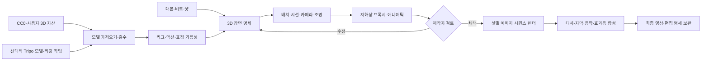

# Blender·Tripo3D 기반 제작 검토

확인일 2026-11-22. 이 문서는 제공된 영상과 공식 기술 문서를 근거로 정리한 기능 설계 입력이다. Blender 실행기와 Tripo 계정 연동의 실제 구현 상태는 별도 개발에서 판정한다. 조사 과정에서는 소프트웨어 설치, 외부 생성 요청과 크레딧 사용을 수행하지 않았다.

## 구현 상태

Blender 설치 이후 로컬 GLB 장면 편집과 렌더 경로를 구현했다. 아래의 최초 조사와 후속 3D 서비스 설계에서, 현재 사용할 수 있는 범위는 캐릭터·배경 등록, 본 포즈·내장 액션·카메라·조명, 프리비즈·최종 MP4·타임라인 연결이다. [Blender 5.3 실증 기록](blender-scene-verification.md)

## 확인한 자료

| 자료 | 확인 범위 | 관찰한 시연과 제작에 적용할 내용 |
| --- | --- | --- |
| `resources/Claude + Blender Is The Best Way To Make AI Videos.mp4` | 13분 53.83초, 1920×1080. 전체 영문 자막과 03:45·05:25·06:50·08:40·11:05·12:55 화면 | Claude 연결, 공개 자산, 생성 캐릭터, 숲 장면, 카메라 이동과 렌더 프레임을 보여 준다. 씬의 배치·조명·카메라를 다시 조정하고 동일 자산을 반복 사용하는 제작 흐름 |
| `resources/2분 만에 게임 캐릭터 완성! 모델링부터 애니메이션까지｜Tripo3D.mp4` | 10분 58.91초, 1920×1080. 전체 한국어 자막과 01:20·03:35·05:50·06:27·08:40·10:12 화면 | 메시 유형, 멀티뷰, 부분 분리, 구도 참조, 리깅·동작 프리셋, Unity 전송을 보여 준다. 상태별 모델 검수와 리깅 실패에 대한 수정 경로 |

파일명은 읽기 편하게 표기했다. 원본 파일은 `resources`에 있는 유니코드 분해형 이름을 사용한다. 위 관찰은 제작자 설명과 샘플 화면에 근거하며 모든 프레임의 품질을 측정한 결과가 아니다.

### Blender 영상의 구간별 적용점

| 구간 | 영상 내용 | 설계에 반영할 항목 |
| --- | --- | --- |
| 00:00–00:42 | 카메라·셰이딩·조명·오브젝트를 변경할 수 있는 3D 장면을 소개 | 생성 결과와 함께 편집 원본, 자산 참조, 장면 버전을 보존 |
| 02:20–04:41 | Blender 설치와 Claude–Blender MCP 연결 설명 | 연결 상태·실행 버전·지원 동작을 먼저 확인하는 로컬 실행기. 영상의 우회 권한 설정 안내는 Omni AI Canvas의 필수 조건으로 채택하지 않음 |
| 04:43–06:31 | 특정 인물과 소품을 Higgsfield로 생성하며 크레딧 소비를 설명 | 이미 있는 자산·공개 자산을 우선 선택하고 특수 자산 생성은 비용을 확인한 별도 작업으로 관리 |
| 06:33–09:19 | Poly Haven 모델·텍스처·HDR 환경을 모아 야간 숲과 차량을 구성 | 자산 묶음, 스케일, 바닥 접지, 환경광과 배치 프리셋 |
| 10:00–12:05 | 인물과 동물 모델을 준비해 시선이 연결되는 장면 배치 | 몸체 리그, 시선 목표, 인물 동선과 공간 축을 샷에 기록 |
| 12:07–13:17 | 위에서 숲으로 진입, 인물 얼굴, 뒤쪽 시점이라는 카메라 순서로 렌더 | 카메라별 샷을 나누고 프레임 범위·렌즈·포커스를 저장. 프록시 확인 후 본 렌더 |

### Tripo 영상의 구간별 적용점

| 구간 | 영상 내용 | 설계에 반영할 항목 |
| --- | --- | --- |
| 00:35–01:42 | 외형 중심 모델과 쿼드 토폴로지 모델 비교 | 용도를 프리비즈·실시간·최종 렌더로 선택하고 메시 밀도와 재질 검수 결과 기록 |
| 01:44–03:18 | 재질·노멀·조명·표면 거칠기와 텍스처의 빛 제거 | 원본 텍스처와 PBR 채널, 조명에 구워진 그림자 여부를 검수 |
| 03:20–04:11 | 앞·뒤 이미지를 넣어 배낭 등 후면 디자인 고정 | 캐릭터 정면·측면·후면 참조 슬롯을 따로 두고 같은 의상·상태인지 확인 |
| 04:13–05:36 | 게임·애니메이션·실사·일러스트 입력 결과 비교 | 스타일과 인물 크기에 따른 결과 검수를 보관. 사례의 성공률을 일반 보장으로 사용하지 않음 |
| 05:37–05:58 | 모델을 의상·가방 등 부분으로 분리 | 메시 부분 선택과 재질 교체. 고정 소품과 동작하는 부분의 관계 기록 |
| 06:00–07:19 | 모델 카메라 화면과 원본 인물 이미지를 함께 참조 | 구도용 렌더와 외형용 이미지를 역할별 연결. 배경이 구도 참조에 끌리는 실패도 점검 |
| 07:21–08:32 | 팔을 벌린 자세, 폴리곤 한도 오류, 리토폴로지와 자동 리깅 | T/A 포즈, 팔다리 분리, 메시 한도, 스켈레톤 규약을 리깅 전 점검 |
| 08:34–09:31 | 팔·몸통이 붙는 변형과 자세 수정 후 달리기 확인 | 걷기·팔 올리기·회전을 대표 검수 클립으로 사용. 겨드랑이·무릎·발 접지 확인 |
| 09:33–10:21 | 텍스트 동작, UV와 Unity DCC Bridge | 동작 프리셋의 지원 여부와 내보낸 파일을 재검증. 영상의 Unity 시연을 Blender 연결 검증으로 대체하지 않음 |

## 공식 기술 문서에서 확인한 범위

Blender는 UI 없는 배경 렌더, 시작·끝 프레임과 출력 경로 지정, 애니메이션 렌더를 지원한다. CLI 인자는 순서대로 실행되므로 출력 설정 뒤에 렌더 명령을 둬야 한다. 아래 예시는 이미 검수한 `.blend` 파일을 PNG 시퀀스로 만드는 형태다. [Blender 명령줄 렌더](https://docs.blender.org/manual/en/latest/advanced/command_line/render.html)

```sh
blender --background scene.blend --disable-autoexec \
  --render-output /project/renders/shot-01/frame_##### \
  --render-format PNG --frame-start 1 --frame-end 120 --render-anim
```

파일에 내장된 Python 자동 실행을 끄는 옵션과 별도 Python 스크립트 실행 옵션은 공식 CLI에 있다. Omni AI Canvas 실행기는 검증한 명세와 자체 스크립트를 사용하고, 모델이 제안한 Python은 검토 가능한 변경안으로 보관하는 편이 적합하다. 드라이버를 이용하는 리그는 자동 실행을 끈 환경에서 동작하는지 프록시로 확인해야 한다. [Blender 5.0 명령줄 인자](https://docs.blender.org/manual/en/5.0/advanced/command_line/arguments.html)

GLB/glTF는 오브젝트 변환, 포즈 본, 셰이프 키 애니메이션을 전달할 수 있다. Blender는 다중 애니메이션을 Action/NLA 형태로 가져온다. 재질·조명·물리의 모든 애니메이션이 glTF로 전달되는 것은 아니므로 최종 장면은 `.blend` 원본과 함께 보관하는 설계가 필요하다. Blender 4.4부터 Action 슬롯 동작이 바뀐 점도 버전 고정 테스트에 포함한다. [Blender glTF 애니메이션](https://docs.blender.org/manual/en/5.1/addons/import_export/scene_gltf2.html)

Tripo의 현재 공식 API는 v3이며 생성·메시 처리·리깅·리타기팅·작업 조회가 공개돼 있다. 공식 CLI/MCP와 DCC 플러그인도 제공한다. Blender 플러그인은 이미지에서 모델 생성 후 GLB/FBX를 가져오는 흐름을 문서화하며 API 키를 사용한다. [Tripo API 개요](https://developers.tripo3d.ai/en/docs/introduction) · [CLI](https://developers.tripo3d.ai/en/docs/cli) · [MCP 연결](https://developers.tripo3d.ai/en/mcp) · [Blender 플러그인](https://developers.tripo3d.ai/en/docs/plugins)

리깅 검사는 `riggable`과 추천 `rig_type`을 반환한다. 자동 리깅은 GLB/FBX 출력과 여러 뼈 이름 규약을 지원한다. 문서가 현재 권장하는 인간형 리그 모델은 `v3.0-20260909`이며 기본값은 더 오래된 모델로 남아 있다. 리타기팅은 리그 버전에 맞는 프리셋을 선택해야 하고 한 번에 최대 5개 동작을 요청할 수 있다. 얼굴 표정·립싱크의 지원을 몸체 자동 리깅 성공만으로 판단해서는 안 된다. [리깅 검사](https://developers.tripo3d.ai/en/docs/animations-rig-check) · [자동 리깅](https://developers.tripo3d.ai/en/docs/animations-rig) · [애니메이션 리타기팅](https://developers.tripo3d.ai/en/docs/animations-retarget)

## 로컬 제작 흐름 제안

다음 구조는 기술 문서에서 도출한 Omni AI Canvas 기능 제안이다. 실제 노드 타입·저장 스키마는 구현 설계에서 확정한다.



- **모델 가져오기.** GLB를 기본 전달 포맷으로 검토한다. 파일 크기·해시·바운딩 박스·단위·재질·텍스처·리그·액션 이름을 읽고 썸네일을 만든다. FBX는 별도 변환·검증 경로로 취급한다. 나무·집 같은 배경은 인스턴스로 반복 배치하고 사용자가 주인공과 핵심 소품을 고른다.
- **연기와 시선.** 샷에는 행동 전후 상태와 실제 액션 이름, 재생 구간·속도·루프·루트 이동을 저장한다. 몸체·머리 회전과 시선 목표로 기본 연기를 만들 수 있다. 표정과 립싱크는 사용할 셰이프 키나 얼굴 본이 있는 모델에서만 기능을 열고 지원 상태를 표시한다.
- **카메라와 조명.** 렌즈 mm와 센서 크기, 카메라 위치·목표·경로·보간, 초점 거리·심도, 키/필/림 조명과 환경광을 조정한다. 레퍼런스에서 추정한 렌즈·필름 룩은 제안값으로 표시하고 카메라 뷰에서 직접 수정한다.
- **프리비즈.** 낮은 해상도와 가벼운 렌더로 첫·중간·마지막 프레임과 전체 동작을 확인한다. 발 미끄러짐, 의상 관통, 화면 축, 소품 접촉, 초점 이탈을 확인한 뒤 본 렌더를 선택한다.
- **숏폼과 롱폼.** 하나의 거대한 렌더 대신 에피소드→씬→샷으로 작업을 분할한다. 자산 버전과 샷 명세가 같은 결과는 재사용하고, 변경된 샷만 렌더한다. 이미지 시퀀스의 완료 프레임 목록으로 중단된 작업을 이어갈 수 있다.
- **인계.** `.blend`, 사용 자산과 라이선스, 샷 명세, 프록시, 최종 컷을 묶어 저장한다. 일반 영상 노드에는 재생할 MP4와 원본 작업 식별자를 연결한다. 대사·음악·효과음은 기존 음향 큐와 합성 시간축으로 연결한다.

## 인터페이스 초안

| 명세 | 필요한 필드 | 실패를 확인할 항목 |
| --- | --- | --- |
| `ModelAssetSpec` | 자산 ID·해시·원본 출처·라이선스·포맷·미터 스케일·위/앞 축·텍스처 목록 | 누락 재질, 외부 파일 경로, 크기와 면수 상한 |
| `RigSpec` | 리그 ID·버전·bone convention·rest pose·액션 이름·얼굴 본/shape key 목록 | 스켈레톤 호환, 실제 표정 지원, 팔다리 관통 |
| `ActionTrack` | model ID·action 이름·시작/종료 프레임·속도·루프·root motion·시선 target | 없는 액션, 불연속 루프, 발 미끄러짐 |
| `BlenderShotSpec` | asset refs·transforms·카메라 keyframes·lens/sensor·포커스·조명·색 관리·fps·frame range | 카메라 축·가림·초점·납품 화면비 |
| `RenderJobSpec` | Blender 버전·엔진·해상도·샘플·샷 명세 해시·출력 위치·완료 프레임 | 프로세스 실패, 디스크 부족, 재시도 중복, 누락·깨진 프레임 |
| `RenderResult` | 프록시/최종 자산·원본 작업 ID·명세 버전·프레임 수·실측 시간 | 실제 길이, 프레임율, 음향 싱크, 재편집 가능성 |

로컬 작업의 상태 후보는 준비→명세 검토→프록시 렌더→채택 대기→본 렌더→합성→완료다. 실패 시 마지막 정상 프록시와 입력 스냅샷을 유지한다. Tripo 작업은 외부 작업 ID를 기록해 조회를 재개하고, 응답이 끊겼을 때 같은 유료 작업을 즉시 다시 제출하지 않도록 설계한다.

## 비용과 자산

| 경로 | 비용 설명 | 사용자에게 보여줄 것 |
| --- | --- | --- |
| 기존 GLB·CC0 모델 → Blender 로컬 렌더 | 생성형 영상 모델 크레딧이 필요하지 않다. 컴퓨터 자원과 렌더 시간은 사용한다 | 예상 프레임 수, 프록시 기준 예상 시간, 디스크 필요량 |
| Tripo 생성·리토폴로지·리깅 | 외부 3D 처리 작업의 크레딧이 적용된다 | 계정의 이용 경로와 작업별 현재 견적, 완료 시 사용량 |
| Claude·Codex의 장면 기획 | 선택 계정의 구독 한도와 사용 조건이 적용된다 | 현재 계정, 모델, 요청 범위 |

확인일의 Tripo API 가격표는 리깅 검사를 무료, 자동 리깅을 25크레딧, 리타기팅을 동작당 10크레딧으로 표시한다. 스튜디오 구독 크레딧과 API 계정 잔액의 통합 여부는 이 조사에서 실계정으로 검증하지 않았다. CLI를 연결했다는 이유만으로 웹 구독에 포함된다고 표시하면 안 된다. [Tripo API 가격표](https://developers.tripo3d.ai/en/pricing)

Kenney Nature Kit는 나무·바위·식생 등 3D 파일 330개, Fantasy Town Kit는 마을 건물 계열 160개를 CC0로 공개한다. 다운로드한 개별 묶음의 라이선스와 버전 파일을 자산 기록에 함께 보관한다. 사용자가 Claude 요금제라고 붙인 두 번째 링크는 Fantasy Town Kit 에셋 페이지다. [Nature Kit](https://kenney.nl/assets/nature-kit) · [Fantasy Town Kit](https://kenney.nl/assets/fantasy-town-kit)

## 단계별 인수 기준

| 단계 | 산출물 | 통과 조건 |
| --- | --- | --- |
| 1 · 로컬 모델과 카메라 | 사용자 GLB 또는 CC0 배경으로 만든 3초 프록시 | 모델·재질·화면비가 맞고 카메라를 수정한 새 프록시가 생성된다 |
| 2 · 리깅 자산 연기 | 걷기·회전·팔 동작을 조합한 2샷 | 스켈레톤과 액션을 다시 불러와 동일 샷을 재현하며 표정 미지원 상태를 정확히 표시한다 |
| 3 · 롱폼 샷 큐 | 45초를 넘는 복수 씬과 샷별 결과 | 중간 실패 후 완료 프레임·컷을 재사용하고 필요한 샷만 재실행한다 |
| 4 · 선택적 Tripo | 견적과 작업 ID가 있는 3D 작업 기록 | 무료 조회와 유료 작업 경로를 구분하며 원본 모델·리그 버전·출력 파일을 추적한다 |
| 5 · 결과 검수 | 레퍼런스·프록시·최종 컷 비교 | 동일 프레임 시각에서 구도·시선·자막 영역·빛을 비교하고 수정할 샷을 선택한다 |

## 확인 한계와 버전

최초 설계 조사 당시 이 컴퓨터의 PATH 및 `/Applications/Blender.app`, `/opt/homebrew/bin/blender`, `/usr/local/bin/blender`에서 Blender 실행 파일을 확인하지 못했다. 다른 사용자 지정 위치의 설치 여부까지 조사하지 않았다. 실제 `.blend` 렌더·리그·Tripo 계정 호출은 이번 검토 범위에 포함하지 않았다.

Blender 공식 문서는 검색 색인에서 5.3 렌더 문서, 5.1 glTF 문서와 5.0 인자 문서를 확인했다. 직접 본문 접속에는 접근 오류가 있어 동일 공식 도메인의 색인 내용을 사용했다. 구현 시 설치한 버전의 `--version`·`--help`, glTF 액션과 렌더 엔진을 실제로 확인해야 한다. Tripo 문서는 현재 v3 경로로 확인했으며 영상에 나온 UI·프로모션·모델 명칭과 일치한다고 가정하지 않는다.
