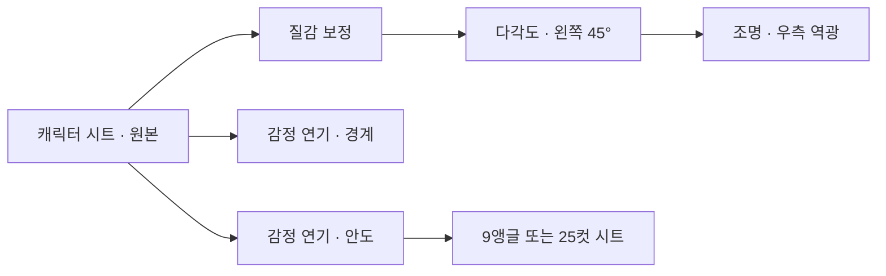

# 이미지에 연결하는 캐릭터 연출 기능 노드

2026-11-22 재검토 · Omni AI Canvas 기획·설계 제안

이미지 선택 툴바, 편집 노드에 붙는 패널, Blender 얼굴 리그와 감정판, 카메라·광원 구형 조작기의 후속 설계는 [이미지 위 도구 모음과 시각 편집기 설계](image-node-editor-design.md)에 정리했다.

**제작자가 기존 캐릭터 시트에서 ‘감정 연기’를 고르면, 그 이미지에 연결된 감정 노드가 즉시 생겨야 한다.** 그 노드에서 얼굴을 선택하고 표정을 움직여 본다. 설정을 닫았다 열어도 같은 표정과 강도가 나타난다. 같은 원본에 조명이나 다른 표정을 추가하면 각각 따로 조절할 수 있다. [기존 설계와의 비교](format-first-character-editing-proposal.md)

## 1. 영상을 다시 보니 무엇이 달랐나

제공된 약 15분 17초 영상과 한국어 자막에서 도구 선택 전후, 미리보기 조작, 생성 표시, 결과 비교를 시간순으로 대조했다. 아래 네 장은 원본에서 직접 추출한 프레임이다. 왼쪽 위부터 오른쪽으로 **04:50 질감**, **07:05 카메라**, **08:05 조명**, **11:45 감정**이다.

원본 영상 (로컬 자료) · 한국어 자막 (로컬 자료)

| 영상 시각 | 화면에서 확인한 동작 | 제품 설계에 반영할 점 |
| --- | --- | --- |
| 04:50 전후 | 원본 이미지에서 오른쪽의 빈 질감 조정 노드로 선이 이어져 있다. 인물과 배경, 조명 일치, 피부, 질감, 선명도 단계를 고른다. | 설정하는 동안에도 작업의 입력과 출력 자리가 보인다. 모델과 출력 규격은 연출값과 따로 선택한다. |
| 07:05~07:36 | 구형 조작기에서 수평 회전·수직 피치·샷 크기를 조절한다. 이어 별도 노드가 생성 중으로 표시되고, 원본과 다른 시점을 가진 이미지가 나온다. | 카메라 위치를 움직이는 일과 새 시점을 생성하는 일 사이에 사용자가 확인할 미리보기가 있다. |
| 08:05~08:35 | 구 위에서 광원의 위치를 바꾸고 밝기·색·주광 방향·림라이트를 고른다. 이어 영화급 조명 보정은 별도 기능으로 열린다. | 수동 광원 배치와 영화 룩 보정을 각각의 기능 노드로 제공한다. |
| 09:35 전후 | 원본과 연결된 스토리보드 시트가 독립된 결과로 표시된다. | 9앵글은 한 순간의 시점 목록, 25컷은 사건의 시간 순서를 편집한다. 시트 생성과 셀 추출은 별도 동작이다. |
| 11:30~12:15 | 원본에서 얼굴을 사각형으로 고른다. 감정 좌표가 바뀔 때 회색 얼굴 모델의 눈썹·눈·입 모양이 변한다. 화면에는 원본 사진도 계속 보인다. | 대상 인물을 지정하는 화면과 연기를 조율하는 얼굴 모델을 함께 제공한다. 좌표를 바꿀 때 표정이 바로 읽혀야 한다. |
| 12:15~12:49 | 연결된 노드에 생성 상태가 나타나고 이후 서로 다른 표정의 인물 결과를 비교한다. | 같은 원본에서 여러 감정 후보를 만들고 각각 채택할 수 있어야 한다. |

첫 브라우저 확인에서는 빈 캔버스의 이미지 편집 메뉴를 살펴봤다. 후속 실측은 별도 Newtake 프로젝트에 원본 이미지와 도구를 직접 붙여 실행했다. 질감·9그리드·25그리드·영화급 조명 보정은 먼저 빈 노드를 만들었다. 다각도·감정·직접 조명은 원본에서 조작기를 먼저 열고 실행할 때 연결된 결과 노드를 만들었다. 9그리드에서는 두 컷을 골라 각각 분리한 뒤 비디오 노드에 연결했다. 공식 페이지도 시트의 컷을 고르고 분리해 영상으로 잇는 흐름을 설명한다. · [Newtake World Camera](https://www.newtake.ai/worldcamera)

회색 얼굴 모델, 카메라 구, 광원 위치와 파생 결과는 화면에서 확인했다. Newtake 내부의 리그 자산·모델 입력 포맷·설정 저장 형식은 공개 화면의 관찰 범위를 벗어난다. 아래에서 ‘기능을 선택하면 바로 노드를 만든다’는 규칙은 사용자가 각 설정이 속한 노드를 바로 찾을 수 있게 하는 우리 제품의 결정이다. 초기 Craft Anything 클린룸 조사에는 프레임 열기와 웹 워크스루 제한을 기록했다. 조사 handoff (로컬 자료)

재실측에서 조명 결과와 25컷 시트를 모두 생성했다. 25컷 중 1-1, 3-3, 5-5를 분리해 각각 비디오 노드의 입력으로 연결했다. 결과와 연결선은 다시 열어도 남았다. 최초 25그리드 요청에는 단일 장면이 나왔고, 실제 25컷 시트의 3-3 추출본에도 인접 행이 일부 들어갔다. 시트 내용과 잘라낸 컷을 각각 검수하는 근거다.

## 2. 현재 앱에서 재사용할 부분과 바꿀 부분

| 현재 경로 | 확인한 동작 | 설계 결정 |
| --- | --- | --- |
| 캐릭터 연출 키트 | 새 캐릭터, 정체성·포즈·의상 참조, 선택한 시트를 묶어 보드에 배치한다. 기존 이미지를 필수 입력으로 받지 않는다. | 이 진입점에는 **새 캐릭터 보드 만들기**라는 목적을 표시한다. 기존 인물에 연출을 붙이는 진입점은 선택 이미지의 **＋ → 연출 추가**로 둔다. [키트 화면](../components/PortraitKitStudio.tsx) · [보드 조립](../lib/portrait-kit.ts) |
| 이미지의 ＋ → 이미지 편집 | 원본과 `identity` 연결을 갖는 파생 키프레임을 이미 만든다. 현재는 설정을 모두 입력한 다음 ‘편집 노드 만들기’를 눌러야 생긴다. | 기능을 고르는 순간 노드와 연결을 한 번에 만들고 해당 노드의 편집기를 연다. 드래그 연결과 실행 취소는 기존 캔버스를 재사용한다. [노드 생성](../lib/image-edit.ts) · [화면 연결](../components/Studio.tsx) |
| 편집 재개 | 감정 좌표·각도·광원 등의 UI 값은 컴포넌트 상태에 있다. 노드에는 종류, 원본 참조, 결과적으로 만든 지시문이 남고, 재편집 화면은 텍스트를 연다. | 기능별 값을 보드에 구조화해 저장한다. 문장, 3D 장면, 썸네일은 동일한 값에서 파생한다. [현재 편집기](../components/ImageEditStudio.tsx) |
| 모델 실행·결과 | 원본 연결과 자산 URL을 검사해 첫 참조로 보내고 실행 시 SHA-256을 검증한다. 결과 검토와 채택 경로가 있다. | 실행 큐와 채택을 재사용한다. 실행 당시 연출 설정과 모델로 실제 보낸 제어 자료도 함께 고정한다. [입력](../lib/run-input.ts) · [해시 검증](../lib/image-edit-server.ts) · [후보 비교](../components/ImageEditResults.tsx) |
| 스테이징·Blender | 샷의 시점·배치 정보와 GLB 캐릭터의 표정 채널, 카메라·조명, 로컬 렌더 경로가 있다. | 기존 좌표와 단위를 변환해 연동한다. 브라우저에서 포인터를 움직일 때마다 Blender를 실행하는 방식은 지연이 커서, Blender는 자산 제작과 정밀 프리비즈에 쓴다. [스테이징](../lib/staging.ts) · [Blender 장면 명세](../lib/blender-scene-spec.ts) |

## 3. 캔버스에서의 동작

- **추가.** 이미지가 있는 캐릭터·레퍼런스·키프레임에서 기능을 선택한다. 바로 옆에 기능 이름이 붙은 노드가 생기고 원본 썸네일, 입력 연결, 현재 설정, 실행 버튼을 보여 준다. 자산이 없는 캐릭터는 먼저 이미지를 선택할 수 있다. 도구를 추가하는 동작은 모델을 호출하지 않는다.
- **편집.** 노드 카드에는 기능, 작은 미리보기, ‘안도 · 강도 40%’ 같은 요약을 둔다. 카드를 선택하면 데스크톱에서는 우측 편집기, 모바일에서는 확장 가능한 시트가 열린다. 새로 만들기와 다시 열기에서 같은 조작기를 쓴다. 하나의 연속 드래그가 한 번의 실행 취소 단위다.
- **분기.** ‘같은 원본에서 변형’은 형제 노드에 설정을 복사하고, ‘이 결과에서 이어서’는 채택한 결과를 입력으로 고정한다. 부모의 채택본이 바뀌면 자식에 ‘새 입력 사용 가능’을 표시하고 사용자가 교체 시점을 결정한다. 아직 출력이 없는 노드에서 후속 작업을 배치할 수 있지만 실행은 입력이 준비된 뒤 가능하다.
- **실행·채택.** 한 기능 노드에 여러 실행 후보를 두고 명시적으로 채택한 한 장을 출력으로 쓴다. 새 설정으로 재실행하는 중에도 기존 채택본을 열 수 있다. 실행 중 설정을 바꾸면 도착한 후보에는 생성 당시 값을 표시한다. 비교는 원본과 후보의 동일 위치를 확대해서 본다.

### 선택한 노드의 연결선 효과

실측에서 Newtake는 선택한 노드에 바로 닿는 입력선과 출력선을 반복해서 움직였다. 9그리드를 가운데 두고 확인했을 때 한 입력선과 두 출력선이 움직였고, 추출 컷 하나를 선택하자 그 컷에 직접 들어오는 선으로 효과가 옮겨갔다.

우리 앱에서는 노드를 선택하면 직접 맞닿은 입력선과 출력선을 강조한다. 성능을 위해 밝은 점선은 각 연결의 출발 노드에서 도착 노드 방향으로 약 0.9초 동안 한 번 흐르고, 이후 선택 강조는 정적으로 남는다. 다른 노드를 선택하거나 빈 캔버스를 누르면 이전 선택 표시를 제거한다. 실행 중인 입력선은 기존 실행 색과 방향 표시를 우선 사용한다. 여러 노드를 선택한 경우에도 주 선택 노드 하나를 기준으로 한다. [현재 연결선 처리](../components/CanvasBoard.tsx) · [현재 연결선 스타일](../components/board.css)

- **동시 재생 제한.** 화면에 보이는 선에만 효과를 표시하고, 실행 중인 선과 선택한 선을 합쳐 최대 6개를 움직인다. 실행 중인 선부터 할당한다. 나머지 연결도 정적 색상과 선 종류로 상태를 읽을 수 있게 한다.
- **렌더링 비용 제한.** 기존 React Flow SVG 경로에 CSS `stroke-dashoffset` 효과를 적용한다. 선택·실행 상태가 바뀌거나 화면 이동이 끝났을 때 표시 대상을 갱신한다. 프레임마다 JavaScript 타이머, React 상태 갱신, 연결 경로 재계산, DB 저장, 블러 필터를 사용하지 않는다. SVG 선을 움직일 때 발생하는 그리기 비용은 실측한다.
- **정적 표시로 전환.** 이동·확대·드래그 중, 백그라운드 탭, 모션 줄이기 설정에서는 선택선과 실행선을 정적으로 표시한다. 이동이 끝나면 현재 선택은 정적 강조로 보여 주고 다음 선택에서 효과를 재생한다.
- **활성화 기준.** 그래프 상한인 노드 120개와 연결선 500개를 채운 보드에서, 동일 기기·뷰포트로 효과를 켜고 끈 상태를 비교한다. 데스크톱과 지원 범위 내 저사양 모바일에서 노드 연속 선택, 이동·확대, 실행 상태가 겹친 경우를 각각 반복 측정한다. 초기 기준은 프레임 시간 p95 증가 1ms 이내, 프레임 누락률 증가 1%p 이내다. 모션을 끈 환경에서는 두 종류의 연결선 모두 정적으로 표시되는지도 확인한다. 기준을 충족하기 전에는 정적 강조를 기본으로 제공한다.

## 4. 화면을 보며 조절하는 편집기

| 기능 노드 | 직접 조작과 즉시 보이는 변화 | 모델 실행 시 전달할 내용 |
| --- | --- | --- |
| **감정 연기** | 원본 위에서 한 얼굴을 선택한다. 그 옆의 중립 3D 얼굴에 친밀함↔거리감, 평온↔흥분 좌표와 강도를 적용한다. 예컨대 ‘경계’에서 눈썹 안쪽이 모이고 입술이 닫히는 과정을 보고 시선·눈꺼풀·입꼬리를 미세 조절한다. ‘중립↔현재’ 재생과 정지 비교를 제공한다. | 원본, 대상 영역, 감정 좌표와 눈에 보이는 행동 설명. 마스크 지원 경로에는 원본 픽셀에 맞춘 마스크를, 표정 가이드 이미지가 검증된 경로에는 선택적으로 가이드 렌더를 전달한다. |
| **다각도·카메라** | 기준 피사체 주위의 카메라를 궤도 위에서 드래그한다. 카메라 위치와 바라보는 점을 따로 이동하고, 옆의 뷰파인더에서 정면·측면·부감·앙각과 샷 크기를 확인한다. 거리 조절과 렌즈 시야각은 개별 컨트롤로 둔다. | 원본, 기준점, 수평·수직 각도, 거리, 시야각과 프레이밍. 지원 모델에서만 실제 카메라 파라미터를 전달한다. 단일 사진의 뒷면은 생성 시 추정하므로 가이드 뷰파인더에는 단순 인체나 사용자가 연결한 GLB를 표시한다. |
| **조명 효과** | 주광 핸들을 얼굴 주위에서 좌→우, 전→후로 옮긴다. 얼굴·코·턱과 바닥 그림자의 방향, 광량·색과 림라이트가 같은 얼굴 모델에서 함께 변한다. 정면도와 위에서 본 조명 배치를 전환한다. | 피사체 기준 광원 방향·거리 또는 방향광, 밝기, 색, 광원 크기·보조광 비율·림라이트. 얼굴 모델을 비춘 결과는 조명 설계 참고 자료로 사용한다. |
| **영화급 조명 보정** | 수동 조명의 광원 데이터를 공유한다. 여기에 기준 룩, 주광과 보조광의 대비, 피부 하이라이트, 그레인, 색온도와 인접 샷 비교를 얹는다. 컬러 보정은 원본 위에서 비교하고 새 그림자 형상은 3D 가이드에서 확인한다. | 원본과 승인된 룩 참조, 유지할 피부·구도와 장면 연속성 지시. 다른 샷의 룩을 선택해도 해당 원본을 자동 대체하지 않는다. |
| **인물 질감** | 얼굴 주변을 실제 원본 픽셀 크기로 확대한다. 피부결·광원 일치·경계 융합·입자·선명도를 조절하고 원본과 나란히 본다. 로컬 선명도·그레인 예시와 생성 후 피부 디테일을 구분해 표시한다. | 변경할 질감과 강도, 보존 영역, 출력 규격. 업스케일 해상도와 피부 선명도는 서로 다른 설정으로 저장한다. |
| **9앵글·25컷 시트** | 9앵글은 같은 행동에 카메라 설정 9개를 적용한 썸네일을, 25컷은 시간순 비트와 각 컷의 시점·연기 지시를 제공한다. 셀을 고르면 그 컷의 편집기를 연다. | 시트 또는 선택한 셀의 범위와 참조를 명시한다. 기존 로컬 분할기로 검수한 칸만 새 자산으로 채택한다. |

**표정 제작 방식.** Blender에서 사용권을 확보한 중립 얼굴에 눈썹 올림·모음, 눈꺼풀 열림, 볼 올림, 입꼬리 좌우, 입술 다물기, 턱 열림 등 필요한 변형을 제작해 GLB로 내보낸다. 눈동자는 별도 회전 채널로 둔다. 연출자가 설계한 좌표별 기준 포즈 사이의 가중치를 보간하고 강도로 중립과 혼합한다. 겹치는 채널은 합산 범위를 제한한다. 좌표가 같더라도 강도를 0으로 내리면 반드시 중립으로 돌아온다. 이 방식은 원본 사진 한 장에서 개인의 얼굴 리그를 복원하는 비용 없이 표정의 움직임부터 확인할 수 있다. [Three.js 얼굴 morph 데모](https://threejs.org/examples/webgl_morphtargets_face.html) · [Mesh morph 가중치](https://threejs.org/docs/pages/Mesh.html)

**카메라와 빛의 기준.** 피사체 중심을 원점, 위쪽을 +Y, 기준 정면을 +Z로 정하고 각도는 도 단위로 저장한다. 편집기 관찰용 카메라와 실제 샷 카메라를 구분한다. 위에서 조명 기구를 살펴봐도 샷 카메라 값은 보존된다. 방향광에는 방향과 타깃이 중요하고, 점광·스폿광은 위치와 거리까지 의미가 있다. 부드러운 그림자를 제공할 때는 광원 크기에 따른 근사 품질을 확인한 후 옵션을 노출한다. [OrbitControls](https://threejs.org/docs/pages/OrbitControls.html) · [DirectionalLight](https://threejs.org/docs/pages/DirectionalLight.html) · [PointLight](https://threejs.org/docs/pages/PointLight.html)

### 조명 결과와 25컷 시트의 인수 기준

| 기능 | 저장할 내용 | 검수할 동작 |
| --- | --- | --- |
| 조명 효과 | 원본 자산 버전, 피사체 기준 주광 방향, 밝기·색·림라이트, 실행별 이미지 후보와 채택본. 원본의 픽셀은 그대로 보관한다. | 편집기에서 좌측과 우측을 바꿨을 때 기준 얼굴의 밝은 면과 그림자가 반응한다. 실행 후 현재 조명 노드에서 원본과 결과를 비교한다. 새로고침하면 조명 설정, 표시 중인 결과, 원본의 입력선이 복원된다. |
| 25그리드 연속 스토리보드 | 시트 자산 버전, 읽기 순서, 25개 컷의 연출 메모, 행·열 경계, 채택 컷의 원본 셀 좌표와 순서. | 생성 전 원본에서 시트 노드로 연결된다. 결과를 열어 5행 5열의 경계와 각 줄의 사건 전개를 확인한다. 가장자리나 칸 사이 경계가 맞지 않으면 보정한다. 선택한 칸만 독립 이미지로 저장하고 시트와 영상 노드에 연결한다. 다시 열 때 원본·시트·컷의 계보와 영상 참조 순서를 확인한다. |

25컷 시트 생성은 외부 모델을 한 번 호출해 이미지 한 장을 받는다. 제공자에 가능한 규격을 조회하고 총 견적을 표시한 다음 제출한다. 기능 종류와 5×5 배치 지시는 구조화된 값으로 유지한다. 사용자가 바꾸는 사건 전개는 별도 입력으로 받아 실행 때 합친다. 기능 지시가 빠진 상태에서 일반 이미지 생성으로 제출되는 경로를 막는다.

생성 완료 화면에서 실제 시트의 25컷과 사건 흐름을 먼저 확인한다. 분할용 가이드가 표시되더라도 이미지 한 장이 실제 25컷으로 나뉘었는지 검수하고 채택한다. 기존 [5×5 분할기](../components/PortraitGridStudio.tsx)는 균일한 행·열을 기준으로 여백과 간격을 조절한다. 비균일한 경계는 개별 경계 조정 또는 시트 교체를 거치게 한다. 선택 셀만 로컬에서 자산으로 만들고, 영상 입력 슬롯과 참조 한도에 맞춰 순서를 확인한 뒤 연결한다. [Newtake World Camera](https://www.newtake.ai/worldcamera)

결과가 실패하면 입력선, 편집값과 이전에 채택한 이미지를 보존한다. 요청이 접수됐는지 불분명하면 기존 작업 상태를 먼저 조회한다. 다시 실행할 때는 현재 모델과 견적을 확인한다. 수동 조명의 미리보기, 외부에서 생성된 조명 이미지, 시트에서 추출한 컷은 각각 독립된 인수 항목으로 검수한다.

## 5. 도구 선택과 모델 연결

| 선택지 | 적합한 역할 | 판단 |
| --- | --- | --- |
| **Three.js + GLTFLoader + 카메라·변환 컨트롤** | 얼굴 morph, 카메라 궤도, 피사체·광원 이동, 조명 렌더 | **기본안.** React Flow 노드마다 WebGL을 띄우지 않고 현재 편집기 하나만 GPU를 사용한다. 다른 카드는 동일 설정의 정적 썸네일을 쓴다. Three.js는 시각 편집기를 열 때 로드한다. [GLTFLoader](https://threejs.org/docs/pages/GLTFLoader.html) · [TransformControls](https://threejs.org/docs/pages/TransformControls.html) |
| **기존 Blender + glTF/GLB** | 얼굴 리그와 기준 포즈 제작, 정밀한 오프라인 렌더, 사용자 GLB 장면 인계 | 기존 로컬 경로를 재사용한다. 얼굴마다 morph 이름·범위가 달라 자산별 채널 매핑과 누락 채널 검사가 필요하다. 공식 데모의 모델은 동작 참고용으로 쓰고 제품 배포 자산은 라이선스를 따로 확인한다. [Blender glTF 내보내기](https://docs.blender.org/api/5.0/bpy.ops.export_scene.html) |
| **Canvas 2D·사전 렌더 포즈** | 대상 사각형, 원본 확대·비교, WebGL 미지원 장치 | 3D를 쓸 수 없는 장치에서도 같은 설정값을 수정하도록 대표 표정 이미지, 정면도·평면도와 방향 버튼을 제공한다. |
| **MediaPipe Face Landmarker** | 다인 사진의 얼굴 후보, 초기 랜드마크와 표정 계수 | 후속 선택 사항. 사용자가 직접 영역을 바꿀 수 있게 한다. 원본 사진의 표정 추정과 제작자가 지시한 목표 표정은 독립 값이다. [MediaPipe Face Landmarker](https://developers.google.com/edge/mediapipe/solutions/vision/face_landmarker?tab=Web) |

**결과에 연출값을 반영하는 경로도 검증해야 한다.** 미리보기가 움직이는 것과 이미지 모델이 그 지시를 따르는 것은 서로 다른 인수 항목이다. 현재 Codex 경로는 원본을 `--edit-target`으로 지정하고, API 경로에는 원본과 편집 지시를 전달한다. 모델별로 허용된 제어 수치, 마스크, 추가 이미지 수와 역할, 추가 자료 전송 비용을 확인해서 노드에 **실제 전송할 원본·마스크·가이드·지시문**을 표시한다. 범용 얼굴의 렌더를 무조건 첨부하면 모델이 원본 배역의 외형까지 바꿀 수 있다. 가이드 지원과 효과를 검증한 모델에만 명시적으로 활성화한다. 마스크를 쓰는 경우에도 결과에서 대상 밖의 변화를 검수한다. [현재 이미지 API](../lib/image-api.ts) · [현재 실행기](../lib/runner.ts) · [OpenAI 이미지 편집](https://developers.openai.com/api/docs/guides/image-generation) · [Gemini 이미지 입력·편집](https://ai.google.dev/gemini-api/docs/image-generation)

### 원본 캐릭터의 외형까지 미리보고 싶은 경우

첫 릴리스의 범용 얼굴은 연기를 읽는 용도다. 원본 캐릭터의 외형까지 보며 조절하는 요구에는 두 경로를 제안한다. **캐릭터 GLB가 있는 경우**에는 해당 모델의 눈·입·눈썹 채널을 매핑하고 실제 캐릭터 메시를 같은 뷰포트에 올린다. 대응하는 표정 채널이 없는 모델도 카메라와 조명에는 그대로 쓸 수 있다. **사진 한 장만 있는 경우**에는 얼굴 랜드마크와 원본 텍스처를 이용한 정면 근처의 2.5D 표정 미리보기를 후속 실험으로 둔다. 옆얼굴, 가려진 눈, 입을 크게 열 때 드러나는 치아는 별도 검수한다. 뒷모습까지 보며 연속성을 맞춰야 하는 제작에는 다면 참조나 실제 3D 자산을 입력으로 받는 편이 적합하다.

화면에서 미리보기 종류를 **연기 가이드**, **내 캐릭터 3D**, **생성 결과**로 표시한다. 한 번의 조작에서 무엇이 움직이는지 제작자가 구분할 수 있고, 같은 기능 노드 안에서 입력 자산에 맞는 뷰를 고를 수 있다.

## 6. 노드 상태와 호환성

- **그래프.** 기존 키프레임의 `imageEdit` 필드를 확장한다. UI에서는 각각 감정·카메라·조명 노드로 보인다. 공통값은 스키마 버전, 기능 종류, 원본 노드·자산 버전, 자유 지시문, 선택한 계정 경로·모델·지원 옵션이다. 감정에는 정규화된 얼굴 영역과 기준 포즈·강도·좌표·개별 채널, 카메라에는 타깃·시점·렌즈, 조명에는 광원 종류·위치·색·강도를 저장한다. 얼굴 리그와 포즈 매핑의 버전도 고정한다. 드래그 중 GPU 장면은 즉시 갱신하고 조작 종료 시 기존 보드 저장·실행 취소에 한 변경으로 전달한다.
- **상태 전이.** 입력 대기 → 조절 가능 → 실행 대기 → 실행 중 → 후보 검토 → 채택. 실행 중 설정이 바뀌면 현재 초안과 제출한 스냅샷을 함께 보존한다. 실패나 취소는 해당 실행에 기록하고 그 전의 채택본과 형제 노드는 계속 사용할 수 있다.
- **기존 데이터.** 지금의 `instruction`만 있는 노드는 같은 원본·지시문으로 다시 실행할 수 있다. 과거 지시문에서 정확한 각도나 표정 가중치를 역산할 수 없다. ‘시각 설정으로 편집’을 선택한 시점에 초기값을 제시하고 원래 지시문을 보존한다. 사용자가 확정하면 새 구조로 저장한다. 무형식·지정 형식 프로젝트 모두 같은 노드 계약을 쓴다.
- **실행·프리셋.** 실행에는 당시 설정, 원본·추가 가이드 해시, 모델과 실제 전송값을 기록한다. 복제 시 같은 묶음의 원본 ID를 재매핑한다. 개인 프리셋에는 표정·카메라·조명 설정을 재사용할 수 있게 하고 작품 사진·얼굴 영역·작품 대사는 기본적으로 입력 자리로 비운다. 기존 그래프 JSONB와 실행 스냅샷으로 시작하고 포인터 좌표를 매 프레임 DB에 쓰지 않는다. [현재 그래프 복제](../lib/board-edit.ts) · [시작 보드·프리셋](../lib/production-start.ts)

## 7. 구현 순서와 완료 판정

1. **이미지 → 기능 노드 → 재개**. 원본 하나에 감정 노드 두 개와 조명 노드 하나를 추가한다. 생성 요청 0건으로 저장·새로고침·복제·한 단계 실행 취소를 확인한다. 한 노드의 수치를 바꿔도 다른 노드와 원본이 유지되어야 한다.
2. **감정 연기부터 검증**. 중립·경계·안도·놀람 기준 포즈를 만든다. 마우스·터치·키보드로 좌표를 옮기며 눈썹·눈꺼풀·입의 차이를 확인한다. 재개하면 같은 리그와 자세가 나타나야 한다. 원본 시트가 여러 얼굴을 포함할 때 선택한 대상 표시도 유지되어야 한다.
3. **카메라와 조명**. 정면에서 왼쪽 45°·부감·후면으로 움직이며 도식과 뷰파인더를 비교한다. 좌측광을 우측광으로 옮기면 기준 얼굴의 밝은 면과 그림자가 함께 바뀌어야 한다. 조명 편집 중 카메라, 카메라 편집 중 광원값의 보존을 확인한다. 같은 설정을 Blender에 인계해 좌우·상하가 맞는지 비교한다.
4. **공급사 연동과 결과 비교**. 모의 공급사로 원본 순서·영역 좌표·지원 옵션·가이드 해시, 재시도 중복과 오래된 결과의 채택을 검사한다. 실제 화질 평가는 별도 유료 실험으로 둔다. 같은 원본에서 감정만, 카메라만, 광원만 바꿔 대상 반영과 얼굴·의상·배경 보존을 판정한다.
5. **좁은 화면·성능**. 320px·390px에서 원본과 조작기를 탭으로 오가고 ‘중립으로’, ‘원본 비교’, ‘실행’에 접근할 수 있어야 한다. 저사양 기준 기기에서 조작 중 30fps를 1차 측정 목표로 삼는다. 편집기를 반복해서 열고 닫을 때 렌더러·텍스처·이벤트가 누적되는지 확인한다. 모션 줄이기에서는 자동 보간 애니메이션을 끄고 선택한 포즈를 즉시 보여 준다.

첫 개발 단위로 권하는 것은 **기존 캐릭터 시트 → 감정 연기 노드 두 개 → 서로 다른 표정 조절 → 새로고침 후 그대로 재개**다. 이 경로가 통과하면 노드 생성, 시각 편집, 저장, 분기라는 네 가지 핵심 동작을 검증한 뒤 카메라와 조명에 같은 구조를 확장할 수 있다.

## 8. 2026-11-23 구현과 브라우저 검수

- 조명 노드를 원본에 연결하고 주광 우측 60°와 림라이트를 저장했다. Ego Browser에서 새로고침한 뒤 값을 다시 확인했다. 감정 안도 프리셋과 시선, 카메라 주시점도 조절해 저장했다.
- Newtake 실측에서 확보한 시트를 검수용 노드에 첨부했다. 3행 3열 위쪽 경계를 42%로 보정하고 1-1, 3-3, 5-5를 분리했다. 영상 노드에 행 우선 순서로 연결했다. 새로고침 후 세 파일의 응답과 연결 순서, 시트 화면의 보정값을 다시 확인했다.
- 시트 편집기 390px과 조명 편집기 320px에서 가로 넘침을 확인했다. 노드 120개·연결선 500개 보드에서 선택된 노드의 연결선 119개가 강조됐다. 움직임을 켜면 6개가 움직였고 모션 줄이기에서는 119개가 정적으로 표시됐다. 저사양 물리 기기의 프레임 시간은 후속 측정 항목이다.

검수는 기존 시트 첨부와 로컬 분할을 사용했다. 연출 3D 화면에는 공용 가이드 모델을 표시한다.

## 9. 2026-11-23 연결 모델 실생성 검수

Ego Browser에서 이미지 기본 에이전트를 Codex로 저장했다. 새로고침 후 두 검수 노드에서 **설정의 기본값 사용**을 선택해 Codex와 ChatGPT 구독 경로가 적용되는 것을 확인했다. 작업실 기본값은 현재 브라우저에 저장되며, 노드별 선택이 우선한다.

- **조명 효과.** 구독 경로에서 1024×1536 이미지를 생성했다. 화면 우측 주광과 윤곽광을 확인하고 결과를 조명 노드에 채택했다.
- **25컷 시트.** 같은 구독 경로에서 1254×1254 이미지에 실제 5행 5열을 생성했다. 구분선을 피해 1-1, 3-3, 4-4, 5-5 경계를 보정하고 네 컷을 분리해 영상 노드에 순서대로 연결했다. 새로고침 후 채택본 2장, 컷 파일 4개, 보정값과 연결선 10개를 확인했다.

경로를 바로잡기 전에 검수자가 노드에서 직접 지정한 별도 과금 OpenAI 이미지 API 요청 2건도 완료됐다. 앱에서 결제 금액은 조회할 수 없었다. 최종 검수 프로젝트의 두 노드에는 모두 Codex 구독 경로에서 생성한 이미지를 채택했다.
