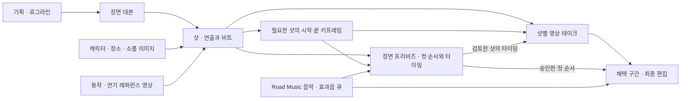

# Omni AI Canvas v0.2 제안 · 대본에서 촬영과 음향까지

2026-11-22 작성 · 일부 구현 및 후속 설계 · 첫 납품 단위는 재생 가능한 장면 한 개다.

**샷을 제작의 기준으로 삼는다.** 대본은 ‘무슨 일이 일어나는가’를, 샷은 ‘누구를 어디에서 얼마나 오래 보고 무엇을 느끼게 할 것인가’를 정한다. 레퍼런스는 여러 샷에서 재사용한다. 프리비즈에서 순서·연기 타이밍·소리를 확인한 뒤 필요한 샷을 골라 생성한다. 제작자가 선택한 테이크와 음향으로 장면을 조립한다.

현재 Omni AI Canvas는 대본 작성, 이미지·영상 생성 및 가져오기, 방향성 있는 노드 연결, 최대 10컷·2분의 MP4 합성을 제공한다. 현재 감독 기획·검토, 씬·샷·레퍼런스 노드와 참조 역할 및 연출 확인용 연결이 구현 단계에 반영됐다. 프리비즈와 음향 시간축의 코드가 연결됐고 렌더와 모의 어댑터 검증을 마쳤다. 실제 음향 엔진 생성과 전체 브라우저 흐름은 별도 확인이 필요하다. [현행 PRD](PRD.md) · [실행 검증](verification.md) · [제작 자료 검토](directing-sources.md)

아래 표와 단계별 인수 기준은 목표 설계다. 현재 지원은 감독안·검토, 기본 노드와 연결 역할, 모델별 미디어 입력 및 영상 하드컷 합성까지다. 타임라인은 컷의 원본 시작·길이, 음향 배치, 하드컷과 0.5초 디졸브를 지원한다. 그 밖의 고급 전환과 외부 편집기 프로젝트 형식은 후속 범위다.

## 1. 제작자가 보는 흐름

드라마 템플릿에서는 프리비즈를 재생하고 샷별로 ‘촬영할 컷’을 골라야 일괄 생성할 수 있다. 개별 샷은 동작 테스트나 레퍼런스 제작을 위해 먼저 생성할 수 있다. 기존 빈 캔버스의 단일 노드 실행 방식도 유지한다. 음향 큐가 없는 작품은 영상 원음으로 납품한다.

| 작업 카드 | 제작자가 만드는 것 | 다음 작업으로 넘기는 값 |
| --- | --- | --- |
| **장면 대본** · 기존 `script` 확장 | 직접 작성·붙여넣기 또는 ChatGPT/Claude 등으로 초안 작성. 장면 목적, 인물의 목표와 장애, 지문, 화자별 대사, 감정 전환을 편집한다. 에이전트는 장면→비트→샷 분할안을 제안한다. | 원문과 장면 식별자. 제안을 적용해도 원문을 보존한다. 대사 수정은 관련 샷에서 재검토한다. |
| **레퍼런스 이미지** · 신규 | 직접 첨부, 텍스트·이미지에서 생성, 기존 캐릭터/키프레임의 채택본을 가져온다. 인물·의상, 장소의 3/4·반대 시점, 소품의 전후 상태, 조명·질감 자료를 만든다. | 실제 파일과 버전, 무엇을 유지할지 적은 한 문장. 같은 이미지도 샷마다 다른 역할을 가질 수 있다. |
| **레퍼런스 영상** · 신규 | 감독이 찍은 연기·동선 영상 첨부, 지원 제공자로 짧은 동작 테스트 생성, 기존 테이크에서 사용할 구간 선택. 예를 들어 손동작 1.2~3.6초만 고른다. | 원본과 입·출점, 참조할 대상(몸동작·카메라 이동·연기). 제공자에 보낼 때는 선택 구간을 로컬에서 잘라 실제 전송 파일을 미리 보여준다. |
| **샷** · 신규 | 한 번의 카메라 셋업, 시작/끝 상태, 동작과 대사, 길이, 촬영·연기 설정을 작성한다. 장면 안에서 대사와 리액션을 다른 샷으로 나눌 수 있다. | 계획된 샷 번호, 샷의 고유 ID, 연출 지시와 연결된 자료. 번호가 바뀌어도 참조는 유지한다. |
| **키프레임** · 기존 확장 | 얼굴이나 구도를 고정할 때 시작 이미지를 만든다. 도착 구도가 중요한 경우 끝 이미지도 선택한다. | 단순 이미지 참조와 구분되는 시작·끝 프레임 역할. |
| **프리비즈** · 신규 | 샷을 순서대로 배치한다. 패널에 스케치·승인 스틸·동작 테스트를 놓고 길이, 컷 지점, 대사 타이밍, 임시 음악과 효과음을 조정한다. | 로컬 FFmpeg로 재생 가능한 애니매틱과 샷별 타임코드. 패널이 비면 길이가 표시된 임시 카드로 렌더한다. |
| **영상 테이크** · 기존 `video` 확장 | 샷에서 제공자별 입력 미리보기와 확인 가능한 견적을 본 뒤 생성한다. 원본 테이크를 비교해 사용할 구간을 고른다. | 선택된 영상 파일, 입·출점, 생성 이력과 출처. 프리비즈나 참고 영상은 명시적으로 채택할 때만 최종 컷으로 쓴다. |
| **음향 큐** · 신규 | 음악·효과음·환경음 중 하나를 선택한다. 임시 파일을 첨부하거나 Road Music에서 제작한다. 프리비즈에서 들으면서 발생 시점과 음량을 조절한다. | 로컬 오디오와 큐 시작점·구간·트랙·게인·페이드. 같은 큐의 최종 음원으로 교체해도 배치가 유지된다. [Road Music 연동안](road-music-integration-plan.md) |

**두 가지 영상 제작법을 모두 지원한다.** 대사 클로즈업과 특정 시점의 인서트에는 첫 프레임을 고정한다. 배우가 공간을 이동하거나 소품이 열리는 샷에는 캐릭터·공간·전후 상태 시트와 동작 참조를 쓰고 첫 프레임을 비울 수 있다. 서사적으로 중요한 동작과 정확한 얼굴 구도가 한 샷에서 충돌하면 이동과 리액션을 나눠 프리비즈에서 연결한다. 제작 방식 비교 (로컬 자료)

### Zephyr 사례로 보강한 제작 지침

기존 샷·참조·프리비즈·테이크를 사용하는 v0.2 설계안이다. 다음 검수는 해당 조건이 있는 샷에 적용한다. [1화와 스페셜에서 확인한 근거](directing-sources.md)

| 제작 단계 | 감독의 선택 | 통과 기준 |
| --- | --- | --- |
| 참조 준비 · 서로 양립할 수 없는 상태 | 같은 대상의 여러 각도는 한 시트에 둘 수 있다. 열린 상태와 닫힌 상태처럼 한 시점에 공존할 수 없는 외형은 별도 참조로 나눈다. 정지 샷에는 필요한 상태만, 변화하는 샷에는 시작·끝과 작동 순서를 지정한다. | 감독이 지정한 대상·시점·상태를 기준으로 상충하는 참조를 연결하면 제출 전에 두 자료를 보여준다. ‘닫힘 → 열림’으로 지정한 전환은 정상 입력으로 취급한다. |
| 프리비즈 · 공간과 중력 | 점프·교차 이동은 배치도에 출발점, 도착점과 화면 방향을 표시한다. 외형 시트를 돌려 특수 자세를 지시할 때는 원본에서 파생한 샷 전용 참조로 보관한다. | 배치도에서 정한 동선과 프리비즈를 나란히 본다. 뒤집힌 자세라면 옷·머리카락 등 눈에 보이는 중력 단서를 테이크에서 확인하고 다음 샷의 기본 시트는 원래 방향을 유지한다. |
| 제출 전 · 자료의 사용처 | 같은 이미지라도 연결별로 ‘연출 확인용’ 또는 ‘생성에 전송’을 고른다. 감독이 배치도를 보고 작성한 동선 문장은 샷 지시로 따로 보낸다. | 연출 확인용 자료는 보드에서 열 수 있어야 한다. 견적·생성의 첨부 목록, 업로드 호출, 자동으로 붙이는 참조 본문에서 빠져야 한다. 전송으로 바꾸면 파일과 역할이 미리보기에 나타난다. |
| 테이크 검수 · 필수 동작과 연출 재량 | 반드시 보여야 할 동작과 모델에 맡길 카메라·연기를 나눈다. 정밀한 구도가 필요한 샷에는 기존 첫·끝 프레임 방식을 쓴다. | 기존 테이크 중 동작·방향을 지킨 후보를 먼저 추린 뒤 연기와 가독성으로 채택 이유를 한 줄 남긴다. 추가 생성은 제작자가 선택한다. |

〈마지막 상영〉에서 ‘정우가 필름을 끼우고 덮개를 닫는’ 샷을 검수한다면, 영사실 평면도는 연출 확인용, 영사기 덮개의 열림·닫힘은 각각 시작·끝 참조다. 손이 덮개를 밀어 닫는 동작을 필수로 두고 카메라 거리를 재량으로 남긴다. 덮개가 처음부터 닫혀 있거나 손이 닿기 전에 닫힌 테이크는 제외한다. 이 사례는 유료 생성 없이도 입력 분리와 전송 미리보기를 검증할 수 있다.

## 2. 감독 패널과 카메라 샷 적용

데스크톱은 캔버스 옆 인스펙터, 모바일은 선택한 샷의 하단 패널을 쓴다. **샷 찾기 → 예시 비교 → 현재 샷에 적용 → 변경 내용 확인**이 한 흐름이다. ‘긴장’, ‘대화’, ‘공간 설명’ 같은 의도나 ‘로우 앵글’, ‘달리 인’ 같은 용어로 카드를 찾는다. 직접 만든 비교 그림과 한·영 용어, 적용되는 필드를 표시한다. 프리셋은 고른 항목만 바꾸며 이전 값으로 되돌릴 수 있다. [CineGuide 관찰 및 기법 대응표](directing-sources.md)

| 인스펙터 | 입력 예 | 적용과 확인 |
| --- | --- | --- |
| 카메라와 구도 | 샷 크기 MCU, 눈높이, 50mm 환산, 얕은 심도, 3분할, 왼쪽 여백, 고정 또는 느린 달리 인 | 프레임 위 격자·시선 화살표로 비교한다. 한 샷의 주 무브 하나가 기본이다. 돌리 줌처럼 의도한 복합 무브는 하나의 조합으로 선택한다. |
| 블로킹과 연속성 | 인물 A는 화면 오른쪽, 왼쪽을 봄. 영사기는 왼쪽, 손잡이는 오른손. | 전 샷의 종료와 다음 샷의 시작을 나란히 본다. 180도 축·시선·입퇴장·소품 손이 바뀌면 어느 값이 다른지 보여준다. 의도한 축 전환은 설명을 남긴다. |
| 표정과 감정 | ‘불안→안도’의 전환, 숨을 멈춤→아래 눈꺼풀이 풀림→손에 힘이 빠짐 | 감정은 연기 의도, 표정·시선·호흡은 프레임에서 검수할 단서로 저장한다. 두 인물이 있으면 화자와 듣는 사람의 반응을 따로 쓴다. |
| 카메라·필름 룩 | 35mm 네거티브 룩, 텅스텐 500T 계열 감도·색 균형, 50mm 렌즈, 미세한 그레인과 번지는 하이라이트 | 필름 포맷과 렌즈 초점거리를 별도 필드로 둔다. 프로젝트 룩을 장면과 샷이 상속하며 변경 항목을 표시한다. 실제 모델에서 지원하는 파라미터, 자연어 룩 지시, 후반 색보정 메모를 구별한다. |
| 컷과 소리 | 정우의 시선→빈 객석, 손가락이 스위치를 누를 때 릴 소리, 다음 컷 첫 0.4초까지 잔향 | 다음 샷과 공유하는 연결 지점, 효과음 큐, 화면에 남아야 할 원음을 명시한다. |

구도 16종은 샷의 프레이밍 선택지로, 편집 16종은 적용 단위에 맞춰 나눈다. 예를 들어 **시선 일치**는 두 샷의 시선과 목표물, **몽타주**는 여러 컷의 순서, **프리즈**는 한 테이크의 프레임과 길이, **스플릿 스크린**은 둘 이상의 영상과 화면 배치가 필요하다. 향후 하드컷과 입·출점을 렌더하고, 나머지 기법은 ‘연출 메모’ 또는 ‘프리비즈 지원’처럼 구현 수준을 표시한다. 디졸브 등 실렌더가 생기면 겹치는 시간만큼 전체 길이와 음향 큐를 다시 계산한다. 용어와 사례 출처를 연결하고 교육 자료의 영상·문구를 제품에 싣는 경우는 별도 사용 권한을 확인한다. [구도 원문](https://app.notion.com/p/16-41d9688af67581029f16d4f761977cff) · [편집 원문](https://app.notion.com/p/16-41a9688af67581029c5fe5bac7f1e71d)

## 3. 예제 장면 · 마지막 상영, 12초

아래는 기존 예제를 확장한 설계용 시안이다. **연출 의도는 관객보다 정우가 한 박자 늦게 빈 객석을 알아차리게 하는 것**이다. 인물 기준 이미지는 세 컷이 공유한다. 남색 작업복, 영사기의 위치, 영사실 안쪽에서 오는 따뜻한 빛은 세 컷에서 유지한다.

| 구간 | 샷과 참조 | 연기·촬영 | 컷과 음향 |
| --- | --- | --- | --- |
| 0–4초 · S01 | 공간 와이드. 장소 이미지, 정우 이미지, 릴 장착 동작 영상의 일부 | 눈높이 35mm, 고정. 정우가 오른손으로 릴을 건다. | 스위치가 눌리는 3.6초에 ACE 클릭음. 릴 회전음을 다음 컷까지 잇는다. |
| 4–9초 · S02 | 얼굴 MCU. 같은 인물 이미지와 승인한 시작 키프레임 | 50mm, 느린 달리 인. 정우가 화면 왼쪽을 보고 “아직 계세요?” 한다. 마지막 음절 뒤 숨을 멈춘다. | S03의 객석 방향과 시선 일치. 7초부터 낮은 무보컬 현악 큐를 깔고 대사 아래로 낮춘다. |
| 9–12초 · S03 | 정우 시점의 빈 객석. 장소의 반대 방향 이미지 | 35mm, 고정. 화면 왼쪽 빈 좌석에만 영사광이 걸린다. | 대답 대신 릴 회전음만 남기고 음악을 내린다. |

**S02에서 제출 직전에 보이는 예시**  
연출 입력은 ‘불안, MCU, 눈높이, 느린 접근’이다. 영문 프롬프트 미리보기에는 “Eye-level medium close-up. The projector stays frame left. Jeong-woo looks left, asks ‘아직 계세요?’, then holds his breath. The camera slowly pushes in.”처럼 실제로 보이고 들릴 일을 적는다. 첫 프레임 파일은 전용 슬롯에, 얼굴 참조는 정체성 슬롯에 표시한다. 로컬 컷 경계와 음악 페이드는 편집 지시로 남긴다. 스틸을 5초 놓은 첫 프리비즈만으로도 반응을 보여줄 시간이 충분한지 판단할 수 있다.

## 4. 그래프와 실행 계약

| 결정 | 제안 계약 |
| --- | --- |
| 저장과 호환 | 기존 다섯 종류는 유지하고 `referenceImage`, `referenceVideo`, `shot`, `previs`, `audioCue`를 추가한다. 저장본 형식은 `graph.schemaVersion`, 동시 편집 번호는 기존 `projects.version`으로 구별한다. 버전 없는 그래프는 기존 의미로 열고, 첫 편집 때 호환 형태로 저장한다. v2 저장 요청은 클라이언트가 지원하는 형식 버전을 명시한다. 저장된 그래프가 v2일 때 형식 버전이 없거나 낮은 쓰기 요청은 API와 MCP에서 갱신 필요 오류로 돌려보낸다. |
| 참조의 의미 | 연결에 `role`을 둔다. 대본, 인물, 의상, 장소, 소품 상태, 연기/카메라 움직임, 시작·끝 프레임, 편집 타이밍, 음향을 구별한다. 같은 파일이 두 역할이면 하나의 자산을 두 연결로 쓴다. 동일한 출발·도착·역할의 중복과 순환은 거절한다. 기존 무역할 연결은 일반 참조로 표시하며 시작 프레임으로 추정하지 않는다. |
| 샷에서 제출까지 | 실행기는 영상 노드가 지정한 샷 한 개와 그 샷에 명시한 입력을 읽는다. 직접 연결한 추가 입력도 포함해 역할·순서를 고정한다. 프리비즈에서는 해당 샷의 시간 정보만 가져오며 전체 영상·음악을 모델에 전송하려면 참조 역할을 따로 선택한다. 클라이언트와 MCP 요청은 동일한 그래프 검증기를 거친다. |
| 시간축 | 프리비즈 노드가 패널의 순서, 고유 샷 ID, 길이, 채택 이미지/클립과 구간을 보관한다. 화면 좌표 변경은 재생 순서에 영향을 주지 않는다. 음향 큐는 장면 시작 또는 샷 ID와 상대 시간에 고정한다. 컷 이동 시 큐도 이동하고, 기준 샷이 사라지면 재배치를 요청한다. |
| 버전과 테이크 | 기존 Neon JSONB와 실행 이력을 활용한다. 이미지/영상/음원 원본은 불변 파일로 두고, 선택본만 교체한다. 실행 시점의 자산 ID·버전·입출점·모델·설정·프롬프트·룩과 샷 상태를 스냅샷에 담는다. 외형·의상·조명 등 확정한 값이 바뀌면 영향받는 샷과 테이크를 표시한다. 재생성은 제작자의 새 요청으로만 진행한다. |
| 사운드와 납품 | `Asset.type`에 오디오를 추가하고 WAV/MP3 등 채택 포맷을 서버에서 검사한다. `audioCue`의 원본과 믹스용 파생본을 구분한다. 최종 내보내기는 채택한 컷의 원음, BGM, 효과음을 48kHz로 맞춰 시작점·게인·페이드·대사 구간 감쇄를 적용한다. 빠진 컷이나 오디오 파일은 이름과 함께 알린다. |

**자산 식별과 이행.** 제안하는 자산 ID는 기존 허용 URL의 업로드 UUID 또는 예제 파일의 고정 키에서 도출한다. 한 번 저장한 미디어의 내용 버전은 원본 파일을 읽을 때 계산한 SHA-256으로 식별하고 새 출력에는 새 파일을 배정한다. 구버전 노드의 `asset.url/type/name`은 그대로 열 수 있다. v2에서 처음 채택할 때 ID·해시를 노드의 자산 메타데이터에 채우고 `runs.input`에 복사한다. URL을 확인할 수 없는 원본은 해당 샷에서 ‘파일 다시 연결’로 표시한다. 테이크는 기존 로컬 `run.id`와 `runs.result.asset`을 이용해 찾고 선택 구간은 샷의 편집 결정에 저장한다. 사람이 직접 가져온 파일에는 가짜 실행 ID를 부여하지 않는다.

**Higgsfield 변환 규칙.** Omni AI Canvas의 샷 명세 한 벌로 전송 미리보기·견적·제출을 만든다. 인물 외형·동작·룩은 모델이 이해할 프롬프트와 참조 순번으로 변환하고, 첫/끝 이미지는 전용 슬롯으로 보낸다. 지원하지 않는 옵션은 ‘프롬프트로 전달’, ‘편집에서 적용’, ‘이 모델에서 사용 불가’ 중 해당 상태를 보여준다. 모델 변경 후 사라질 입력을 사용자가 확인할 수 있어야 한다. [공식 CLI](https://github.com/higgsfield-ai/cli) · [공식 스킬](https://github.com/higgsfield-ai/skills)

- 현재 Omni AI Canvas의 Higgsfield 어댑터는 이미지에 `gpt_image_2_5`, 영상에 `seedance_2_5`를 사용한다. 조사한 CLI 1.2.2에서 GPT Image는 이미지 참조 배열을, Seedance는 텍스트 전용·다중 참조·영상 편집·연장 모드와 시작/끝 이미지 필드를 제공한다. v0.2에서는 샷별로 일반 이미지와 첫 프레임이 서로 다른 인수로 직렬화되는지 먼저 검사한다. 영상 편집 모드에는 정확히 하나의 원본 영상을 요구한다.
- 카메라 모델명·필름 스톡·조리개를 임의의 CLI 플래그로 만들지 않는다. Cinema Studio의 네이티브 카메라 프리셋이나 멀티샷은 현재 계정의 워크플로 스키마, 선택 가능한 ID, 시간 제약을 확인한 후 별도 어댑터로 연다. Kling 등 다른 제공자는 각자의 참조 제한을 적용한다.
- `higgsfield-generate`의 모델 조회·미디어 역할·프롬프트 지침을 기본으로 삼는다. `higgsfield-soul-id`는 재사용할 배우의 선택적 학습 경로, `higgsfield-video-explainer`의 블록별 시각·음향 기획은 프리비즈 참고로 쓴다. 설명 영상의 블록 길이나 상품 사진 스킬의 구성을 드라마 기본값으로 강제하지 않는다. `higgsfield-generate`는 프로젝트 범위에 고정 설치했고 연출 지침의 출처를 기록했다.
- 참조 파일을 넣은 비용 조회가 업로드를 일으키면 기존의 ‘견적 미확인’ 동작을 유지한다. 실제 제출 전에 전송할 파일·역할·구간과 계정을 보여준다. 제출한 작업은 기존 요청 ID와 외부 작업 번호로 추적하며 응답이 끊겼을 때 자동으로 다시 결제하지 않는다.

## 5. 제작 관문과 구현 순서

| 단계 | 한 번에 완성할 사용자 흐름 | 완료 기준 |
| --- | --- | --- |
| 1 · 대본과 참조 연결 | 장면 대본 → 샷 분할 제안 → 승인 → 이미지/영상 참조 만들기·연결. 노드 유형, 업로드, 그래프 검사, 에이전트 출력 스키마 및 MCP를 함께 바꾼다. | v0.1 예제가 그대로 열리고, 같은 캐릭터를 두 샷에 재사용한다. 잘못된 미디어와 순환을 UI·API·MCP 모두에서 거절한다. 저장 후 다시 열어 역할과 구간이 같다. |
| 2 · 촬영과 프리비즈 | 한국어 카메라 카드 → 샷 설정 → 키프레임/상태 시트 중 선택 → 로컬 애니매틱. 모바일에서도 역할 선택과 순서 변경을 제공한다. | 〈마지막 상영〉 3컷이 12초로 재생된다. 샷 하나에 프리셋을 적용한 뒤 감정만 바꾸면 다른 설정이 유지된다. 180도 축·시선과 컷 지점을 확인한다. 외부 생성·업로드 호출 횟수는 0이다. |
| 3 · Higgsfield 촬영 | 프리비즈에서 샷 선택 → 참조 검토 → 명세 확정 → 테이크 생성 및 채택. 영상 원본에서 필요한 초만 고른다. | 테스트 어댑터에서 시작 이미지·동작 영상·텍스트 전용을 구별하고, 불가능한 조합은 제출 전에 멈춘다. 견적과 제출의 모델·설정·참조가 같다. 하나의 샷을 다시 만들어도 다른 샷과 원본 테이크가 보존된다. |
| 4 · 음악·효과음·최종 컷 | Road Music으로 BGM과 효과음을 각각 제작하거나 파일을 가져온다. 프리비즈의 임시 큐를 교체하고 채택 테이크와 함께 믹스한다. | Road Music 모의 실행과 샘플 WAV로 컷 이동, 대사 감쇄, 중복 효과음, 무음 컷, 내보내기를 검사한다. 재생 길이와 큐 시작점 오차는 출력 한 프레임 이내다. 실제 엔진 검증과 음원 청취는 별도로 기록한다. |
| 5 · 영화와 시리즈 | 장면별 샷 목록·캐릭터 상태·테이크 이력을 시퀀스 단위로 탐색한다. 장면별 승인본과 컷·음향 큐 시트를 후반 편집으로 인계한다. | 두 장면에서 같은 인물 참조를 재사용하고 젖은 의상의 변형은 지정한 컷에만 영향을 준다. 현행 10컷·2분·64MiB 한도 안에서 장면 단위 납품을 먼저 검증한다. 장편 일괄 렌더는 분할·재개와 용량 검증을 통과한 뒤 연다. |

**감독의 테이크 선택 기준**은 인물과 의상, 공간·광원·소품의 연속성, 시선과 연기 비트, 대사·립싱크, 소리와 컷의 타이밍이다. 문제 시각과 증상을 찍고 원인 한 가지를 바꿔 비교한다. 예컨대 얼굴이 바뀌면 캐릭터 참조부터, 손동작이 끊기면 선택 구간과 시작 상태부터 확인한다. 좋은 2초가 남아 있으면 그 구간을 먼저 채택한다. 매번 장면 전체를 재생성하는 비용을 피할 수 있다. 제작 진단표 (로컬 자료) · [Higgsfield 사례별 근거](directing-sources.md)

첫 구현의 기준은 **한 장면이 대본에서 12초짜리 프리비즈로 재생되는 것**이다. 이어서 같은 샷 명세로 만든 테이크와 Road Music 큐를 교체해 최종 MP4를 검수한다. 전체 기법의 자동 렌더, 3D 가상 카메라, 장편용 멀티트랙 편집기는 후속 범위다.
