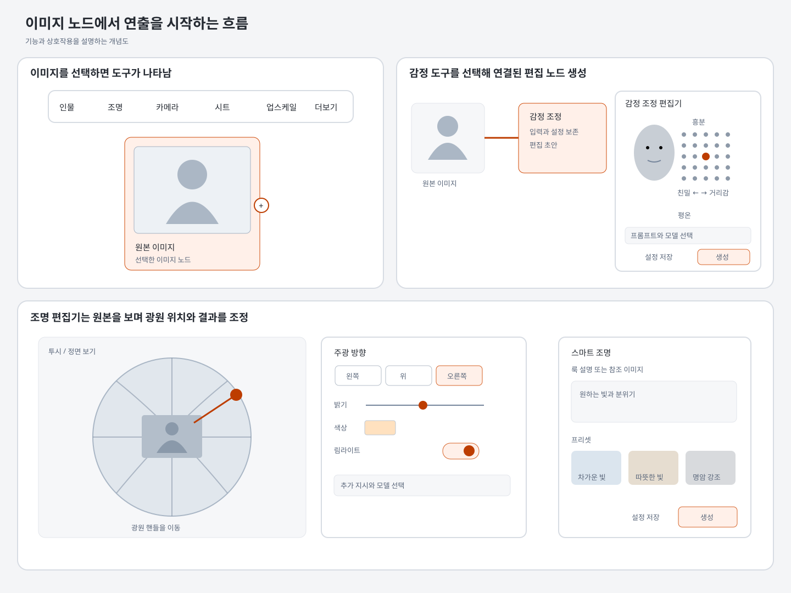

# 이미지 위 도구 모음과 시각 편집기 설계

2026-11-23 · Omni AI Canvas 후속 제품 설계 · C2·C3·C4·C6·C7·C8·C9

**이미지를 클릭하면 바로 위에 편집 도구가 뜬다. 도구를 선택하면 원본에 연결된 초안 노드와 그 도구의 편집기가 함께 열린다.** 이후에는 그 노드를 클릭해 같은 설정, 프롬프트, 결과 후보를 다시 연다. 사용자가 생성 여부를 결정하는 곳도 이 편집기다. UI는 기존 SEED 색상·서체·Lucide 아이콘을 사용한다.

그림은 조작 대상과 배치를 보여 주는 초기 와이어프레임이다. 현재 감정 조정은 원본 이미지, 기준 표정 사진과 감정판을 표시한다. 아래 얼굴 리그 내용은 3D 제작과 후속 검토에 참고한다.

## 무엇을 확인했나

| 근거 | 관찰과 설계에 미치는 영향 |
| --- | --- |
| 이번 첨부 4·6·10, 기존 검증 캔버스 재확인 | 이미지 선택 상태에서 상단 도구와 더보기 메뉴가 나타난다. 채택 결과가 있는 연출 노드에서는 상단에 다음 작업 도구가, 아래에 현재 노드의 참조·모델·프롬프트 편집기가 함께 보인다. 두 위치의 역할을 구분한다. |
| 이번 메뉴 열람 | 상단 유틸리티의 접근 가능한 이름은 주석·회전·다운로드·미리보기였다. 사용자 지정 화면에는 표시할 도구를 고르는 슬롯 5개, 순서 변경, 기본값 복원, 취소와 저장이 있었다. 설정 창은 취소로 닫았다. |
| 첨부 1·2·3·5·7~9 | 카메라 궤도와 사진판, 질감 옵션 5축, 모델·배율 선택형 업스케일, 중립 얼굴과 감정 좌표판, 수동·스마트 조명 편집기가 보인다. 숫자·배율·모델 이름은 해당 화면에서 표시된 예시다. |
| 앞선 실행 실측 | Newtake는 질감·시트 등에서 빈 노드를 먼저 만들고, 감정·다각도·직접 조명에서는 조작기를 먼저 열고 실행할 때 결과 노드를 만들었다. 우리 서비스에서는 사용자가 요청한 대로 생성형 도구를 고르는 순간 연결된 초안을 만든다. 재실측에서는 조명 출력, 실제 25컷과 선택 셀의 후속 연결까지 확인했다. |
| 현재 서비스 | ＋·우클릭·우측 패널에서 9종의 연출 노드를 만들 수 있다. 설정·참조·결과 채택·5×5 분할은 저장된다. 지금의 감정 가이드는 기하 도형으로 구성되며 프리셋·슬라이더로 조절한다. 현재 기술 과제는 선택 이미지에 툴바를 붙이고, 전용 편집기와 실행을 한곳에 모으고, 사실적인 얼굴 리그와 공간 조작기를 제공하는 것이다. [캔버스](../components/CanvasBoard.tsx) · [편집기](../components/ImageEditStudio.tsx) · [현재 3D 가이드](../components/DirectionPreview.tsx) |

## 1. 제작자가 거치는 화면

| 사용자의 행동 | 화면과 저장 동작 |
| --- | --- |
| 이미지가 붙은 캐릭터·참조·키프레임의 썸네일 클릭, 탭 또는 키보드 선택 | 원본 선택 테두리와 상단 툴바 하나를 표시한다. 카드 드래그로 판정된 동작은 이동으로 끝낸다. 빈 이미지 자리에는 이미지 추가를 제공한다. 다중 선택에서는 단일 이미지용 편집기를 닫는다. |
| 상단에서 감정·조명·다각도 같은 도구 선택 | 한 번의 보드 변경으로 현재 이미지 버전을 참조하는 노드와 입력선을 만들고 선택을 옮긴다. 인접한 빈자리에 놓고 편집기 첫 조작 항목에 포커스를 둔다. 도구를 여는 데 생성 호출은 0건이다. |
| 편집 노드를 클릭 | **이미지 연출 편집 대화상자**가 열리고 원본 썸네일과 도구명, 시각 조작부, 추가 지시, 계정·모델·출력 옵션, 실행 버튼을 표시한다. 닫았다 다시 열면 저장한 초안을 읽는다. 이미 선택한 노드를 다시 클릭해도 새 노드가 생기지 않는다. |
| 생성 클릭 | 보드 저장과 입력 검증 후 해당 노드에서 실행한다. 대기·실행 중에는 연결된 원본과 직전 채택본이 보인다. 실패하면 오류와 재시도 경로를 같은 자리에 둔다. 공급사가 보고한 실제 진행률이 있을 때만 퍼센트를 표시한다. |
| 결과 비교·채택 | 원본과 채택본을 같은 크기의 썸네일로 비교하고, 원본·채택본·후보를 눌러 편집기 안의 미리보기에서 확대한다. 채택한 결과 이미지 위에는 다음 작업의 도구가 나타난다. 아래 편집기는 이 결과를 만든 설정을 연다. **같은 원본에서 변형**은 형제 노드, **이 결과에서 이어서**는 채택본을 입력으로 한 자식 노드다. |
| 빈 캔버스 클릭·Esc·다른 노드 선택 | 열린 하위 메뉴부터 닫고, 편집기를 닫으면 해당 노드로 포커스를 돌려준다. 초안은 노드에 남는다. 현재 브러시 획·드래그 취소, 마지막 변경 실행 취소, 초안 노드 삭제를 별도 동작으로 제공한다. |

**툴바 배치.** 설치된 React Flow의 `NodeToolbar`를 선택 노드 하나에 연결한다. 확대율이 달라져도 버튼 크기는 화면 픽셀 기준으로 유지한다. 캔버스와 양측 패널이 차지한 영역을 기준으로 좌우 위치를 제한한다. 상단이 잘리면 아래로 뒤집고, 편집기와 겹치면 편집기를 캔버스 가장자리에 붙인다. ＋와 우클릭은 동일한 도구 목록을 연다. [React Flow NodeToolbar](https://reactflow.dev/api-reference/components/node-toolbar)

**기본 배치 제안.** 인물·감정, 조명, 카메라, 시트, 업스케일의 다섯 자리를 두고 끝에 더보기를 둔다. 인물의 본 버튼은 감정, 시트의 본 버튼은 9앵글을 연다. 펼침 버튼은 각각 질감과 다른 시트 종류를 연다. 더보기에는 검색·전체 도구·도구 모음 편집이 있다. 사용자는 자리를 교체하거나 순서를 바꿀 수 있다. 주석·회전·다운로드·확대 보기는 공통 동작으로 묶고 좁을 때 더보기에 넣는다. 화면에서 차지하는 폭에 따라 남은 도구를 더보기로 옮기며 고정 순서는 유지한다.

**모바일.** 390px와 320px에서는 이미지 위에 감정·조명 등 들어가는 만큼과 ‘전체 도구’를 남긴다. 편집기는 하단 시트로 열고 원본·3D 가이드와 설정 사이를 전환한다. 메뉴는 두 단계 이내로 도달한다. 터치 표적은 44px 이상을 목표로 한다. 캔버스의 두 손가락 이동·핀치는 빈 캔버스가 처리한다. 활성 핸들·격자·브러시는 자신의 영역에서만 포인터를 잡고 손을 떼거나 취소하면 해제한다.

## 2. 어떤 도구가 무엇을 여나

아래는 목표 목록이다. **기존**은 관련 연출 노드나 기능이 있는 경우, **확장**은 다른 화면의 기능을 가져오거나 새 제어가 필요한 경우, **신규**는 이미지 노드에서 쓸 실행 계약부터 만들어야 하는 경우다. ‘더보기’에서 같은 도구를 검색해도 동일한 편집기와 노드가 열린다.

| 도구 | 열리는 편집기와 입력 | 산출물·구현 출발점 |
| --- | --- | --- |
| 감정 조정 | 원본 이미지와 기준 표정 사진을 보고 5×5 감정판에서 선택 | 동일 배역의 표정 후보 |
| 인물 질감 | 원본 1:1 확대 비교. 인물·배경 융합, 조명 일치, 피부, 입자, 선명도를 각각 3단계와 세부값으로 조절 | 원본 구도를 유지한 편집 이미지. 기존 4개 연속값에 조명 일치 축 추가 |
| 조명 효과 / 영화급 조명 보정 | 수동 광원 구와 스마트 조명. 영화급 보정에서는 장면 룩·대비·색온도·샷 비교 추가 | 각자 독립된 조명 후보. 기존 두 노드 확장 |
| 다각도 | 원본 사진판, 카메라 궤도, 샷 크기, 프리셋, 추가 지시 | 한 장의 새 시점. 기존 각도·거리·FOV·주시점 재사용 |
| 멀티 카메라 9앵글 / 스토리 4컷 / 연속 25컷 | 각각 한 순간의 시점 목록 또는 시간순 비트 편집. 25컷은 각 셀에 연기 메모 | 한 장의 시트 후보. 기존 세 종류와 Codex 실생성 경로 재사용 |
| 얼굴 3면도 / 전신 3면도 / 캐릭터·장면·제품 설정도 | 회전 기준, 포함할 뷰·상세 부위, 의상·재질·조명 고정 항목 | 용도별 설정 시트. 얼굴 3면도는 기존, 나머지는 별도의 시트 템플릿과 검수 규격 추가 |
| 스테이징·일반 스토리보드 / 장면 이전·이후 추론 | 샷 지시 또는 기준 이미지와 시간 오프셋. 이전 자료의 메뉴 예시는 3초 후·5초 전 | 동선 시트 또는 앞뒤 장면 후보 스틸. 생성한 상상 장면으로 표시. 기존 샷·스테이징과 연결하는 확장 |
| 그리드 분할 | 실제 시트를 열고 행·열, 개별 셀의 네 경계, 추출 컷을 선택 | 로컬 컷 자산과 출처 연결. 기존 2×2·3×3·5×5·가로 3칸 재사용. 4×4·사용자 지정은 행렬 스키마와 노드 상한 검증을 확장한 뒤 제공 |
| 업스케일 | 원본 픽셀·예상 출력 크기, 방법·모델·배율과 피부/글자 확대 비교 | 업스케일 파생 이미지. 신규. 로컬 보간 확대와 AI 디테일 복원을 별도 방법으로 표시. 지원 배율·최대 픽셀 수·비용을 검사 |
| 자르기·회전 | 이미지 위 비율 프레임·손잡이, 가로세로 전환, 회전 각도 | 파생 이미지. 감독 도구의 크롭·회전 로직 재사용 검토. EXIF 정방향 기준 표시와 픽셀 추출 일치 검수 |
| 주석 | 펜·색·굵기·지우개 및 획 되돌리기 | 원본에 정규화된 벡터 주석. 필요할 때 주석 포함 이미지 내보내기. 신규 |
| 누끼 | 피사체 선택, 가장자리 브러시·깃털·체커보드 미리보기 | 원본 크기의 알파 PNG와 재편집 마스크. 전용 분할 엔진 및 알파 검증 신규 |
| 지우기 / 다시 그리기 | 같은 마스크 브러시. 지우기는 배경 복원, 다시 그리기는 교체할 내용·보존 영역 지시 | 각각 독립적인 영역 편집 노드. 마스크 편집·전송·마스크 밖 변화 비교 신규 |
| 확장 | 네 방향으로 캔버스 늘리기, 원본 고정 위치, 추가 영역과 지시문 | 새 영역을 생성한 이미지. 원본 내부 보존 검사와 아웃페인팅 경로 신규 |
| 요소 편집 / 레이어 편집·분리 | 요소를 클릭해 선택·이동·교체한다. 레이어 패널에서는 순서·가시성·투명도와 합성 결과를 조작한다 | 선택 영역·알파 레이어·합성본. 평면 사진을 분리할 때 드러나는 뒷배경 복원은 별도 생성 작업. 마스크·합성·레이어 저장 신규 |
| 파노라마 | ‘720도 파노라마’로 노출된 메뉴. 입력 규격과 이음새를 확인하는 구면 뷰어, 드래그 시점 미리보기 | 기존 파노라마의 열람과 일반 사진에서 구면 영상을 생성하는 작업을 구분. 메뉴 이름은 확인했고 투영 형식·내보내기·모델은 실험 대상 |
| 다운로드 / 확대 보기 / 도구 모음 편집 | 원본 크기로 보기, 파일 받기, 표시할 도구·순서 선택 | 도구별 실행 노드 없이 수행. 현재 보드 다운로드를 재사용하고 고정 도구 순서는 작업실 설정에 저장 |

시트 **분할**은 출력 이미지의 픽셀을 자르는 로컬 작업이다. **그리드 생성**은 모델이 여러 장면을 그리는 작업이다. 같은 메뉴에서도 두 동사를 분명히 표시한다. 생성된 25컷의 실제 내용과 경계를 확인한 뒤 선택한 셀만 분리한다. 기존 시트 노드, 컷별 출처·보정 좌표, 영상 입력 순서를 보존한다. [분할 편집기](../components/PortraitGridStudio.tsx) · [기존 서비스 실생성 검수](character-direction-node-design.md#9-2026-11-23-연결-모델-실생성-검수)

## 3. Blender와 Three.js로 감정 편집기 만들기

**기술 판단.** Blender에서 표정을 조형하고 Three.js가 그 변형 가중치를 화면에서 움직이는 방식은 공개 기술로 가능하다. 이 환경에는 Blender 5.3.0과 Three.js 0.187.0이 있다. Three.js 공식 얼굴 예제의 코드와 공개 GLB 메타데이터를 읽어 얼굴 메시의 이름 있는 변형 52개를 확인했다. 눈썹 안쪽 올림, 좌우 눈 감기, 턱 열기, 좌우 미소처럼 독립적으로 움직일 채널이 실제 파일에 들어 있다. 이 예제는 경로의 타당성을 확인한 자료다. 제품의 얼굴 자산은 별도로 제작·관리한다. [Three.js 얼굴 예제](https://threejs.org/examples/webgl_morphtargets_face.html) · [예제 소스](https://github.com/mrdoob/three.js/blob/dev/examples/webgl_morphtargets_face.html) · [GLTFLoader](https://threejs.org/docs/pages/GLTFLoader.html)

**자산 파일 확인.** Blender 공식 Human Base Meshes v1.4.1의 원본 .blend를 Blender 5.3.0에서 읽었다. 애니메이션용 실사 머리 `GEO-head_animation_realistic`의 기본 메시는 정점 3,242개였고 이 머리의 Shape Key는 0개였다. 좌우 홍채와 공막은 개별 메시로 들어 있다. 이 머리를 쓰려면 눈꺼풀·입술·볼의 실제 연기 변형을 제작 일정에 포함해야 한다. Three.js 공식 예제의 52개 채널은 별도의 완성된 얼굴 자산에서 확인했다. [확인한 Blender 번들](https://download.blender.org/demo/asset-bundles/human-base-meshes/human-base-meshes-bundle-v1.4.1.zip) · [확인한 Three.js 예제 GLB](https://github.com/mrdoob/three.js/blob/dev/examples/models/gltf/facecap.glb)

1. **얼굴 제작.** 제품용 중립 흉상의 출발점으로 위 실사형 머리를 권한다. 사용할 정확한 파일·버전·라이선스와 수정 내역을 보관한다. 눈꺼풀과 입술 주위에 변형 가능한 토폴로지를 확보하고 안구, 눈꺼풀, 치아·구강, 목과 어깨를 준비한다. 무광 회색 재질과 같은 카메라·조명에서 기준 렌더를 만든다. [Blender 공식 자산 번들](https://developer.blender.org/docs/release_notes/3.6/asset_bundles/) · [공식 배포 목록](https://www.blender.org/download/demo-files/)
2. **표정 리그.** Blender의 Basis를 중립으로 둔다. 좌우 눈썹 안쪽·바깥쪽, 찡그림, 눈꺼풀 열림·감김, 볼 올림, 입꼬리 올림·내림, 입술 다물기, 턱 열림에 Shape Key를 만든다. 시선은 좌우 안구 회전으로 다룬다. 웃으면서 눈을 가늘게 뜨는 조합에는 보정 형태를 만들어 볼과 아래 눈꺼풀이 함께 움직이게 한다. 중립·기쁨·긴장·안도·의심 포즈를 정면과 사선에서 승인한다.
3. **브라우저 인계.** GLB로 내보내 Shape Key 이름·중립 가중치·정점 변형과 노멀을 왕복 확인한다. Blender 드라이버의 논리는 포즈별 가중치 표로 내보내고, 필요한 클립은 샘플링해 저장한다. 제작 원본 .blend, 배포 GLB, 채널 매핑과 버전, 기준 포즈 렌더가 한 세트다. 브라우저는 이름으로 각 메시의 morph 인덱스를 찾아 가중치를 적용한다. 눈꺼풀 누락이나 좌우 반전은 납품 검사에서 잡는다. [Blender glTF 내보내기](https://docs.blender.org/manual/en/latest/addons/scene_gltf2.html) · [glTF 2.0 규격](https://registry.khronos.org/glTF/specs/2.0/glTF-2.0.pdf)
4. **대상 선택.** 자동 얼굴 후보가 있으면 원본 위에 표시한다. 자동 인식에 실패하거나 캐릭터 시트에 여러 얼굴이 있으면 직접 사각형을 그린다. 선택한 얼굴의 썸네일과 ‘대상 변경’을 상단에 둔다. 첫 버전은 한 편집 노드가 한 얼굴을 담당한다. 원본 정방향 픽셀 기준 0~1 좌표로 저장하고 레터박스·확대·터치에서도 동일 부위를 가리키게 한다.
5. **감정판.** 정면 흉상 옆에 5×5 기준점을 둔다. 왼쪽은 친밀, 오른쪽은 거리감, 위는 흥분, 아래는 평온이다. 기존 데이터의 양수 `warmth`는 친밀을 뜻하므로 왼쪽 끝은 +1, 오른쪽 끝은 −1로 매핑한다. 위쪽 `arousal`은 +1이다. 가운데는 중립, 좌상단은 반가움, 우상단은 경계처럼 연출자가 **25개 기준 포즈와 명칭**을 승인한다. 점 클릭은 해당 포즈, 점 사이 드래그는 가까운 네 포즈의 가중치를 양선형 보간한다. 이름은 가장 가까운 포즈를 표시하고 실제 좌표는 연속값으로 저장한다.
6. **세부 조절과 일관성.** 좌표 포즈에 세부 눈·눈썹·입·시선 보정을 합치고 허용 범위로 제한한 뒤 강도로 중립과 혼합한다. 강도 0이면 모든 채널이 승인 중립 상태로 돌아온다. 원본·가이드·생성 결과를 각자 표시한다. ‘중립에서 현재까지’ 재생, 일시 정지, 초기화와 방향키 좌표 이동을 지원한다. 기본 눈·입만 움직이는 기존 단순 모델은 저사양 대체 화면에 사용할 수 있다.
7. **생성.** 원본을 첫 입력으로 고정하고 대상, 표정, 강도, 유지할 외형, 추가 지시를 실행 스냅샷에 넣는다. 지원이 확인된 경로에서만 얼굴 마스크나 가이드 이미지를 첨부한다. 범용 흉상을 사진과 함께 무조건 보내면 배역 외형까지 변할 수 있다. 실제 결과에서는 선택 얼굴의 변화와 다른 인물·의상 보존을 별도로 비교한다.

**얼굴 자체가 움직여야 하는 경우.** 사용자 캐릭터의 리그 GLB가 있으면 채널 매핑 검사 후 같은 감정판으로 그 얼굴을 움직일 수 있다. 사진만 있는 경우에는 공용 흉상이 연기 의도를 보여주고 원본 배역의 표정은 생성 결과에서 확인한다. 원본 사진의 즉시 변형까지 원하면 랜드마크·깊이 기반 2.5D 미리보기를 별도 실험으로 두고, 측면·가림·입 안쪽의 실패율을 검수한다. 앱의 기존 Blender 경로에도 이름으로 표정 키를 찾아 가중치를 넣는 부분이 있다. [로컬 Blender 장면 처리](../scripts/blender_scene.py)

### 감정판 제작용 포즈 시트

자동 얼굴 선택을 추가할 때는 MediaPipe Face Landmarker를 원본이 바뀔 때 한 번 실행해 얼굴별 후보 사각형을 구하는 방식을 검토한다. 검출은 편집기 밖의 작업 스레드에서 하고, 영역을 직접 그리는 경로를 항상 제공한다. 원본의 검출 표정과 제작자가 감정판에서 지정한 목표 포즈는 따로 저장한다. [MediaPipe 얼굴 랜드마크](https://developers.google.com/edge/mediapipe/solutions/vision/face_landmarker?tab=Web)

Three.js에서는 각 얼굴 메시의 `morphTargetDictionary`로 이름을 해석한 뒤 `morphTargetInfluences`에 포즈 가중치를 쓴다. 납품 GLB에서 실제 이름을 읽으므로 특정 메시 순번에 의존하지 않는다. 첫 자산은 기본 GLB로 기능을 검수하고, 압축판을 도입할 때는 그 파일이 요구하는 디코더·텍스처 전송량·첫 화면 표시 시간을 함께 비교한다. 검토한 공식 예제 GLB는 Meshopt와 BasisU 관련 확장을 요구한다. [Three.js Mesh](https://threejs.org/docs/pages/Mesh.html) · [공식 예제 로더 구성](https://github.com/mrdoob/three.js/blob/dev/examples/webgl_morphtargets_face.html)

다음 25개는 우리 제품에 제안하는 연출 이름이다. 같은 흉상·카메라·조명에서 만든 포즈를 하나씩 승인하고, 이름을 가린 상태에서도 서로 가까운 표정을 구별할 수 있는지 점검한다.

| 흥분도 ↓ / 친밀도 → | 매우 친밀 | 친밀 | 중간 | 거리감 | 큰 거리감 |
| --- | --- | --- | --- | --- | --- |
| 매우 높음 | 환희 | 반가운 놀람 | 깜짝 놀람 | 격앙 | 격분 |
| 높음 | 신난 웃음 | 기대 | 궁금함 | 긴장 | 경계 |
| 중간 | 따뜻한 미소 | 호의 | 중립 | 의심 | 냉담 |
| 낮음 | 안도 | 편안함 | 차분함 | 망설임 | 외면 |
| 매우 낮음 | 나른한 미소 | 평온한 만족 | 고요함 | 기운 빠짐 | 가라앉은 단절감 |

첫 아트 검수는 네 포즈로 시작한다. **안도**는 눈꺼풀과 미간의 긴장이 풀리고 입꼬리가 작게 올라간다. **경계**는 눈썹 안쪽이 모이고 입술이 붙는다. **반가운 놀람**은 눈꺼풀과 눈썹이 올라가고 턱이 열리며 양쪽 입꼬리가 살짝 올라간다. **의심**은 한쪽 눈썹을 높이고 한쪽 눈꺼풀을 좁힌다. 매 포즈에 사용한 좌우 채널과 가중치를 리그 버전과 함께 기록한다. 슬라이더 값만 변하고 얼굴에 이 차이가 읽히지 않으면 다음 포즈 제작으로 진행하지 않는다.

## 4. 카메라와 조명은 원본 위에서 조작한다

| | 다각도 편집기 | 조명 효과 편집기 |
| --- | --- | --- |
| 화면 | 중앙에 원본 비율을 유지한 사진판, 바깥쪽에 카메라 궤도·아이콘·위아래 기준, 옆에 샷 가이드 뷰파인더 | 중앙 사진판·기준 피사체 주위에 광원 핸들과 광선 방향. 투시 보기와 정면 보기 전환. 옆에 중립 흉상을 실제로 비춘 미리보기 |
| 직접 조작 | 카메라 핸들 드래그와 수평 회전·수직 피치 입력이 양방향 동기화된다. 샷 크기, 거리, FOV, 주시점은 독립값. 수평 0°, 수직 +30°, 클로즈업처럼 현재 샷을 읽을 수 있다. | 핸들 드래그·6방향 버튼·숫자 입력이 같은 광원을 바꾼다. 좌·우·상·하·전·후방, 밝기, 색상 사용/해제, 림라이트 지원. 후방은 깊이 표시와 방향 버튼으로 지정한다. |
| 프리셋과 지시 | 기본, 어안, 기울인 샷, 부감, 앙각, 파노라마 부감, 후면. 어안은 렌즈 왜곡, 기울기는 카메라 롤로 정의한다. 범위 밖 프리셋을 고르면 해당 수치를 표시한다. 프롬프트 접기는 문장 보존, 적용 토글은 제출 여부로 구분한다. | 수동과 스마트를 전환해도 이전 수동 초안을 복원한다. 스마트는 룩 설명·같은 프로젝트의 참조 이미지·자체 제작 룩 예시를 받는다. 예를 들어 차가운 역광, 부드러운 창광, 황혼 측광을 선택하면 적용된 방향·색·세기를 보여 준다. |
| 실행과 실패 | 프레이밍 목표와 원본 보존 조건을 전달한다. 원본에 찍히지 않은 뒷모습은 모델이 생성한다. 피사체 GLB가 있으면 실제 3D 뷰파인더를 쓴다. | 룩 프리셋은 로컬 매핑으로 즉시 미리 본다. 자유 설명은 추가 지시로 유지한다. 별도 AI 분석이 필요할 때는 사용자가 ‘설명으로 제안’을 실행하고 제안 수치를 적용한다. 영화급 보정은 기준 룩·색온도·대비·그레인과 인접 컷 비교를 다루는 별도 노드다. |

**공간 구현.** 피사체 정면을 +Z, 위를 +Y로 두고 원본 중앙을 기준점으로 삼는다. 투시 관찰은 PerspectiveCamera, 정면 관찰은 OrthographicCamera를 쓴다. 관찰 시점을 바꿔도 샷 카메라와 광원 좌표는 보존한다. Raycaster로 핸들을 선택하고 구면 교점에서 방위각·고도를 구한다. 드래그가 화면 가장자리를 넘어가도 마지막 유효 방향을 유지한다. 광원 방향은 피사체를 타깃으로 삼고, 정면 캡처를 기준으로 화면 오른쪽 조작이 실제 오른쪽 볼·어깨의 하이라이트와 대응하는지 시험한다. Blender와의 좌표 변환은 한 곳에서 수행한다. [Three.js Raycaster](https://threejs.org/docs/pages/Raycaster.html) · [DirectionalLight](https://threejs.org/docs/pages/DirectionalLight.html)

**표현 범위.** 사진판은 공간 관계를 설명한다. 평면 사진을 돌리거나 밝기 필터를 씌우는 것만으로는 코 뒤 그림자나 보이지 않는 측면을 복원할 수 없다. 조작 중에는 리그·피사체 가이드에 실제 광원을 적용하고, 실행 후 동일 배율 원본 비교로 생성 이미지를 검수한다. 우리 편집기가 보장할 수 있는 부분은 조작 위치·설정 재현·입력 전달이다. Newtake 내부 모델과 동일한 출력 품질은 확인되지 않았다.

### 같은 연출값이 가이드와 생성 모델에 도달하는 경로

| 필요한 결과 | 선택할 방법 | 검수할 차이 |
| --- | --- | --- |
| 드래그 중 표정·광원·카메라 | 브라우저에서 Three.js가 흉상과 사진판을 렌더한다. Blender는 리그 제작과 기준 렌더에 사용한다. | 네트워크 호출 없이 조절한다. 주광을 오른쪽 60°로 옮긴 뒤 정면에서 투시 보기로 바꿔도 같은 광원을 가리켜야 한다. |
| 3D 배우의 표정·조명·샷 | 사용자가 연결한 캐릭터 GLB의 실제 메시와 표정 키를 쓰고, 같은 설정을 Blender 정밀 프리뷰로 인계한다. | 눈 감기·입꼬리·역광·후면 샷을 두 렌더러에서 같은 구도로 대조한다. |
| 사진 속 배우의 새 완성 스틸 | 기본 Codex `image_gen`에 원본 이미지와 연출 지시를 보낸다. 입력으로 검증된 경우에만 보조 가이드를 첨부한다. | 원본과 생성 후보의 얼굴·의상·광원 방향·프레이밍을 비교하고 제작자가 채택한다. |
| 사진 속 얼굴에 비치는 빛까지 근사한 프리뷰 | 후속 실험으로 얼굴의 반사색과 형상을 추정해 원래의 음영을 분리하고 목표 조명으로 다시 합성한다. Holo-Relighting은 단일 인물 사진에서 조명·시점·머리 자세를 제어한 연구 사례다. | 안경·측면·가림·여러 얼굴에서 품질과 처리 시간을 측정하고 가중치 배포 조건을 확인해야 한다. [Holo-Relighting 연구](https://yiqunmei.net/holo-web/) |

단일 사진의 새 시점을 위해 상대 카메라 변환을 조건으로 쓰는 연구도 있다. Zero-1-to-3의 대상은 주로 개별 물체다. 인물과 배경이 함께 있는 영사실을 같은 품질로 재구성한다고 일반화할 수 없다. 첫 출시에서는 조작기 좌표와 뷰파인더를 정확히 맞추고, 사진의 보이지 않던 면은 생성 후보에서 검수한다. [Zero-1-to-3 원 논문](https://arxiv.org/abs/2303.11328)

**좌표 인계 예시.** 정면을 +Z, 화면 오른쪽을 +X, 위를 +Y로 둔다. 수평각 θ와 고도 φ에서 타깃 기준 핸들 방향은 `(sin θ cos φ, sin φ, cos θ cos φ)`이다. 각도는 저장 시 도, 계산 시 라디안을 쓴다. 조명은 이 위치에서 타깃을 향한다. 샷 카메라는 이 방향에 거리를 곱한 오프셋과 독립 주시점을 사용한다. Blender의 Z-up과 glTF의 Y-up 변환은 입출력 경계 한 곳에서 처리한다. 내보내기 때 변환된 자산에 같은 축 변환이 중복되지 않는지 정면·우측·상단 기준 렌더로 확인한다.

**프리셋 계산 예.** 정면은 수평 0°·피치 0°, 정면 부감은 수평 0°·양의 피치, 후면은 수평 180°를 초기값으로 제안한다. 궤도는 한 바퀴 회전할 수 있고 0°와 360° 경계에서 같은 자세를 복원한다. 클로즈업은 피사체 크기를 기준으로 거리와 프레이밍을 정하고, 어안 미리보기는 별도의 렌즈 왜곡 패스를 적용한다. 기울인 샷은 샷 카메라의 롤을 바꾼다. 가이드의 렌즈 효과와 생성 모델이 보장하는 렌즈 옵션을 각자 표시한다.

**스마트 조명의 우선순위.** 룩을 선택하면 방향·밝기·색·림라이트 초깃값을 한 번 적용한다. 이후 사용자가 옮긴 광원값이 실행값이다. 추가 참조는 조명 스타일 역할로 보관한다. 설명으로 새 제안을 받아도 ‘적용’을 누르기 전의 수동 배치를 복원할 수 있어야 한다. 예를 들어 ‘차가운 역광’을 고른 뒤 주광을 화면 오른쪽으로 옮기면, 우측광 수치와 차가운 톤이 함께 남는다.

## 5. 다른 전용 편집기의 계약

- **질감.** 인물·배경 경계와 조명 일치를 따로 조절한다. 다섯 축 각각 약·기본·강의 효과를 설명하고 1:1 얼굴 크롭에 원본과 로컬 샤프닝·그레인 예시를 나란히 표시한다. 피부 생성·경계 재합성은 실제 후보에서 평가한다. 기존 4축의 수치는 그대로 읽고 새 축은 명시적으로 기본값을 부여한다.
- **업스케일.** 방법 → 지원 모델/프로필 → 허용 배율 순으로 고른다. 예상 출력 픽셀과 비교 크롭을 표시한다. 첨부 3의 Topazlabs와 2·4·6배는 화면 근거다. 전용 제공자를 연결·검증하기 전에는 해당 엔진명이나 지원 배율을 약속할 수 없다. 정해진 픽셀 크기의 로컬 리샘플과 AI 복원은 각각 식별 가능한 결과로 기록한다.
- **영역·레이어.** 원본 위 브러시·지우개·복원, 브러시 크기와 경계 부드러움, 마스크 반전·초기화를 공용으로 쓴다. 마스크는 원본 크기의 단일 채널로 보관하고 스트로크 좌표·미리보기와 함께 복원한다. 단순 레이어 합성은 로컬로, 가려진 내용 복원은 생성으로 보낸다. ‘지우기’의 결과는 채워진 이미지, ‘누끼’의 결과는 알파를 가진 피사체다.
- **시트·설정도.** 카메라 탐색, 캐릭터 자료, 시간 순서 스토리보드를 구별한다. 생성 미리보기의 격자와 모델이 실제 그린 컷 경계가 어긋날 수 있다. 선택한 컷의 크롭 미리보기를 보고 보정한 뒤 분리한다. 작업을 재개해도 시트 버전과 컷 순서가 유지돼야 한다.

## 6. 노드·상태·실행 연결

공통 도구 목록에 식별자, 표시 이름·별칭, 입력 종류, 편집기, 산출물, 노드 생성 여부, 실행 경로, 필요한 모델 기능을 둔다. 상단 도구와 더보기, ＋, 우클릭, 우측 상세 패널은 이 목록에서 같은 동작을 연다. 데이터는 기존 키프레임과 `imageEdit.kind`를 확장한다. Redux나 별도 작업 큐를 추가할 필요는 없다. [현재 노드 생성](../lib/image-edit.ts) · [현재 편집 흐름](../components/Studio.tsx)

| 보존 위치 | 값과 동작 |
| --- | --- |
| 프로젝트 그래프 | 노드·원본 입력선, 원본 자산 버전, 도구와 설정 스키마 버전, 얼굴 영역·좌표·강도·리그 버전, 광원·카메라 값, 추가 지시, 마스크·레이어·참조의 자산 ID. 큰 GLB·마스크·이미지는 파일로 두고 그래프에는 참조만 저장한다. |
| 편집기 초안 | 한 노드가 주 편집기를 하나만 소유한다. 드래그 중에는 로컬에서 즉시 반영하고 손을 떼면 한 번의 변경 이력을 만든다. 텍스트는 짧은 입력 지연 후 보드 저장에 합친다. ‘설정 저장’과 생성 전에는 미반영 편집을 먼저 저장한다. 저장 실패 시 초안·재시도 표시를 유지한다. |
| 실행 스냅샷 | 서버가 프로젝트 입력선, 원본 해시, 확정한 설정·프롬프트·모델·지원 옵션을 고정한다. 클릭 중복과 네트워크 재전송은 동일 요청 ID를 재사용한다. 실행 중 편집한 값은 다음 실행에 적용한다. 원본이 바뀌면 이전 결과를 보존하고 새 입력을 명시적으로 연결한다. |
| 공용 설정과 권한 | 작업실 DB에 고정 도구 ID와 순서 필드를 추가하는 제안이다. 저장 버전 충돌을 확인한다. 실행 경로는 저장된 모델 기본값과 서버 허용 정책을 재사용한다. Codex 구독이 기본이며 별도 과금 API는 작업실 허용 및 해당 요청에 대한 사용자의 명시적 선택을 확인한다. |
| 후속 처리 | 미리보기·다운로드는 조회, 캔버스 배치·로컬 컷 분리는 로컬 작업, 생성형 편집은 모델 작업으로 표시한다. 대상 없는 도구와 미지원 모델 옵션에는 비활성 이유를 표시한다. 서비스가 확인할 수 있는 견적만 보여 준다. |

편집기 푸터는 **참조 → 추가 지시 → 모델·출력 → 생성**을 같은 맥락에 둔다. ‘설정 저장’은 모델 호출 0회, ‘생성’은 확인된 요청 1건이다. 화면비·해상도·수량은 제공자가 실제로 보장하는 조합만 선택지로 보여 준다. 한 요청에서 결과 한 장을 보관하는 현재 계약에서는 수량을 한 장으로 표시한다. 다장 지원은 후보 식별자·부분 실패·견적을 먼저 확장한다. 마스크/다중 참조가 필요한 도구는 해당 경로의 전송 능력이 검증된 뒤 활성화한다. [실행 입력](../lib/run-input.ts) · [원본 해시](../lib/image-edit-server.ts) · [공용 설정 및 과금 경계](architecture.md#이미지영상-모델-경계)

기존 `instruction` 전용 노드는 원문을 보존해 연다. 감정판의 가로축을 뒤집어 표시해도 기존 저장값의 의미는 보존한다. 리그 버전이 다르면 명시적인 매핑표로 옮기고 누락 채널은 알린다. 구형 데이터에는 단순 기본값을 제안하고, 원래 값에서 복구할 수 없는 그림자·렌즈 왜곡·표정 포즈를 임의로 추정하지 않는다.

## 7. 구현 단위와 통과 기준

| 순서 | 출시 전 확인할 일 |
| --- | --- |
| 1. 선택 툴바와 편집기 | 이미지 단일 선택 후 도구 버튼이 바로 나타난다. 감정·조명은 상단 한 번의 클릭으로 원본에 연결된 초안과 전용 편집기가 열린다. 한 번 실행 취소하면 새 노드와 선이 함께 사라진다. 기존 노드를 열고 닫는 동작은 노드 수를 바꾸지 않는다. |
| 2. 감정판 | 클릭하거나 드래그해 고른 감정에 맞는 기준 사진과 이름을 표시한다. 감정 좌표를 저장하고 새로고침 후 복원한다. 기존 강도·얼굴 영역·세부 표정 값은 설정 저장과 생성 입력에 보존한다. |
| 3. 카메라·조명 | 사진판에서 좌·우·후면과 ±피치, 원경·클로즈업을 바꿔 아이콘·수치·뷰파인더가 일치하는지 확인한다. 정면/투시 전환 전후 설정 동일, 역광과 림라이트의 실루엣 변화, 스마트 모드에서 수동으로 돌아왔을 때 값 복원을 검사한다. |
| 4. 프롬프트·실행·결과 | 원본 클릭부터 모델 확인·생성까지 패널 탭 전환 0회. 편집 중 생성·재시도·중복 클릭·다른 창 저장 충돌·실패 후 재개·결과 채택을 점검한다. 생성 성공과 인물 동일성·조명 방향·25컷 구성의 콘텐츠 검수는 따로 판정한다. |
| 5. 확장 도구 | 로컬 자르기·회전·주석부터 연결한다. 마스크와 알파가 정확한 좌표로 왕복한 후 누끼·지우기·재그리기·레이어를 연다. 업스케일은 실제 픽셀과 디테일, 파노라마는 이음새와 투영, 설정도는 뷰 수·인물 또는 제품의 연속성을 검증한다. |
| 공통 성능·접근성 | 320·390px와 데스크톱에서 메뉴·생성 버튼·초점 복귀를 확인한다. 감정판은 키보드로도 기준점을 고를 수 있다. 조명·카메라 조작은 키보드로도 값을 변경할 수 있다. 열려 있는 공간 조작기는 입력·리사이즈 때 렌더한다. 120노드·500선 보드에서 조작 중 30fps 이상을 초기 목표로 측정하고 20회 개폐 후 렌더러·이벤트·텍스처가 누적되는지 확인한다. |

**첫 구현 검수 장면은 ‘영사기사 이미지 클릭 → 감정 노드 → 5×5에서 표정 두 가지를 비교 → 지시문 저장 → 다시 열기’다.** 이어 같은 원본에 우측 림라이트와 후면 카메라 노드를 추가한다. 세 작업의 설정이 독립적으로 남고 제작자가 어느 원본을 편집 중인지 한눈에 확인하면, 나머지 도구를 같은 인터페이스에 확장한다.

## 8. 첫 구현 검수

- Ego Browser에서 원본 한 장의 상단 도구로 감정·조명·다각도를 열었다. 노드 3개와 원본에서 이어지는 연결선 3개를 확인했다.
- 감정판의 2행 4열, 투시 보기의 우측 주광과 림라이트, 정면 부감 클로즈업을 저장했다. 새로고침 후 각 노드를 선택해 프롬프트와 설정을 다시 열었다. 조명 드래그 시 수평 방향이 60°에서 89°로 바뀌었다.
- Blender 얼굴 GLB의 14개 변형 채널이 들어 있는 파일과 브라우저 로딩을 확인했다. 320px·390px에서 툴바와 편집기가 화면 안에 있고 닫은 뒤 노드로 포커스가 복귀했다. 검수 프로젝트의 생성 기록은 0건이었다.
- Blender 형상 제작과 GLB 검수에 공식 Blender 자산과 고정 버전의 프로젝트용 스킬을 적용했다. [제작 스킬](../.agents/skills/blender-production-guide/SKILL.md) · [얼굴 출처와 재생성](../public/rigs/README.md)

## 9. 기준 표정 사진과 조명 가이드 최초 적용 기록

- Newtake의 기존 검증 캔버스에서 영사기사 이미지의 인물을 직접 지정하고 5행 5열을 순서대로 눌렀다. 25개 좌표의 라벨 변화와 얼굴 사진을 기록했다.
- 요청에 따라 데스크톱 작업실의 기준점 미리보기에 Newtake 캡처에서 얼굴만 잘라 사용한다. `public/rigs/expression-previews/`의 무손실 WebP는 행·열의 원본 픽셀을 보존한다. 한 번에 선택한 사진 한 장을 요청하며, 캔버스 참조와 생성 모델 입력은 원본 프로젝트 이미지에서 가져온다.
- 시선·강도 등 세부 표정 또는 표정 재생을 조작하면 라이브 3D 가이드를 연다. 감정판에 연결된 이름과 25개 기준값은 `lib/direction-face-poses.ts`에 두어 세부 조절과 모델 지시에서 공유한다. 저장된 좌표와 세부 값으로 편집기를 다시 연다.
- 스튜디오 조명은 광원 위치에 렌즈와 몸체를 놓고 광선을 원본 쪽으로 향하게 한다. 정면과 투시는 조명 배치를 보는 두 시점이며, 림라이트를 켜면 별도 기구와 광선이 보인다.
- Ego Browser에서 기준 사진 25장이 좌표에 맞게 표시되는 것을 확인했다. 1행 4열을 저장한 뒤 새로고침해 사진을 다시 열었다. 강도 조절에서 3D 가이드가 열리고 기준점을 누르면 사진으로 돌아왔다. 390px와 320px에서 작업실 검색창이 편집기를 가리지 않고 닫기 후 노드로 포커스가 복귀했다. 우측 조명 위치를 드래그해 26°·8°와 림라이트를 저장한 뒤 재확인했다. 검수 프로젝트에 생성 실행은 0건이었다.

## 10. 이미지 도구 실측과 적용

| 기능 | 관찰 | 적용 |
| --- | --- | --- |
| 레이어 편집 | 이미지에서 대상 또는 영역을 고르고, 설명과 실행 취소·다시 실행을 사용한다. 빈 입력에서 자동 분리 안내가 보였다. | 다각형 수동 분리 또는 macOS Vision 자동 전경 분리로 투명 PNG 두 장을 만든다. 결과는 원본과 연결된 독립 노드로 저장한다. 설명은 수동 선택 레이어의 이름과 작업 메모에 저장한다. |
| 캐릭터 설정도 | 원본에 연결된 초안과 이미지 프롬프트가 열렸다. | 기존 Codex 이미지 생성 흐름을 연결한다. 전신 정면·측면·후면, 표정, 의상·소품 구성을 선택하며 프롬프트에 16:9를 요청한다. |
| 업스케일 | 원본을 연결한 새 노드에서 모델과 2·4·6배를 고른다. | 연결 초안에서 로컬 2·4·6배, 자연스럽게·선명하게, 크기 확인과 원본·출력 비교를 제공한다. TopazLabs는 실측에서 관찰한 외부 모델이다. |
| 주석 | 펜, 사각형, 텍스트, 색, 굵기, 이전·다음 편집이 보였다. | 주석을 사본 PNG로 합성해 독립 노드에 저장한다. |
| 회전 | 연결 초안이 생성되고 0~360도 회전 및 미러 편집기가 열렸다. | 임의 각도·90도 단축·가로·세로 반전을 제공한다. 원본을 보존하고 편집값과 PNG를 연결 노드에 저장한다. |
| 다운로드·미리보기 | 다운로드는 원본 파일명으로 저장된다. 미리보기는 별도 화면을 연다. | 원본 파일을 바로 받는다. 미리보기 창에서 이미지 크기와 확대를 확인한다. |

감정판 클릭과 드래그, 좌표 슬라이더는 가장 가까운 기준 사진을 표시한다. 25개 좌표 이름은 Aside Browser에서 관찰한 문구로 통일했다. 사진과 접근 가능한 레이블, 생성 지시는 같은 좌표 인덱스를 사용한다. 강도·시선 등 세부 연기 값을 만질 때는 기존 3D 가이드가 열린다.

Ego Browser에서 드래그 중 서로 다른 두 사진과 새로고침 후 마지막 사진을 확인했다. 감정판의 25개 이름을 실측 기록과 대조했다. 자동·수동 레이어, 90도 회전과 가로 반전, 2배 확대, 텍스트 주석, 원본과 바이트가 일치하는 다운로드, 확대 미리보기, 캐릭터 설정도 초안을 검수했다. 회전·업스케일 값을 저장 뒤 다시 열고, 390px·320px의 더보기에서 미리보기를 열었다. 캐릭터 설정도의 실제 모델 생성 호출은 0건이었다.
