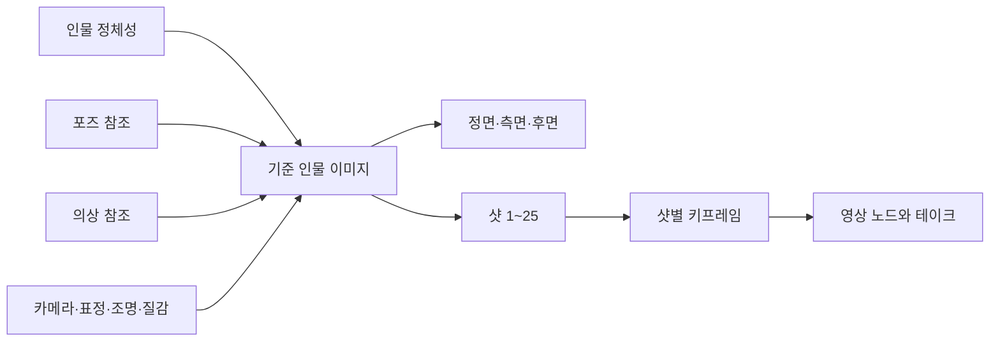

# 캐릭터 연출과 참조 제작 설계

현재 코드에서 확인한 시트 생성 지시·셀 분할의 범위와 후속 편집 도구 제안은 [제작 형식과 캐릭터 이미지 편집 검토](format-first-character-editing-proposal.md)에 정리했다.

확인일 2026-11-22. 두 로컬 영상의 전체 자막을 검토하고 각 기능 시점의 영상을 확인했다. 갤러리는 공개 페이지에서 검색·선택과 이용 안내를 읽었다. 결과 이미지의 정체성 유지율과 모델별 생성 성능은 별도 실험이 필요하다.

## 관찰한 제작 흐름

| 자료와 위치 | 확인한 기능과 제작자가 보여준 순서 | Omni AI Canvas의 적용 |
| --- | --- | --- |
| 포즈·의상 조합 영상 (로컬 자료) 00:54–02:31 | 의상, 마네킹 포즈, 인물 이미지를 각각 고르고 생성기에 함께 첨부한다. 생성한 이미지에서 세 요소의 반영 여부를 확인한다. | 인물 정체성·포즈·의상 참조를 독립 노드로 두고 이미지 기준 노드에 연결한다. 사용자가 각 참조를 넣고 생성 모델을 고른다. |
| Newtake 인물 영상 (로컬 자료) 01:00–04:13 | 캐릭터 디자인 시트와 텍스트로 인물 이미지를 생성하고 결과를 비교한다. | 캐릭터 이름과 얼굴·헤어 고정값을 편집하고 기준 이미지 노드에서 계정과 모델을 선택한다. |
| 같은 영상 04:13–06:56 | 피부와 이미지 질감을 조정한 결과를 비교한다. | 자연스러운 피부결, 미세한 비대칭, 과하지 않은 선명도 등을 수정 가능한 텍스트 지침으로 전달한다. |
| 같은 영상 06:56–08:26 | 시점과 카메라 방향을 조절하고 25그리드 연속 스토리보드를 요청한다. | 카메라 시점을 선택한다. 25개의 샷과 25개의 키프레임 노드를 선택적으로 만들고 각 샷의 행동·연속성을 편집한다. |
| 같은 영상 08:26–11:26 | 기존 사진에서 영화적 조명 보정을 시험하고 결과를 비교한다. | 조명 방향·질감 텍스트를 기준 이미지와 샷에 전달한다. |
| 같은 영상 11:26–14:32 | 표정과 감정을 조정하고 정면·측면·후면 인물 참조를 제작한다. | 감정을 보이는 행동으로 기술하고 세 시점의 독립 키프레임을 생성한다. |

영상 속 Newtake는 조절 화면과 생성 기능을 제공한다. Omni AI Canvas의 현재 키트는 사용자가 생성 모델에 보낼 지침과 노드 구성을 제공한다. 화면을 바꾼 이미지나 25분할 이미지가 자동 생성되지는 않는다.

## 참조 자료와 선택

| 출처 | 확인한 인터페이스와 용도 |
| --- | --- |
| [POSE-DB-01](https://ai-pose-gallery.pages.dev/) | 얼굴 없는 마네킹 포즈를 이름과 분류로 찾고 정면·위·아래·측면·사선 관점을 고른다. 한 장씩 참조하는 용도로 안내한다. 이미지 일괄 수집과 데이터 재배포는 금지다. |
| [COSTUME-DB-01](https://ai-costume-gallery.pages.dev/) | 얼굴과 배경이 없는 의상 이미지를 계절·종류·검색어로 선택한다. 일괄 수집과 이미지 재배포는 금지다. |
| [WaveSpeed 포즈 갤러리](https://wavespeed.ai/free-tools/ai-pose-gallery/glamour) | 마네킹과 선화, 정면·3/4·측면으로 구분한다. 이미지 생성기에서 포즈 참조로 사용할 수 있다고 설명한다. |
| [AI 얼굴 갤러리](https://ai-portrait-gallery.pages.dev/) | 얼굴과 스타일링 이미지를 나눠 제공하며 화면에는 CC0와 이미지 재배포 자제를 함께 안내한다. 사용 시 해당 페이지의 개별 안내를 확인한다. |
| [Newtake 캔버스](https://www.newtake.ai/ko/canvas) | 사용자 제공 영상에서 템플릿과 인물 편집 노드를 확인했다. 공개 웹 조회에서는 캔버스 본문을 읽지 못했다. |

갤러리는 링크로 열고 사용자가 선택한 자료를 각 노드에 첨부한다. Omni AI Canvas에 갤러리 원본을 포함하지 않는다. 인물·포즈·의상의 참조 역할이 모델 입력 슬롯과 다를 수 있으므로 실제 모델의 입력 방식을 사용자가 확인한다.

## 작업 구성

현재 구현은 제작 자료와 연결을 구성한다. 정체성은 `identity`, 의상은 `prop`, 포즈는 `context` 역할로 전달한다. 생성 공급사의 입력 슬롯에서 포즈·의상 전용 슬롯을 제공하면 사용자가 그 슬롯을 따로 선택한다. 같은 정체성 이미지를 복수 샷에서 재사용할 수 있고, 포즈를 참고용으로만 쓰려면 연결의 사용 범위를 연출 확인용으로 바꾼다.

25컷은 도입·목표·행동과 반응·전환·결과 다섯 구간의 편집 가능한 샷이다. 동일한 초안 동작과 카메라 설정으로 시작하므로 각 샷에서 실제 행동과 시선, 앞뒤 연결을 작성해야 한다. 3면도는 정면·측면·후면을 각각 생성할 수 있는 키프레임이다.

## 인수 기준과 후속 설계

| 영역 | 현재 확인할 결과 | 보강할 기능 |
| --- | --- | --- |
| 정체성·의상·포즈 | 각 참조를 독립적으로 편집하고 기준 이미지와 샷에 연결한다. | 동일 인물의 얼굴·의상·헤어 승인본과 씬별 상태 버전을 함께 비교한다. |
| 3면도·25컷 | 정면·측면·후면과 선택한 25개 샷이 독립 노드로 생긴다. | 이미지 한 장에 3면도나 5×5 그리드를 만드는 모델별 기능을 조회하고 각 셀 추출·검수·재생성 경로를 구현한다. |
| 시점·조명 | 카메라 시점과 광원 방향을 직접 수정해 해당 샷에 전달한다. | 촬영 배치 도구의 시점 미리보기를 키트와 연결하고 이미지 편집 공급사가 허용하는 각도·조명 옵션을 표시한다. |
| 표정·질감 | 표정 변화를 시선과 행동 중심으로 쓰고 질감 지시를 확인한다. | 원본을 유지하는 편집과 새로운 이미지 생성의 결과를 비교하고, 표현 강도는 모델이 실제로 지원할 때만 조절한다. |
| 비용·검토 | 보드를 배치할 때 영상·이미지 생성 요청을 보내지 않는다. | 공급자별 비용과 참조 슬롯을 확인한 후 개별 샷을 생성하고 채택한 테이크를 표시한다. |
