# 제작 에이전트 사용 가이드

Omni AI Canvas는 작품의 기획부터 대본·샷·이미지·영상까지 연결해 검토하는 개인용 제작실이다. 상단 **사용 가이드**에서도 핵심 순서를 볼 수 있다.

[제작 흐름 그림](../public/guide/workflow.svg) · [계정과 과금 경로 그림](../public/guide/billing.svg)

## 시작하기

프로젝트 루트의 `.env`에 `DATABASE_URL`과 `DATABASE_URL_UNPOOLED`를 설정하고 `npm ci`, `npm run db:migrate`, `npm run dev`를 실행한다. 브라우저에서 `http://127.0.0.1:5050`을 연다. 환경변수나 계정 설정을 바꾼 후 서버와 실행 중인 작업자를 다시 시작한다. 상세 설치와 백업은 [README](../README.md)를 따른다.

### 선택적 서비스 설정

구독 경로는 해당 CLI에서 로그인한다. Antigravity 직접 텍스트 실행은 개인 계정의 인증·청구를 확인한 뒤 `SCENE_ROOM_AGY_PERSONAL=1`로 켠다. 이미지 API는 별도 과금이며 OpenAI는 `OPENAI_API_KEY`, Gemini는 `GEMINI_API_KEY`, BytePlus Seedream은 `ARK_API_KEY`와 선택적 `SEEDREAM_MODEL`을 사용한다. 예시 키 목록은 프로젝트의 `.env.example`에 있다. [서비스별 설정과 공식 문서](providers.md)

## 이야기에서 제작안까지

1. 새 프로젝트를 열고 노드 선택을 해제한다. 작업실의 **제작** 탭에서 **새 제작안**을 고른다.
2. 작품 형식과 장면 수를 선택하고 이야기의 인물·갈등·원하는 분위기를 입력한다. 사용 가능한 계정과 모델을 고른 뒤 **감독에게 제작안 요청**을 누른다. 텍스트 작업은 선택한 계정의 사용량이 적용된다.
3. 제안된 기획·시나리오·캐릭터·씬·대본·샷과 연결을 미리 본다. 구조와 그래프 검증을 통과한 결과를 검토한 후 적용한다. 기존 작업의 최신 상태를 확인하고 반영한다.
4. 전체 **대본·연출 검토** 또는 씬을 선택한 뒤 **이 씬의 대본·연출 검토**를 요청할 수 있다. 제안별 내용을 확인하고 필요한 항목만 적용한다.

감독 에이전트에는 프로젝트에 고정된 Higgsfield 생성 스킬의 프롬프트 지침과 Omni AI Canvas의 연출 지침을 제공한다. 생성된 초안과 검토 의견은 제작자가 확인한다. [스킬 출처와 버전](skills.md)

### 드라마의 내레이션과 속마음

감독은 행동과 대사만으로 전달하기 어려운 시간 경과, 세계관의 제약, 인물의 숨은 의도가 있을 때 짧은 `[VO]`를 제안한다. 내레이션은 배경이나 인물의 지난 판단을, 속마음은 지금 겉으로 말할 수 없는 판단을 전한다. `[OS]`는 같은 씬에서 문 너머나 무전기를 통해 실제로 들리는 대사다. 기존 대본의 무음 지시나 요청란의 `VO 없이 구성` 같은 조건이 우선한다.

제작안을 검토하면 `[VO]` 대사의 화자와 문장, 목소리 지시가 음향 큐에 표시되고 선택한 샷의 시작점과 발화 길이가 타임라인에 배치된다. 해당 큐에서 녹음하거나 외부 음성 파일을 첨부하고, 실제 발화가 계획한 길이와 다르면 음향 레이어를 조정한다. `[OS]`는 대본에 출처와 함께 남기고 샷의 소리 지시에 반영한다.

| Drama Skills 적용 지점 | 캔버스에서 쓰는 기준 |
| --- | --- |
| 시나리오·회차 설계 | 인물의 목표, 저항, 선택과 결과, 다음 회차에 이어지는 상태를 확인한다. |
| 씬·대본 집필 | **Drama Skills · 대본 집필** 지침에서 행동으로 보일 정보, 짧은 VO로 전할 정보, 실제 현장에서 들리는 OS를 고른다. |
| 대본·연출 검토 | 장면의 인과와 음성 필요성, 출처, 발화 여백을 대조한다. 큐와 타임라인을 함께 바꿔야 하는 의견은 검토 총평에 표시한다. |
| 샷·영상 준비 | 대본이 확정된 뒤 화자 시점과 소리의 시작·종료, 여백을 넘긴다. 생성 모델의 입력 슬롯과 타임라인의 실제 프레임은 제작 도구에서 확인한다. |

## 에이전트에 자료 첨부

요청란 아래 **파일 첨부**로 파일을 선택하거나 이미지를 붙여넣고, **공개 링크 주소**에는 공개 HTTPS 주소를 추가한다. 하나의 요청에 최대 8개를 선택할 수 있다. 파일은 각각 최대 64 MiB다. 텍스트는 UTF-8 TXT·MD·SRT·CSV·JSON과 PDF·DOCX·PPTX에서 추출하며 문서당 최대 12,000자를 사용한다. PDF 처리에는 `pdftotext`와 `pdftoppm`, Office 텍스트 추출에는 `python3`, 이미지·영상 처리에는 FFmpeg가 필요하다.

일반 첨부에서 MP4·WebM 영상은 최대 2시간까지 읽고 대표 프레임 최대 3장과 내장 자막 텍스트를 추출한다. 이 일반 첨부 경로에서는 말소리를 받아쓰지 않는다. 레퍼런스 전용 분석은 컷별 화면 최대 96장을 시트 최대 8장으로 묶고 컷 번호, 화면 문자 위치와 사용 가능한 자막을 이용하며 로컬 Whisper 구간 전사도 설정할 수 있다. [제작 프리셋과 분석 범위](style-preset-workflow.md) 텍스트가 없는 PDF는 첫 페이지만 이미지로 읽으며 OCR은 하지 않는다. 링크는 최대 1 MiB의 공개 HTML·텍스트를 받아 본문 최대 18,000자를 추출한다. 로그인이나 스크립트 실행이 필요한 페이지는 직접 내용을 입력해야 한다. 화면의 **내용 확인**과 전송 미리보기에서 실제 추출 결과를 살펴본다.

제작안·텍스트·연출 검토에서 Codex와 Claude는 이미지와 영상 대표 프레임을 읽는다. Claude는 일반 요청에서 이미지 최대 4개, 레퍼런스 전용 분석에서는 최대 8개를 읽는다. 파일은 각 5 MiB·합계 16 MiB다. Antigravity 직접 실행과 Road Music은 추출 텍스트를 사용한다. Higgsfield·Kling·Topview의 생성 작업에서는 선택한 모델의 슬롯으로 이미지·영상 원본을 전달한다. 첨부와 기존 노드 참조를 합쳐 미디어 최대 12개·64 MiB이며 참조 데이터는 120,000자 이하다. [서비스별 처리](providers.md)

## 노드별 작업 예시

| 노드 | 작업 | 예시 |
| --- | --- | --- |
| 기획·시나리오·대본·씬·샷 | 노드를 선택하고 에이전트에서 본문 수정을 요청 | 폐관 전날 영사기사의 갈등을 대본과 샷으로 구체화 |
| 캐릭터 시트 | 텍스트를 다듬거나 이미지 생성을 선택 | 영사기사의 외형과 의상을 설정하고 참조 이미지 생성 |
| 레퍼런스 이미지·키프레임 | 파일을 첨부하거나 이미지 생성을 선택 | 캐릭터와 장소를 참조해 영사실 첫 장면 생성 |
| 레퍼런스 영상·AI 영상 | 파일을 첨부하거나 영상 생성을 선택 | 키프레임을 시작 프레임으로 연결해 장면 생성 |

노드를 선택한 뒤 **작업 종류**, 에이전트, 모델과 요청 내용을 확인한다. 참조 목록에서 보내는 자료를 살피고 작업을 요청한다. 결과는 노드에 자동 반영되지 않으며 확인 후 적용한다. 이미지·영상 생성은 선택한 서비스의 크레딧 또는 API 사용량이 적용된다. 지원 모델과 입력 조건은 [서비스 안내](providers.md)를 따른다.

## 참조와 영상 생성

노드를 연결할 때 **인물 외형**, **장소**, **소품 상태**, **동작**, **시작 프레임**, **끝 프레임**, **색감·질감**, **내용 참고** 중 역할을 정한다. 자료마다 **생성 입력** 또는 **연출 확인용**을 선택한다. 연출 확인용 연결은 생성 요청과 견적에 전달되지 않는다. 제작자가 전송 목록을 확인한 다음 요청한다.

예를 들어 영사실 영상에 키프레임을 시작 프레임으로 연결하고, 공간 배치도는 연출 확인용으로 둔다. 끝 프레임이나 영상 동작 참조는 선택한 모델이 해당 입력을 지원할 때 사용한다. 서비스와 모드별 제한은 화면의 오류와 [서비스 안내](providers.md)를 확인한다.

## 영상과 음향 다듬기

영상 또는 음향이 들어 있는 노드를 선택해 **미디어 도구**를 열면 구간·속도를 조정하고 영상의 프레임, 3×3 콘택트 시트 또는 음향을 추출해 새 노드에 넣을 수 있다. 선택 구간과 결과는 각각 2분, 파일은 64 MiB 이하여야 한다.

Higgsfield 영상 작업의 **원본 영상 리메이크**와 **영상 이어쓰기**는 각각 Seedance 2.5의 편집·연장 모드다. 영상 참조 하나가 필요하고 이 모드에서는 시작·끝 프레임을 함께 지정하지 않는다. 실제 생성은 서비스 계정 크레딧을 사용한다. 모델 스키마와 모의 테스트는 확인했으며 실제 유료 생성은 확인하지 않았다.

## 결과 보관과 내보내기

프로젝트 그래프와 실행 이력은 Neon에 저장되고 업로드·생성 미디어는 로컬 `.scene-room/media/`에 보관된다. 다른 컴퓨터로 옮길 때 데이터와 미디어를 함께 보관한다. **내보내기**에서 영상 노드와 순서를 선택해 MP4를 만든다. 현재 합성은 최대 10컷, 합계 2분이다.

**제작 도구**의 자산 보관함에서 현재 프로젝트의 미디어와 실행 결과를 검색해 새 노드로 복사하거나 선택한 노드에 연결한다. 캔버스에서는 노드를 검색하고 여러 노드를 선택해 복제·그룹화하거나 실행 취소할 수 있다.

**감독 도구**에서는 샷을 선택해 카메라와 배우·소품의 배치를 계획하고 연출 확인용 배치도를 저장한다. 이미지 편집은 자르기·회전·밝기·대비·채도 조정본을 새 참조로 만든다. **타임라인**에서는 이미지·영상·빈 카드를 배열하고 음향의 시작과 길이·음량·페이드를 정한 뒤 하드컷 또는 0.5초 디졸브로 미리보기 MP4를 만든다. 결과는 확인 후 프리비즈 노드에 반영한다. 타임라인은 최대 7분, 60컷과 40개 음향 큐를 허용하며 출력 파일은 64 MiB 이하여야 한다. 7분 경계값은 테스트했고 7분 전체 실렌더는 확인하지 않았다.

음향 큐의 Road Music 경로는 `ROAD_MUSIC_HOME`으로 로컬 설치 폴더를 지정할 수 있다. 선택한 엔진이 설치돼 있어야 하며, 생성된 원본은 Road Music 프로젝트에 남고 Omni AI Canvas에는 사본이 저장된다. 제출 결과가 불확실하면 작업 번호를 확인한 뒤 재시도한다. [서비스 안내](providers.md)

**공모전 기획**에는 공고 URL만 입력하거나 아이디어·메모를 함께 입력할 수 있다. 공모전 기획을 감독에게 넘긴 뒤 에이전트 요청란에서 문서·이미지·영상·링크를 추가해 함께 참고시킬 수 있다. 실시간 원문과 조회 시각을 확인하고 미확인 항목을 고친다. 조회 실패 시 원문을 직접 넣거나 지원되는 세 주소의 확인일이 표시된 참고 요약을 확인한다. 에디공은 공고 모음이므로 개별 공고를 선택한다. 공모전 준비 노드를 만들거나 감독 기획으로 넘겨 2~3개 후보와 선택안, 시나리오·대본·씬·샷 및 제출 계획을 검토 후 적용한다. 출품과 게시 절차는 주최 플랫폼에서 진행한다. [공모전 조건과 확인 범위](contest-workflow.md)

## 확인 범위

[실행 검증 기록](verification.md)에는 실제 계정·브라우저·Neon에서 확인한 경로와 모의 테스트를 구분해 적었다. 감독안과 서비스별 실제·모의 검증 내역은 실행 검증 기록을 따른다. 생성 서비스의 로그인, 사용 가능한 모델과 과금은 계정마다 달라질 수 있다. 타임라인과 음향, 로컬 연출 도구의 단위·렌더 검증과 실제 계정·브라우저 확인 범위는 대응표를 따른다. 서비스의 생성형 영상 교체와 고급 레이어 편집은 별도 서비스에서 작업한다. [캔버스 기능 대응과 상태](canvas-parity.md)
