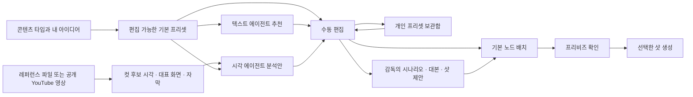

# 레퍼런스로 만드는 제작 프리셋

## 기존 제작실에서 이어지는 것

감독 에이전트에는 작품 형식 6개, 형식별 이야기 구성, Higgsfield 촬영 지침, 인물 상태·샷·키프레임·프리비즈를 연결하는 기능이 있었다. 영상 첨부는 대표 프레임과 내장 자막을 전달했다. 한 크리에이터가 레퍼런스에서 발견한 편집과 연출을 여러 작품에서 선택해 반복 사용하는 흐름을 추가한다.

## 제작 흐름

### 제작자가 결정하는 세 가지

1. **무엇을 만들까.** 타입은 영상의 목적과 제작 노드를 정한다. 같은 세로 영상이라도 인플루언서는 진행자 일관성과 시연, 숏드라마는 인물의 욕망과 다음 회의 갈등, 공모전은 심사 기준과 제출 규격이 우선이다. 공모전 원문과 아이디어는 기존 공모전 기획에서 결합한다.
2. **어떻게 보여줄까.** 전개, 컷 리듬, 구도, 카메라, 감정 연기, 필름과 조명, 자막, 화면 배치, 음향을 따로 편집한다. 예를 들어 레퍼런스의 질문형 훅과 제품 클로즈업까지의 간격을 유지하면서 진행자, 사례, 대사와 결말은 내 콘셉트에 맞춰 쓸 수 있다. 제작자는 이 중 일부만 선택해 변형할 수 있다.
3. **어떤 노드로 시작할까.** 수동 경로는 즉시 연결된 기본 보드를 만든다. 감독 경로는 같은 프리셋과 사용자의 콘셉트로 실제 작품의 아이디어·시나리오·대사·샷을 채운 제안을 반환한다. 검토 뒤 반영하고 선택한 샷의 지도·시선·행동·사운드를 노드에서 다시 조정한다.

## 설계와 인수 기준

| 제작 타입 | 첫 기획에서 답할 질문 | 타입별 보드에서 다룰 자료 |
| --- | --- | --- |
| AI 인플루언서 | 이 진행자를 다음 영상에서도 알아볼 단서는 무엇인가 | 인플루언서 바이블, 반복 화법과 시연 대본 |
| 공모전 | 심사 기준을 어느 장면에서 증명하고 어떤 규격으로 납품하는가 | 공식 요강, 심사 기준과 근거표, 제출 규격. 요강 연결 전에는 아이디어 보드로 시작 |
| 숏폼 | 첫 화면의 질문에 어느 컷이 답하는가 | 첫 훅, 세로 안전 영역, 컷별 자막 대본 |
| 숏드라마 | 한 회차에서 무엇이 뒤집히고 다음 화로 무엇을 남기는가 | 회차 설계, 감정 비트와 회차 훅 |
| 드라마 | 누구의 선택이 다음 인물의 감정과 행동을 바꾸는가 | 관계와 감정선, 씬 사이의 의상·소품·시선 연속성 |
| 영화 | 각 막의 전환을 이미지나 소리로 어떻게 느끼게 하는가 | 영화 시각·음향 설계, 반복 모티프와 공간 축 |
| 광고 | 어떤 상품 가치를 화면에서 확인할 수 있는가 | 시연 근거와 CTA, 상품 상태 참조 |
| 뮤직비디오 | 어느 음악 구간에서 이미지나 카메라의 리듬이 바뀌는가 | 음악 구조, 구간별 컷과 비트 맵, 퍼포먼스 |
| 모션그래픽 | 메시지를 어느 순서로 읽히게 하고 움직임을 어디에 쓰는가 | 모션 디자인 보드, 화면 계층과 자막 타이밍 |
| 애니메이션 숏 | 인물의 어떤 키 포즈가 상황을 이해시키는가 | 스타일 시트, 포즈·배경·애니매틱 |

| 단위 | 요구 기능 | 검증할 행동 |
| --- | --- | --- |
| 타입과 스타일 | 콘텐츠 유형과 스타일을 독립적으로 수정한다 | 같은 영화에 두 가지 자막·렌즈 조합을 적용하고 서로 다른 초안을 보존한다 |
| 분석 | 파일 또는 읽을 수 있는 공개 YouTube 영상에서 시각 증거를 확보한다 | 시각과 스틸을 대조할 수 있다. 접근 실패한 영상에는 파일 업로드 경로를 안내한다 |
| 추천 | 선택한 에이전트가 현재 콘셉트 또는 레퍼런스를 바탕으로 편집 가능한 제안을 반환한다 | 잘못된 응답은 저장되지 않는다. 검토 전까지 편집본은 유지된다 |
| 개인 보관함 | 이름·타입별로 다시 사용할 수 있는 프리셋을 저장·수정·복사한다 | 새 프로젝트에서도 불러온다. 충돌하는 두 번째 저장은 이전 편집을 덮어쓰지 않는다 |
| 감독·노드 | 선택한 기법과 스타일이 기획 요청, 새 보드와 노드 지침으로 이어진다 | 노드 배치만으로 이미지·영상 생성 작업이 실행되지 않는다 |

### 관찰과 제안

분석 화면에서 보이는 타임코드는 레퍼런스의 시간이다. 제작자가 새 작품에 사용할 길이와 비트는 편집 가능한 제안이다. 파일의 화면비와 대표 화면은 확인할 수 있지만 외관만으로 실제 카메라 모델, 필름 스톡이나 감정의 원인을 식별하기는 어렵다. 그런 값은 후보 또는 미확인으로 기록한다. 인기 영상에서 발견한 방식은 아이디어와 실험의 출발점이다. 조회수나 완성 품질은 이 기능의 예측 지표에 포함하지 않는다.

프로젝트 첨부와 에이전트 실행에는 원본 근거를 보관한다. 공용 보관함에는 사용자가 저장한 제작 지시와 텍스트 근거를 넣는다. 새 제작에서 참조 원본을 모델 입력으로 쓸 때에는 해당 프로젝트에서 별도로 첨부한다.

## 예시 · 같은 편집 리듬으로 다른 쇼츠 만들기

오래된 운동화를 복원하는 30초짜리 쇼츠에서 첫 3초의 결과 미리보기, 3~21초의 손 작업, 21~27초의 전후 비교, 마지막 3초의 관객 질문을 관찰했다고 가정한다. 프리셋에는 구간 끝을 10·70·90·100%로 저장한다. 각 구간에 결과 클로즈업, 손을 따라가는 오버헤드, 좌우 분할, 눈높이 정면 같은 구도를 기록한다. 자막에는 원본 문장 대신 첫 줄 길이, 강조할 단어와 비교 화면에서 피할 영역을 쓴다.

새 작품의 콘셉트를 ‘낡은 카세트 플레이어 수리’로 바꾸면 감독은 같은 리듬 위에 재생 버튼, 벨트 교체, 첫 음악, 다음 수리품에 대한 질문을 배치할 수 있다. 영화 버전이라면 첫 음악을 듣는 인물의 반응을 길게 잡고 자막을 줄인 복사본을 저장한다. 예시의 시각과 비트는 사용법을 보여주기 위해 정한 값이다.

## 현재 분석 범위

- MP4·WebM 파일, 공개 YouTube와 프로젝트 영상을 최대 8편 분석한다. 영상 한 편은 1 GiB·60분까지 지원한다. YouTube는 인증 없이 접근 가능하고 다운로드 조건을 충족해야 한다. 한 편의 상세 분석은 최대 96개 화면을, 여러 편의 비교는 최대 8개 시트를 영상별로 나눠 전달한다. 10분을 넘는 영상은 로컬 음성 전사를 건너뛰고 내장 또는 공개 자막을 활용한다.
- 초당 10개 화면에서 급격한 전환을 탐지한다. 제작실 미리보기와 별도로 컷별 중앙·시작/끝 부근 및 컷 내부 시각에서 최대 96개 표본을 골라 번호와 원본 시각이 표시된 시트 최대 8장으로 분석한다. 컷 번호로 원본을 탐색하고 놓친 경계를 직접 보정하거나 컷 구간을 골라 분석 밀도를 높일 수 있다. 컷 후보에서 구간을 나누면 최대 24개 비트로 편집할 수 있다.
- macOS에서는 Vision이 표본 화면에서 한국어·영어 문자와 위치를 찾는다. 간판, 로고, 자막의 역할은 화면 맥락으로 확인한다. 내장 자막이나 YouTube 제공·자동 자막에 출처를 표시한다. 자막이 없고 로컬 모델이 설정된 환경에서는 Whisper의 구간별 전사를 사용할 수 있다.
- 카메라 연속 궤적, 실제 렌즈나 필름 종류, 모든 자막의 등장·퇴장 시각과 정확한 단어별 타이밍은 표본만으로 확정하기 어렵다. 분석안의 구도·렌즈·필름은 사용자가 선택하고 수정할 수 있는 연출 지시다.

## 후속 우선순위

1. **내 결과와 프리셋 비교.** 같은 분석기로 완성본을 읽어 컷 길이 분포, 초반 훅, 자막 안전 영역의 차이를 나란히 보여주면 재생성이 필요한 샷만 고를 수 있다.
2. **말·음악 기준 편집.** 시간 구간 전사를 단어에 정렬하고, 표본 화면 사이에서 자막의 출현·퇴장 시각을 추적하며, 음악 비트를 추정하는 작업에 우선순위를 둔다. 음성이 빠른 쇼츠는 이 데이터가 추가될 때 구간 매칭이 정밀해진다.
3. **여러 레퍼런스에서 공통 패턴 추출.** 채널 영상 몇 편의 공통 훅·화면 구성과 개별 장면을 구분해 시리즈 프리셋을 만들고, 제작자가 어떤 특징을 가져올지 선택하게 한다.

저장소별 채택 근거와 라이선스는 [기술 검토](reference-production-research.md), 제공 영상과 프롬프트 자료의 구간별 적용점은 [11가지 연출 기법](cinematic-techniques.md)에 있다.
