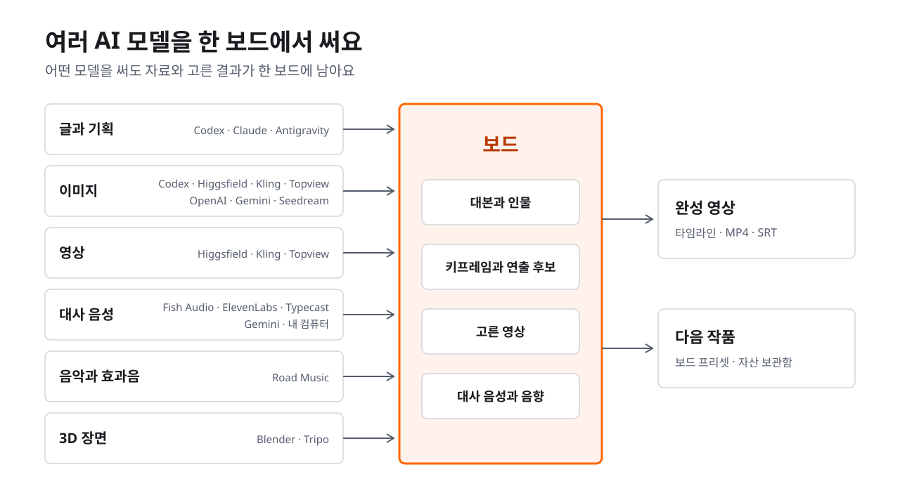
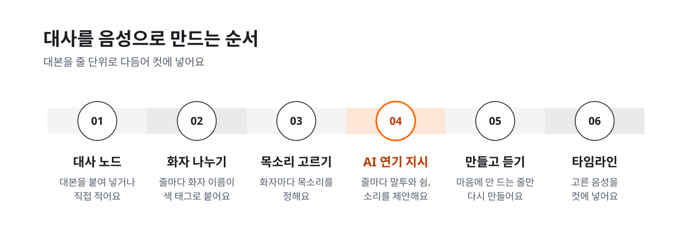

# Omni AI Canvas 사용 가이드

아이디어부터 대본, 참조 이미지, 장면 영상과 편집까지 한 프로젝트에서 이어가는 방법을 소개합니다. 처음이라면 **마지막 상영** 예제부터 열어 보세요. 원하는 도구가 정해져 있다면 아래 목차에서 바로 찾아갈 수 있습니다.

- [시작하기](#시작하기) · [화면 구성](#화면-구성) · [프로젝트와 제작 형식](#프로젝트와-제작-형식)
- [캔버스와 노드](#캔버스와-노드) · [감독과 에이전트](#감독과-에이전트) · [제작 지침](#제작-지침)
- [공모전 기획](#공모전-기획) · [레퍼런스와 스타일 프리셋](#레퍼런스와-스타일-프리셋)
- [이미지와 캐릭터 연출](#이미지와-캐릭터-연출) · [영상과 클립](#영상과-클립) · [3D와 프리비즈](#3d와-프리비즈)
- [모션그래픽](#모션그래픽) · [대사와 음성](#대사와-음성) · [음악과 효과음](#음악과-효과음) · [타임라인과 내보내기](#타임라인과-내보내기)
- [계정과 비용](#계정과-비용) · [저장과 프로젝트 관리](#저장과-프로젝트-관리) · [문제가 생겼을 때](#문제가-생겼을-때) · [문서와 추가 안내](#문서와-추가-안내)

## 시작하기

Node.js 22.13 이상, npm, Neon 데이터베이스를 준비합니다. 영상 작업에는 FFmpeg와 ffprobe도 필요합니다. 프로젝트 루트에서 `.env.example`을 `.env`로 복사하고 데이터베이스 주소를 채운 뒤 다음 명령을 실행하세요.

```sh
npm ci
npm run setup:check
npm run db:migrate
npm run dev
```

브라우저에서 [Omni AI Canvas](http://127.0.0.1:5050/)를 열고 **캔버스 열기**를 누릅니다. 설치 점검은 파일과 설정 여부를 보여 줍니다. 계정 연결과 실제 모델 이용 가능 여부는 작업실에서 확인합니다. 선택 기능의 준비물과 운영 모드는 [새 환경 설치와 배포 준비](release-setup.md)에 정리했습니다.

### 〈마지막 상영〉 예제 둘러보기

1. 제작실의 프로젝트 메뉴에서 **마지막 상영**을 엽니다.
2. 기획에서 대본과 캐릭터 시트로 나뉘고, 두 자료가 키프레임으로 이어지는 연결선을 확인합니다.
3. 키프레임을 선택해 이미지 도구를 살펴보고, 영상 노드의 5초 샘플을 재생합니다.
4. 각 노드를 선택하면 오른쪽 작업 패널에서 본문과 참조, 지침, 실행 기록을 볼 수 있습니다.



## 화면 구성

| 위치 | 할 수 있는 일 |
| --- | --- |
| 상단 | 프로젝트 관리, 저장 상태 확인, 내보내기, 설정, 사용 가이드 열기 |
| 왼쪽 노드 추가 | 기획, 시나리오, 씬, 대본, 샷, 캐릭터, 참조, 키프레임과 영상 등 추가 |
| 도구함 | 제작 키트와 캔버스 목록, 자산 탐색. 노드를 찾거나 보관한 결과를 다시 사용 |
| 가운데 캔버스 | 자료를 노드로 배치하고 연결. 검색, 확대·축소, 미니맵, 선택, 자동 정렬과 실행 취소 |
| 제작 도구 | 레퍼런스 분석, Blender, Tripo, Higgsfield 워크플로우, 모션그래픽, 캐릭터 연출, 자산 보관함, 타임라인, 감독 도구, 클립 편집, 공모전 기획 |
| 오른쪽 작업실 | 대화, 제작, 노드, 지침, 기록. **가이드**에서 첫 제작 순서를 보고, **탭 사용법**에서 현재 탭의 조작과 문제 해결 방법을 확인합니다. |

모바일에서도 제작실의 주요 작업을 할 수 있습니다. 좁은 화면에서는 도구함과 작업 패널을 열고 닫으며 캔버스를 사용합니다.

## 프로젝트와 제작 형식

상단 프로젝트 메뉴에서 새 프로젝트를 만들거나 기존 프로젝트를 엽니다. **무형식**으로 시작하면 필요한 노드를 직접 구성할 수 있습니다. 제작 형식을 고르면 용도에 맞는 기본 보드와 추천 지침을 준비합니다.

| 제작 형식 | 시작할 때 살펴볼 내용 |
| --- | --- |
| AI 인플루언서 | 인물의 외형과 캐릭터 상태, 이미지와 연출 |
| 공모전 | 공고와 아이디어, 출품용 기획과 장면 |
| 숏폼 | 짧은 영상의 훅과 구간별 연출 |
| 숏드라마 | 회차의 갈등과 감정 변화, 씬과 샷 |
| 드라마 | 인물 관계와 대사, 장면 구성 |
| 영화 | 이야기와 씬, 샷·카메라·프리비즈 |
| 광고 | 상품과 참조, 시연 샷과 영상. Higgsfield 패션 광고 워크플로우 선택 가능 |
| 뮤직비디오 | 곡의 구간과 영상, 퍼포먼스와 편집 |
| 모션그래픽 | 문구와 수치, 장면별 움직임과 로컬 렌더 |
| 애니메이션 숏 | 캐릭터·배경과 샷, 3D 장면과 프리비즈 |

씬 수는 **자동**이나 1~12개를 선택할 수 있습니다. 자동으로 시작하면 공통 기획 노드를 준비하고 감독 기획에서 씬 수를 제안받아 검토합니다. 형식을 바꾸거나 해제해도 편집한 노드와 자산은 보존됩니다.

반복할 구조가 있다면 **프리셋 저장**에서 보드 전체나 선택한 노드를 저장하세요. 새 프로젝트에는 구조와 지침이 적용됩니다. 원래 작품의 본문과 미디어, 실행 정보는 새 보드에 복사되지 않습니다. 영상의 구간과 촬영 기법을 저장하는 **스타일 프리셋**은 아래의 레퍼런스 분석에서 관리합니다.

## 캔버스와 노드

1. 왼쪽에서 종류를 고르거나 캔버스의 **노드 추가**를 누릅니다. 빈 곳의 작업 메뉴에서 파일을 가져오거나 붙여넣을 수도 있습니다.
2. 카드를 이동하고 포트의 **＋**에서 기존 자료를 연결하거나 후속 노드를 만듭니다.
3. 연결한 자료의 역할을 정합니다. 예를 들어 인물 외형, 장소, 소품 상태, 동작, 시작·끝 프레임과 색감·질감 등을 지정할 수 있습니다.
4. 외부 모델에 보낼 자료는 **생성에 전송**, 동선이나 배치 확인에만 사용할 자료는 **연출 확인용**으로 둡니다. 실행 전 전송 목록을 확인하세요.

캔버스 검색과 미니맵으로 큰 보드를 탐색합니다. 배치 최적화는 노드 사이에 간격을 확보하며 실행 취소로 이전 배치를 복원할 수 있습니다. 작업 메뉴에서 노드를 복사·복제·그룹화하고 자산으로 저장할 수 있습니다. 트랙패드에서 두 손가락으로 스크롤하면 화면이 움직이고, 벌리거나 오므리면 확대·축소됩니다.

### 문서 노드

기획, 시나리오, 씬, 대본, 샷 같은 문서형 카드의 책 아이콘을 누르면 본문을 읽고 편집합니다. 마크다운 제목·표·목록을 확인하고 저장하며, 개별 문서를 Markdown이나 PDF로 내보낼 수 있습니다. PDF 내보내기에는 Chrome 또는 Chromium 계열 브라우저가 필요합니다.

## 감독과 에이전트

### 이야기에서 제작안 만들기

1. 노드 선택을 해제하고 작업실의 **제작** 탭에서 기획 방식을 고릅니다.
2. 작품 형식, 씬 수, 사용 가능한 계정과 모델을 고릅니다. 이야기의 인물, 갈등과 분위기를 입력합니다.
3. 필요한 문서·이미지·영상·공개 HTTPS 링크를 첨부하고 전송 내용을 확인합니다.
4. 제작안의 기획, 시나리오, 캐릭터, 씬·샷과 연결을 미리 봅니다. 검토 후 필요한 결과를 적용합니다.
5. 전체 대본·연출을 검토하거나 특정 씬만 선택해 검토 의견을 받을 수 있습니다.

프로젝트 대화는 선택 노드와 별개로 작품 전체를 논의할 때 사용합니다. 노드를 선택하고 요청하면 그 자료의 글을 고치거나 이미지·영상을 만듭니다. 제안은 확인한 뒤 적용합니다. 서비스별 첨부 형식과 크기, 이미지 처리 범위는 [제작 에이전트 사용 가이드](production-agent-guide.md#에이전트에-자료-첨부)를 확인하세요.

## 제작 지침

작업 패널의 **지침**에서는 노드에 적용되는 기본 지침과 스킬 출처, 작업 순서를 확인합니다. 제작 형식별 추천을 적용하거나 필요한 지침을 골라 수정하고 저장할 수 있습니다. 수정 제안도 검토 후 반영합니다. 선택한 지침은 작업 요청 당시의 입력과 함께 보관됩니다.

프로젝트에는 제작에 쓰는 공식 스킬 원문과 요약 지침이 포함됩니다. 제작자 블로그의 별도 첨부 원문과 아이디어 목록은 출처에서 받은 파일을 로컬에 보관해야 열 수 있습니다. 파일 위치와 출처는 [스킬 관리](skills.md)와 [설치 안내](release-setup.md#제작자-첨부-원문)를 참고하세요.

## 공모전 기획

1. **제작 도구 → 공모전 기획**을 열고 공식 공고 URL을 입력합니다. 아이디어가 있다면 함께 적습니다.
2. 공고에서 불러온 출처와 원문, 요강 항목을 확인하고 필요한 내용을 수정합니다. 공고 목록이라면 개별 공고를 선택합니다.
3. 조회되지 않는 내용은 직접 입력합니다. 참고 요약이 나오면 확인일과 출처를 확인합니다.
4. 확인한 내용을 출품 준비 노드로 만들거나 감독 기획으로 넘깁니다. 작품 후보와 선택안, 씬·샷과 제출 계획을 검토한 뒤 적용합니다.

최종 조건과 제출 방법은 주최 측 공고에서 확인하세요. [공모전 준비 흐름](contest-workflow.md)

## 레퍼런스와 스타일 프리셋

**제작 도구 → 제작 프리셋 · 레퍼런스 분석**에서는 형식과 아이디어를 고르고 영상의 구성과 촬영 스타일을 정리합니다.

1. 프로젝트 영상, MP4/WebM 파일 또는 접근 가능한 공개 YouTube 영상을 추가합니다. 레퍼런스는 최대 8편이며 각 영상은 60분·1 GiB 이내입니다.
2. 대표 화면과 컷 후보, 사용 가능한 자막을 보고 구간 경계를 확인하거나 고칩니다. macOS 화면 문자 인식과 로컬 Whisper 받아쓰기를 골라 쓸 수 있습니다.
3. 텍스트로 아이디어 추천을 받거나 이미지 입력을 지원하는 에이전트로 대표 화면을 분석합니다. 분석 근거와 제안은 직접 확인합니다.
4. 훅, 전환, 마무리 등 구간과 기법을 편집하고 개인 스타일 프리셋으로 저장합니다. 새 프로젝트의 보드와 감독 요청에 이어 사용할 수 있습니다.

이미 만든 보드와 작업 기록에는 그때의 설정이 남아 있습니다. [스타일 프리셋 사용 흐름](style-preset-workflow.md) · [컷 분석과 로컬 제작](local-video-production.md)

## 이미지와 캐릭터 연출

이미지가 붙은 노드를 선택하면 상단에 이미지 도구가 나타납니다. 도구를 고르면 원본과 연결된 작업을 준비하고 설정을 편집할 수 있습니다.

| 도구 | 사용 방법 |
| --- | --- |
| 감정 조정 | 5×5 감정판에서 목표를 고르고 기준 표정 사진과 원본을 함께 확인 |
| 조명 효과 | 광원 가이드와 프리셋으로 주광 방향을 조정하고 림라이트 확인 |
| 다각도 | 원본을 기준으로 카메라 시점과 구도를 정리 |
| 캐릭터 설정도·시트 | 캐릭터 참조와 여러 컷 구성을 준비하고 생성 결과 검토 |
| 이미지 분할 | 시트의 경계를 보정하고 필요한 칸을 이미지로 분리해 영상 입력에 연결 |
| 레이어 편집·업스케일 | 원본에서 파생된 레이어나 확대 결과를 작업에 사용 |
| 주석·회전·미리보기·내려받기 | 이미지를 확인하거나 로컬 편집 결과와 원본을 보관 |

연출 설정은 저장해 다시 열 수 있으며 생성 전 계정과 조건을 확인합니다. 원본과 후보를 확대해 비교하고 필요한 결과를 채택하세요. [이미지 편집기 사용과 설계](image-node-editor-design.md)

**감독 도구**에서는 카메라 구도, 렌즈·조명 지시, 배우와 소품의 위치를 계획합니다. 배치도는 샷의 연출 확인용 자료로 보관합니다. 이미지 자르기·회전·색상 조정 결과도 새 참조로 만들 수 있습니다. **캐릭터 연출 키트**는 인물 참조와 표정·시점 등의 작업을 준비할 때 사용합니다.

캐릭터 시트를 선택하고 노드 탭의 **외형과 목소리 설정**을 엽니다. 기존 Soul을 불러오거나 **새 Soul 캐릭터 학습**에서 같은 인물의 이미지 5~20장을 선택합니다. 학습 상태가 준비됨이면 **Soul 기준 이미지 만들기**로 이미지를 만든 뒤 기록에서 시트에 적용합니다. 시트를 영상 노드에 **인물 외형**으로 연결한 다음 참조를 지원하는 영상 모드를 선택합니다.

| Soul 유형 | 선택 기준 | 예시 |
| --- | --- | --- |
| **Soul 2.0** | 인물 사진의 스타일, 의상, 분위기를 다양하게 탐색할 때 | 캐스팅 프로필, 패션 룩북, 여러 스타일의 캐릭터 기준 사진 |
| **Soul Cinematic** | 영화풍 조명과 질감을 살려 장면의 분위기를 잡을 때 | 감정 클로즈업, 드라마 장면 스틸, 영상 시작 프레임 |

두 모델에서 만든 이미지를 모두 영상 참조로 사용할 수 있습니다. 캔버스의 **Soul 기준 이미지 만들기**는 시트에 저장한 유형에 맞춰 이미지 모델을 선택합니다. Higgsfield 웹에서 Soul Cinematic은 **Soul Cinema**로 표시됩니다. [Higgsfield 공식 모델 비교](https://higgsfield.ai/creator-hub/help-center/ai-models/how-do-i-use-soul-cinema)

**왼쪽 제작 키트 → 제작 도구 → TTS 등록 샘플 만들기**를 열고 샘플을 받을 캐릭터를 고릅니다. 상단 **제작 도구** 목록과 캐릭터 노드에서도 이 화면을 열 수 있습니다. 서비스별 목록에서 목소리를 고르면 그 행에서 제공 샘플을 들을 수 있습니다. 제공 샘플이 없는 목소리는 **짧게 합성**으로 확인합니다. **음성 생성**으로 등록용 대사를 읽히고 **캐릭터에 샘플 추가**를 누릅니다.

캐릭터 시트의 **외형과 목소리 설정 → Higgsfield 개인 목소리 등록**에서 저장한 샘플을 듣고 등록합니다. 사용 권한이 있는 MP3·WAV 녹음 파일도 선택할 수 있습니다. 작업실 MCP에서 등록을 지원하지 않으면 샘플을 내려받아 Higgsfield Audio에서 등록하고 돌아와 목소리 목록을 다시 불러옵니다. [계정 연결과 과금](providers.md#캐릭터-외형과-목소리-등록)

### 디렉터 스튜디오에서 촬영 기법 고르기

이미지·영상 제작 노드에서 **디렉터 스튜디오**를 엽니다. 구도·앵글, 화면 배치·시선, 카메라 이동·시간, 창의 시점의 예제를 보고 카드를 고르세요. 카메라 이동은 카드에 마우스를 올리거나 초점을 옮기면 재생됩니다. 이름이나 **긴장**, **여백** 같은 낱말로 검색할 수 있습니다.

카메라, 렌즈와 조리개는 같은 장면을 그 장비로 찍은 결과 사진입니다. **기준 사진과 비교**를 누르면 왼쪽에 기준, 오른쪽에 결과가 나옵니다. 사진은 효과를 설명하는 예시이며 실제 결과는 생성 모델에 따라 다릅니다.

고른 연출은 창 아래에 모입니다. **생성 요청에 적용할 내용**을 펼치면 실제로 보낼 지시를 확인할 수 있고, 서로 맞지 않는 선택은 안내가 나옵니다. **연출 적용**을 누르면 노드에 저장합니다. 정지 이미지 요청에는 카메라 이동·시간 표현·편집 리듬을 보내지 않습니다.

기본 예제 외에 CineGuide 예제를 이 컴퓨터에서 보려면 프로젝트 폴더에서 `npx tsx scripts/director-references.ts`를 실행합니다. 파일은 `.scene-room/research/cineguide`에만 저장합니다. 이용 조건은 원본 사이트에서 확인하고 공유하지 마세요.

## 영상과 클립

키프레임을 영상 노드의 시작 프레임으로 연결하고, 선택한 서비스와 모델이 지원하는 참조 슬롯을 확인해 생성합니다. 직접 만든 파일이나 외부 결과도 노드에 첨부할 수 있습니다. 결과는 재생해 검토한 뒤 채택합니다.

영상 또는 음향 노드의 **미디어 도구**에서는 구간과 속도를 조절하고 프레임, 3×3 콘택트 시트 또는 음향을 추출해 새 노드에 넣을 수 있습니다. 선택 구간과 결과는 각각 최대 2분, 파일은 64 MiB 이하여야 합니다.

Higgsfield Seedance의 영상 리메이크와 이어쓰기에는 원본 영상 참조가 필요합니다. 그 모드의 입력 조건과 실제 비용은 선택한 서비스에서 확인하세요. [영상 생성과 참조](production-agent-guide.md#참조와-영상-생성)

## 3D와 프리비즈

**제작 도구 → Blender 3D 장면**에서 프로젝트의 캐릭터·배경 GLB를 등록하고 샷에 배치합니다. 모델의 본과 동작을 확인하고 포즈, 카메라, 조명, 길이와 화면비를 정할 수 있습니다. 로컬 Blender로 프리비즈와 최종 테이크를 렌더한 뒤 타임라인에 연결하세요. 특정 프레임을 후속 샷의 배치 참조로 사용할 수도 있습니다.

**Tripo 3D 리깅·동작**에서는 모델과 작업 상태를 조회하고, 지원하는 리깅과 동작 작업을 요청해 완성된 GLB를 프로젝트로 가져옵니다. Tripo 작업에는 계정의 이용 조건이 적용됩니다. [Blender와 Tripo 사용 범위](blender-tripo-production.md)

## 모션그래픽

**제작 도구 → 모션그래픽 스튜디오**에서 대본이나 씬의 문구를 가져오거나 새 장면을 만듭니다. 제목, 보조 문구, 길이와 색을 정하고 레시피에 따라 이미지·수치·단계를 입력합니다.

키네틱 타이포, 숫자와 진행 차트, 단계 설명, 카드 스토리, 이미지 깊이 연출, 캐릭터 컷아웃을 사용할 수 있습니다. 장면을 로컬에서 렌더해 MP4로 합친 후 영상 노드에 추가합니다. 저장된 장면 명세를 다시 열어 수정하고 새 테이크를 만들 수 있습니다. [모션그래픽 레시피](local-motion-recipes.md)

## 대사와 음성



### 녹음하거나 불러오기

배역별 대사는 음향 노드의 **캐릭터 목소리 녹음**에서 받습니다. 마이크 권한을 허용하고 최대 60초를 녹음한 뒤 미리 듣기에서 확인해 음향 노드에 첨부합니다. 갖고 있는 음성 파일도 음향 노드에 첨부할 수 있습니다.

### 목소리를 골라 만들기

1. **작업실 설정 → API 키**에서 Fish Audio, ElevenLabs, Typecast 또는 Gemini TTS를 연결합니다. 로컬 모델만 쓸 때는 건너뜁니다.
2. 대본·시나리오·음향 큐에서 **대사 음성 만들기**를 열고 읽을 대사를 편집합니다.
3. 목소리를 검색해 공개된 샘플을 듣습니다. 샘플이 없으면 **짧게 합성**으로 발음을 확인합니다.
4. **음성 생성**을 누르고, 완성한 음성을 내려받거나 음향 큐로 적용합니다.

API로 만들면 그 서비스 계정의 사용량이 늘어납니다. [음성 제작과 과금](tts-studio-design.md)

### 이 컴퓨터에서 만들기

Apple Silicon Mac에서 `npm run setup:local-tts`를 실행하면 API 사용량 없이 만들 수 있습니다. 먼저 [uv](https://docs.astral.sh/uv/)를 설치하세요. 이미 받은 S2 Pro가 있으면 `npm run setup:local-tts -- <s2-pro 폴더>`로 다시 씁니다.

| 하고 싶은 일 | 방법 |
| --- | --- |
| 공개된 목소리 따라 하기 | Fish Audio 목소리를 고른 뒤 **생성 모델**에서 로컬 모델을 선택 |
| 내 음성 따라 하기 | 음성 서비스에서 **내 음성 · 로컬 무료**를 고르고 캐릭터 샘플이나 프로젝트 음향을 참조로 선택 |
| 참조 없이 새 목소리 | **새 목소리 만들기**에서 성별·나이대·음색 선택 (Drama 3) |
| 감정과 소리 지시 | **감정과 말투**, **대사에 넣을 소리와 쉼**, **말을 감싸는 지시**를 조합 |
| 길이 맞추기 | **목표 길이**로 대사를 늘여 말하게 하기 (Drama 3) |
| 같은 목소리로 다시 | 만든 음성에서 **다시 연기**를 눌러 대사나 말투를 바꾸기 |
| 같은 결과 다시 쓰기 | **이 설정과 시드 쓰기**를 누르거나 음성을 캐릭터에 저장해 다음 참조로 쓰기 |

참조 음성을 쓸 때는 사용 권한을 확인한 뒤 생성합니다. 진행률과 남은 시간이 나오고, 오래 걸리면 **생성 취소**로 멈춥니다. S2 Pro 결과는 연구와 비상업 용도로만 쓸 수 있습니다. [서비스별 조건](providers.md)

### 여러 화자 대화 만들기

1. 대본의 **대사 음성 만들기**에서 **여러 화자 대화**를 고릅니다. `화자: 대사` 줄을 읽어 화자를 나눕니다.
2. 화자는 색 태그로 구분합니다. 태그를 누르면 그 인물의 줄만 강조합니다. 화자별 목소리를 고르고 들어 봅니다.
3. 줄을 누르면 그 자리에서 고치고 **지시 넣기**로 소리와 말투를 고릅니다. 한꺼번에 고칠 때는 **글로 편집**을 엽니다.
4. **AI로 연기 지시 넣기**를 누르면 대본에 맞는 쉼·소리·말투를 넣고 이유를 보여 줍니다. 대사는 바뀌지 않으며 줄마다 되돌릴 수 있습니다.
5. **대화 만들기**를 누릅니다. 줄마다 듣거나 다시 만들고, 고친 뒤에는 **바뀐 줄 만들기**로 그 줄만 새로 만듭니다.
6. **음향 큐로 추가**하면 대본에 연결됩니다.

### 등록한 목소리로 내레이션 만들기

음향 큐에서 **VO 화자**를 고른 뒤 **등록 목소리로 VO 만들기**를 엽니다. `[VO]`가 적힌 큐는 그 대사를 발화란에 채웁니다. **캐릭터 음성 생성**을 누르고 실행 기록의 결과를 같은 큐에 적용합니다. 얼굴 이미지와 음성을 함께 쓰는 영상에는 캐릭터 시트와 적용된 음향 큐를 연결하고 이미지·음향 참조를 받는 모드를 선택하세요.

## 음악과 효과음

음향 큐에 갖고 있는 파일을 가져오거나 **Road Music**을 연결해 로컬 음악 엔진으로 음악, 효과음, 환경음을 준비합니다.

1. [Road Music](https://github.com/roadkwonai/music-road)을 설치하고 사용할 엔진을 준비합니다. Omni AI Canvas의 `.env`에서 `ROAD_MUSIC_HOME`을 Road Music 설치 폴더로 지정합니다.
2. 음향 노드의 에이전트 작업에서 ACE-Step, YuE MLX 또는 YuE와 작업 목적을 고르고 분위기와 목표 길이를 입력합니다. 효과음과 환경음은 ACE로 만듭니다.
3. 생성된 음원을 듣고 확인합니다. 원본은 Road Music에 남으며 작업실에는 사본이 저장됩니다.
4. 타임라인에서 음향 노드의 시작 시점, 길이와 음량, 페이드를 조절합니다.

YuE 음악 기획·가사·검수 스킬은 [Road Music 음악 스킬 저장소](https://github.com/roadkwonai/music-road-music-skills)와 프로젝트에 동봉된 `yue-music`을 참고합니다. 엔진의 설치와 지원 플랫폼, 실제 생성 가능 여부는 로컬 Road Music에서 확인하세요. [서비스 안내](providers.md)

## 타임라인과 내보내기

1. **제작 도구 → 타임라인**을 열고 화면비를 선택합니다.
2. 컷을 추가해 프로젝트의 이미지나 영상을 고릅니다. 순서, 원본 시작점, 길이와 하드컷·디졸브 전환을 조정합니다.
3. 음향 레이어를 추가하고 시작과 길이, 음량과 페이드를 정합니다. 단어 자막을 편집해 필요할 때만 넣을 수 있습니다.
4. 저장 후 미리보기와 납품본을 만들 수 있습니다. 확인한 납품본을 프리비즈 노드에 반영합니다.

타임라인에는 최대 7분, 60컷, 음향 큐 40개까지 넣을 수 있고 출력 파일은 64 MiB 이하여야 합니다. 인접 테이크 사이의 **렌즈 전환**에서는 선택한 윤곽을 프레임별로 추적하고 보정한 뒤 결과를 적용하거나 다시 편집할 수 있습니다. [타임라인 안내](timeline.md) · [렌즈 전환](higgsfield-fashion-ad-workflow.md#로컬-렌즈-전환)

상단 **내보내기**에서는 선택한 영상 노드를 순서대로 합쳐 MP4를 만듭니다. 최대 10컷, 합계 2분입니다. 프로젝트 구조는 JSON으로 내보낼 수 있습니다.

## 계정과 비용

상단 **설정**에서 작업별 기본 에이전트와 모델, 작업 공간 배치, 계정 연결 상태를 관리합니다. 노드에서 따로 고른 설정이 있으면 그 작업에는 그 설정을 먼저 씁니다. 모델과 입력 조건, 예상 사용량이 화면에 나오면 실행하기 전에 확인하세요.

| 계정·도구 | 연결 방식 |
| --- | --- |
| ChatGPT · Codex | 로컬 Codex CLI의 구독 계정. 텍스트와 이미지 작업 |
| Claude | 로컬 Claude Code 계정. 기획과 텍스트 작업 |
| Antigravity | 프로젝트 MCP 연결. 직접 텍스트 실행은 개인 계정 경로를 확인해 별도로 활성화 |
| Higgsfield · Kling | 공식 CLI 계정. 모델과 계정별 크레딧 조건 확인 |
| Topview | 제작실의 공식 OAuth MCP 연결 |
| OpenAI · Gemini · Seedream 이미지 API | 키를 등록하고 작업실 설정에서 따로 결제하는 API를 허용 |
| Road Music | `ROAD_MUSIC_HOME`으로 지정한 로컬 앱과 설치된 엔진 |
| Tripo | 공식 API 계정과 키. 유료 작업의 제출 여부 확인 |

연결과 견적을 조회하는 것과 실제 생성은 다른 단계입니다. 이미지·영상 생성의 모델과 지원 범위는 서비스 계정에 따라 달라집니다. [계정과 서비스별 안내](providers.md)

## 저장과 프로젝트 관리

작업 중에는 상단의 저장 상태를 확인합니다. 저장 실패나 충돌이 표시되면 안내에 따라 다시 저장하거나 현재 작업을 JSON으로 내보낸 뒤 최신 프로젝트를 확인하세요. 실행 결과를 적용할 때도 현재 보드와 요청 당시의 상태를 확인합니다.

프로젝트 관리에서는 제목, 카테고리와 태그를 정하고 검색·복제·보관·휴지통 이동을 할 수 있습니다. 자산 보관함은 현재 프로젝트의 미디어와 생성 결과, 직접 저장한 자산을 다시 쓸 때 사용합니다. 스타일 프리셋과 보드 프리셋은 용도에 맞게 저장하고 새 작업에서 고릅니다.

프로젝트 보드와 실행 기록은 Neon에, 업로드·생성 미디어는 로컬 `.scene-room/media/`에 보관됩니다. 다른 컴퓨터로 옮길 때는 데이터와 미디어를 함께 백업하세요. 계정 키와 개인 작업물은 로컬 설정에 보관합니다. [아키텍처와 보관 경계](architecture.md)

## 문제가 생겼을 때

| 증상 | 확인할 것 |
| --- | --- |
| 설치 점검에서 파일이나 모듈이 없다고 나온다 | `npm ci`를 다시 실행하고 `npm run setup:check`로 확인합니다. |
| 계정은 로그인했는데 모델이 보이지 않는다 | **작업실 설정 → 계정 연결**에서 **연결 상태 새로고침**을 누릅니다. |
| 저장 충돌이 표시된다 | 현재 작업을 JSON으로 내보낸 뒤 저장된 최신 프로젝트를 확인합니다. |
| 요청이 대기 상태로 멈춰 있다 | 기록 탭의 **대기 작업 시작**을 누르거나 `npm run worker -- --drain <프로젝트-UUID>`를 실행합니다. |
| 제출됐는지 확실하지 않다 | 같은 요청을 다시 보내기 전에 실행 기록의 작업 번호와 서비스의 작업 목록을 확인합니다. 중복 결제를 막기 위해서입니다. |
| 로컬 목소리 모델이 목록에 없다 | Apple Silicon Mac인지 확인하고 `npm run setup:local-tts`를 실행한 뒤 `npm run setup:check`에서 로컬 TTS 항목을 봅니다. |
| 영상 편집이나 내보내기에 실패한다 | `ffmpeg`와 `ffprobe`가 PATH에 있는지, FFmpeg가 5.1 이상인지 확인합니다. |
| 문서를 PDF로 내보내지 못한다 | Chrome이나 Chromium을 설치하거나 `.env`의 `NODE_DOCUMENT_CHROME_PATH`에 경로를 적습니다. |

## 문서와 추가 안내

| 더 알아볼 내용 | 문서 |
| --- | --- |
| 설치, 선택 도구, 환경 변수 | [새 환경 설치와 배포 준비](release-setup.md) |
| 음성 모델과 과금 | [음성 제작](tts-studio-design.md) · [서비스별 조건](providers.md) |
| 생성 요청과 자료 전달 | [제작 에이전트 사용 가이드](production-agent-guide.md) |
| 실제 확인한 기능과 제한 | [기능 대응표](canvas-parity.md) · [실행 검증 기록](verification.md) |
| 에이전트별 캔버스 연결 | [MCP 사용법](mcp.md) |
| 제작 스킬과 출처 | [프로젝트 스킬](skills.md) · [제작 참고자료](production-reference-map.md) |
| 전체 요구사항과 구현 경계 | [PRD](PRD.md) · [아키텍처](architecture.md) · [용어집](../glossary.md) |
