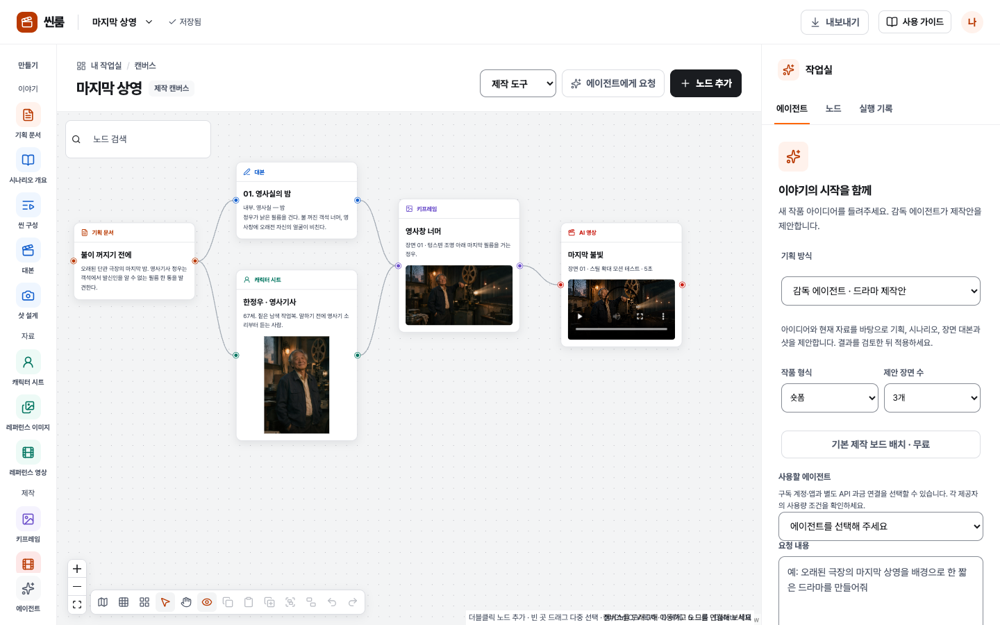

# 실행 검증 기록

2026-11-22 · 개인 로컬 환경 · Next.js 16.4.6 · Neon Postgres · 예제 프로젝트 **마지막 상영**

| 경로 | 확인한 결과 |
| --- | --- |
| 캔버스 편집 | 실제 브라우저에서 프로젝트와 노드를 만들고 제목·참조를 수정했다. 새로고침 후 첨부 이미지와 참조가 복원됐다. |
| Neon | 마이그레이션 재적용, 새 프로젝트 저장과 재조회, 오래된 버전의 저장 거절, 동일 요청의 중복 제출 방지, 작업 점유와 만료 처리, 제공자 작업 번호 보존을 검사했다. 테스트용 프로젝트는 정리했다. |
| 에이전트 기획 | 실제 ChatGPT 구독으로 Codex에 브리프를 전달해 노드 2개와 연결 1개가 포함된 그래프를 받았다. |
| 대본과 키프레임 | Claude의 실제 텍스트 결과를 확인했다. Omni AI Canvas의 이미지 실행기가 샘플 인물을 참조해 새 이미지 파일을 만들었고, 앱의 미디어 API로 2,001,831바이트를 읽었다. |
| 외부 에이전트 | stdio MCP에서 실제 로컬 API로 노드 2개와 연결 1개를 추가하고 Neon에서 변경된 버전을 다시 읽었다. 클라이언트별 설정 및 승인 상태는 [MCP 안내](mcp.md)에 기록했다. |
| 영상 | 실제 파일을 업로드해 HTTP 부분 재생을 확인했다. 서로 다른 크기·프레임률의 유음·무음 영상 2개를 순서대로 합성해 프레임 순서와 오디오를 검사했다. 모바일 UI에서 예제의 5초 MP4를 내려받았다. |
| Higgsfield | 공식 CLI로 로그인 상태, 모델과 생성 전 비용 조회를 확인했다. 참조 파일이 없는 기본 영상의 당시 견적은 35크레딧이었다. 참조를 전송해야 견적이 나오는 조합은 미확인 사유를 반환했다. |
| 화면 및 빌드 | 375px 모바일과 1280px 이상 데스크톱에서 확인했다. ESLint, TypeScript, 기본 테스트 14개, Neon 통합 테스트, 프로덕션 빌드를 통과했다. 프로덕션 서버의 예제 불러오기·영상 합성·부분 재생도 확인했다. |

검증 중 Higgsfield, Kling, TopView에 신규 유료 영상 생성을 제출하지 않았다. Kling과 TopView의 현재 계정 OAuth 및 생성 성공은 미검증이다. Antigravity의 선택적 직접 실행은 모의 CLI로 검증했고 프로젝트 기본 경로는 MCP다. 참조 영상과 두 서비스의 로그인 화면에서 확인한 범위는 [레퍼런스 조사](research.md)에서 볼 수 있다.

## 제작 감독 · 캔버스 편집기 · 첨부 수용 검사

2026-11-22 로컬 운영 환경에서 생성 및 전달 경로를 구분해 확인했다.

| 검사 | 확인한 결과 |
| --- | --- |
| 모델 지정과 감독 기획 | 실제 ChatGPT 구독의 Codex 모델을 지정해 두 씬의 대본·샷·참조를 구성했다. 브라우저에서 승인해 노드 17개·연결 27개를 저장했다. |
| 씬 검토와 부분 수정 | 첫 씬의 대본 수정안을 한 건 선택 적용했다. Neon 재조회에서 다른 16개 노드와 27개 연결이 그대로였다. Claude는 모델 선택과 로그인 확인 후 계정의 주간 사용량 한도를 반환했다. 다른 제공자로 자동 전환하지 않는다. |
| URL만 있는 출품 기획 | 비글루 2회 공고의 날짜가 표시된 요강으로 추가 아이디어 없이 실제 감독 요청을 실행했다. 스케치·선정 이유·대본과 영문 시놉시스, 포스터, 자막 등 준비 항목을 포함한 37개 노드와 73개 연결을 확인했다. 생성은 제작 초안까지이며 주최 측 제출이나 합격 여부 판단은 수행하지 않았다. |
| 실제 이미지·문서 분석 | 내용에 정답이 담긴 시험 이미지와 텍스트 파일을 같은 요청에 첨부했다. 실제 Codex 응답이 픽셀에 표시된 영문·숫자와 문서에만 있는 장면 키워드를 모두 정확히 반환했다. |
| 영상·문서·링크 입력 | 실제 5초 영상에서 0.5·2.5·4.5초 프레임을 추출했다. 공개 페이지의 본문을 회수하고 다른 프로젝트에서 첨부 조회가 차단됨을 확인했다. PDF·DOCX·PPTX와 내장 자막은 로컬 파일 테스트, Claude 이미지 입력은 CLI 스트림 모의 테스트로 검사했다. |
| 제작 도구 | 실제 작업실에서 촬영 배치도를 샷의 연출 확인용 자료로 저장했다. FFmpeg 픽스처로 프레임·콘택트 시트·오디오 추출, 속도와 화면비 편집, 프리비즈 카드·디졸브·음향 배치·납품 오류 처리를 확인했다. 7분·60컷은 경계값 검사이며 7분 전체 렌더는 미실행이다. |
| 계정·비용 | OpenAI·Gemini·Seedream은 모의 API 응답과 실제 이미지 바이트로 요청 형식·참조·저장을 검증했다. Higgsfield 영상 재제작과 연장은 스키마와 요청 인수로 검증했다. 새 유료 이미지·영상은 요청하지 않았다. Road Music은 로컬 입력 검증과 모의 서비스 작업 번호·WAV 회수를 확인했고 실제 음원 추론과 청취는 미검증이다. |
| 가이드 | 앱 내 사용 가이드 모달, 별도 가이드 페이지, 한국어 툴팁, 모바일 설명 모드를 확인했다. 세 개의 도식은 실제 브라우저에서 이미지로 디코딩된다. |

[사용자 가이드](production-agent-guide.md) · [공모전 자료와 기준일](contest-workflow.md) · [캔버스 비교 및 구현 범위](canvas-parity.md)

전체 회귀 검사에서 기본 테스트 73개, Neon 통합 테스트, ESLint, TypeScript와 운영 빌드가 통과했다. 최종 버전에서는 이미지·문서 첨부가 있는 질의가 노드 재작성의 기본 지침보다 사용자의 구체적인 출력 요청을 우선하도록 조정했다.

운영 서버에서 작업실과 사용 가이드, 도식 3개, 공모전 목록 판별, 실제 이미지 첨부의 프로젝트별 재조회 및 제공자 목록 응답을 확인하고 검증 전용 프로젝트와 파일을 정리했다.

## 직접 연동 구현 전 공급사 확인

2026-11-22에 로컬 운영 서버의 `/api/providers`와 예제 프로젝트의 `/estimate`를 호출하고, 공식 CLI·MCP의 응답을 대조했다. 생성 제출과 참조 업로드는 수행하지 않았다.

| 공급사 | 공급사 도구에서 확인한 범위 | Omni AI Canvas에서 확인한 범위 |
| --- | --- | --- |
| Higgsfield | CLI 1.2.2 로그인 성공. CLI 카탈로그에 이미지 47개, 영상 45개, 별도 워크플로 22개가 표시됐다. 참조 없는 견적은 GPT Image 2.5 0.25크레딧, GPT Image 2.6 0.75크레딧, Seedance 2.5 35크레딧이었다. | 이미지와 영상 연결 준비 상태. 기본 모델은 GPT Image 2.5와 Seedance 2.5로 고정되어 있다. 두 작업의 기본 견적은 참조를 업로드하지 않고 미확인 사유를 반환했다. 모델 ID를 명시한 견적은 HTTP 422로 거절됐다. |
| Kling | CLI 0.2.4 설치 확인. `who_am_i`는 OAuth 로그인 정보 부재로 실패했다. | 로그인 필요 상태. 실행기는 Kling Image 3.0과 Kling Video 4.0을 지정하며 영상은 5초로 요청한다. 참조가 있는 영상에는 시작 이미지 한 장을 전달한다. 계정별 모델 선택과 멀티모달 영상 참조는 공급사 도구의 별도 기능이다. |
| Topview | 공식 MCP 초기화 요청에 HTTP 401이 반환됐다. 계정별 모델과 사양은 로그인 후 `topview_get_generation_config`에서 확인할 수 있다. | Codex의 프로젝트 MCP 등록은 비활성화 상태다. Omni AI Canvas는 영상 노드에서 외부 작업과 결과 첨부를 안내한다. 앱의 모델 선택과 직접 생성은 구현되지 않았다. |

기본 테스트 73개를 다시 통과했다. 위 견적은 확인한 프롬프트와 기본 파라미터 기준이며 실제 생성 성공이나 최종 차감을 검증하지 않는다. [Higgsfield CLI](https://github.com/higgsfield-ai/cli) · [Kling MCP·CLI 가이드](https://kling.ai/app/mcp/guide) · [Topview 공식 MCP 스킬](https://github.com/topviewai/skill/tree/main/topview-generate)

## 공식 CLI·MCP 모델 선택 구현 후 검증

2026-11-22. 실제 공급사로 생성 또는 참조 업로드를 제출한 건수는 0건이다.

| 경로 | 검증 결과 |
| --- | --- |
| Higgsfield 실계정 | Omni AI Canvas의 모델 사양 API에서 GPT Image 2.6, Seedance 2.5, Kling 4.0을 확인했다. 프로젝트 견적 API에서 설정을 적용한 GPT Image 2.6 이미지의 1크레딧 견적과 Seedance 2.5 5초 720p 영상의 35크레딧 견적을 조회했다. |
| Omni AI Canvas 브라우저 | Seedance 2.5에서 복합 참조를 선택하고 길이·해상도·오디오 옵션과 연결된 키프레임의 시작 프레임 할당을 확인했다. 이 조합의 견적은 참조를 전송하지 않고 미확인 사유를 표시했다. |
| 입력 검증 | 영상 슬롯에 이미지를 지정하거나 해상도 허용 값을 벗어나면 실행 전 HTTP 422를 반환했다. 예제 프로젝트의 실행 이력은 견적 전후에 같았다. |
| Kling CLI | 사용자 계정의 OAuth 로그인은 남아 있다. 공식 응답 형식과 모의 CLI로 복합 참조에 선택 옵션과 원본 이미지·영상을 전달하고 작업 번호 저장·결과 회수를 검증했다. |
| Topview MCP | 앱의 계정 연결 요청이 공식 인가 주소로 HTTP 303 응답을 반환했다. 계정 동의는 남아 있다. 모의 MCP로 모델 설정, 업로드한 참조 ID, 제출 번호 기록과 동일 번호로 결과 조회를 검증했다. |

기본 테스트 89개, Neon 통합 테스트, ESLint, TypeScript, 프로덕션 빌드를 통과했다. 연결된 계정의 유료 제출과 실제 공급사 결과 회수는 이번 검증 범위에 포함되지 않는다.

## 실계정 연결과 작업별 기본값

2026-11-22. Kling CLI OAuth와 Topview MCP OAuth가 모두 완료된 상태에서 공식 조회와 Omni AI Canvas를 대조했다.

| 검사 | 확인한 결과 |
| --- | --- |
| Kling 실계정 | 이미지 모델 ID 10개와 영상 모델 ID 8개. CLI가 제공하는 점이 들어간 모델 ID까지 허용해 Nano Banana 2와 GPT Image 2.5를 표시했다. Kling 4.0 복합 참조에서 3~30초, 계정이 반환한 720p, 오디오 옵션과 이미지 10개·영상 5개 슬롯을 확인했다. |
| Topview 실계정 | 이미지 모델 ID 33개와 영상 모델 ID 61개. 공식 `submitModel`의 공백을 보존했다. GPT Image 2 이미지 편집에서 품질과 해상도 및 참조 이미지 슬롯을 확인했다. 영상은 Seedance 2.5 시작·끝 프레임 및 복합 참조, Kling 2.6 단일 이미지, Kling O3 다중 이미지 슬롯을 대조했다. |
| OAuth 콜백 | Topview에서 브라우저가 접속한 루프백 호스트와 콜백 호스트가 같도록 수정했다. `127.0.0.1`과 `localhost`에 대한 회귀 검사를 추가했다. |
| 기본 에이전트 | 브라우저의 설정에서 텍스트 기본 에이전트·모델을 저장하고 대본 노드 자동 적용, 노드별 변경, 새로고침 후 유지 및 기본값 복원을 확인했다. 저장한 모델이 목록에서 사라지면 선택을 요청한다. |

외부 생성·참조 업로드 0건. 예제의 생성 이력은 검증 전후 동일했다. 기본 테스트 95개, Neon 통합 테스트, ESLint, TypeScript 및 프로덕션 빌드를 통과했다.

## 작업 공간과 노드 지침

2026-11-22. 데스크톱에서 좌측 캔버스 검색과 노드 선택, 우측 프로젝트 대화 이력, 지침·워크플로·Higgsfield 공통 지침 조회를 확인했다. 설정에서 시작 탭과 패널 너비를 저장하고 새로고침 후 다시 확인했다. 폭 390px에서 좌측 도구함과 우측 프로젝트 에이전트를 각각 열었으며 페이지의 가로 넘침은 없었다.

모의 Claude로 한 프로젝트 대화의 두 턴을 실행했다. 같은 스레드의 응답이 후속 요청에 전달되고, 참조하지 않은 노드 본문은 제외되며, 동일 요청 재시도에서 실행 기록이 중복되지 않았다. 노드 지침 수정안 생성 후 그래프가 유지됐고, 브라우저에서 수정안을 적용한 뒤 Neon을 다시 읽어 지침과 노드 본문을 확인했다. 실제 공급사 생성과 유료 크레딧은 사용하지 않았다.

## 레퍼런스 제작 프리셋 · 2026-11-22

- 실측 경로에서 공개 YouTube 영상의 원본과 공개 자막을 취득했다. 합성 영상으로 컷 전후 프레임과 타임코드, macOS에서 한글·영문 문자 영역을 확인했다. 실제 Whisper 모델 추론은 수행하지 않았다. Whisper CLI의 구간 자막 전달과 실패 처리는 테스트 실행기로 검증했다.
- 격리한 Next 서버와 Neon 테스트 프로젝트에서 2초·2컷 영상 업로드 → 대표 프레임 8장·변화 후보 1초 → 모의 Claude CLI가 시각 입력 수신 → 워커 결과 → 개인 보관함 저장 → 다른 프로젝트에서 조회까지 확인했다. 같은 요청 번호를 다시 보내면 기존 실행을 돌려줬다.
- 실제 브라우저에서 390px 폭의 제작 프리셋 모달과 숏드라마 전용 노드 배치, 모션 숏 렌더와 영상 노드 추가를 확인했다. 로컬 MP4에서 한글과 페이드·확대·상승을 검증했다. 검증에 만든 프로젝트, 프리셋과 미디어는 정리했다.
- 프리셋의 동시 수정과 원본 보존은 실제 Neon에서 검사했다. 타입별 초기값, 비트의 시간 비율, 감독 납품 화면비, 프리비즈 음향 큐 재배치, 모션 명세의 그래프·MCP 보존은 회귀 테스트에 포함했다. 공급사 이미지·영상 생성과 유료 크레딧은 사용하지 않았다.
- 최종 빌드의 로컬 서비스에서 제작 도구 → 제작 프리셋 → 공모전 → 기본 노드와 연결 미리보기를 열었다. 타입 10개, 기법 18개, 스타일 항목 9개와 3씬 공모전용 기본 노드 27개를 확인했다. 사용 가이드와 보관함 API가 정상 응답했다. 전체 테스트 122개, ESLint, TypeScript, 프로덕션 빌드와 Neon 통합 검사를 통과했다.

## 컷별 구독 분석과 로컬 모션 제작 · 2026-11-22

실제 Codex 구독 워커로 공개 쇼츠의 컷 후보 32개 전부를 분석했다. 개인 프리셋 저장, 새 작품의 감독 제작안, 자막 변화가 빠른 3컷 상세 재분석, 같은 프리셋의 18초 모션 기획을 완료했다. 최종 보드에는 41개 노드와 93개 연결이 있다. 영상 생성 공급사 호출은 없었다. [실행 식별자와 실측](shorts-live-verification.md)

보정 전·후 첨부를 이용한 HTTP 검증에서 수동 경계 두 개, 특정 컷 재분석, 원본 미디어 주소 재사용과 이전 자동 검출본 보존을 확인했다. 프로덕션 딥링크가 컷 해석 32건을 복원했고 390px 브라우저에서 가로 넘침이 없었다. 인물 키트의 25샷·3면도 구성, 여섯 장면 레시피, 189초 H.264 출력과 캐릭터 컷아웃을 확인했다. 전체 테스트 137개, ESLint, 타입 검사, 프로덕션 빌드 및 Neon 통합 검사가 통과했다. [로컬 렌더 기록](local-motion-recipes.md)

## Blender 장면·Higgsfield 워크플로우·맥 트랙패드 · 2026-11-22

- 실제 Blender 5.3.0에서 Fox와 Kenney 배경을 한 장면으로 만들었다. 프리비즈 640×360과 최종 H.264 1280×720은 24fps·2초, 타임라인 결과는 30fps·2초다. 탑뷰에서 추출한 0.5초 프레임은 대안 카메라 샷에 연출 확인용으로 연결했다. 최종 9개 노드·7개 연결을 다시 읽고 MP4 다섯 개를 프로덕션 서버에서 재생 요청했다. [장면·출처·파일](blender-scene-verification.md)
- 렌더 중 샷 설정이 바뀌는 경우 자동 등록을 막고 사용자가 당시 설정을 확인해 테이크로 보관할 수 있음을 검사했다. 미등록 렌더 재열기와 연결 복구는 합성 MP4로 브라우저와 Neon에서 검증했다.
- 세 장르 워크플로우와 선택형 지침 보드를 검증했다. 감독과 노드의 지침 선택을 보존하고 중복 안내 및 실제 스냅샷을 확인했다. 프로덕션에서 등록 원본 12개가 응답했으며 숏드라마 아이디어 선택기에 100개가 표시됐다. 녹음·청취·WAV 첨부는 브라우저의 마이크 입력만 합성 신호로 대체해 검증했다. [재검토 문서](higgsfield-production-audit.md)
- 캔버스를 손 모드로 열고 데스크톱 브라우저에서 배경을 끌 때 화면이 이동하며 노드를 끌면 그 노드만 이동하는 것을 확인했다. 휠 확대와 선택 모드 영역 선택도 확인했다. 이 맥의 내장·Bluetooth 세 손가락 드래그 설정값은 활성이다. 물리 트랙패드에 세 손가락을 대는 동작은 직접 시험하지 않았다.
- 전체 테스트 151개, ESLint, TypeScript, 프로덕션 빌드, Neon 통합 검사가 통과했다. Tripo3D와 외부 영상 생성 작업은 실행하지 않았다.

## 다중 배역과 후반 제작 확장

- Fox 두 배역에 Walk와 Run을 각각 적용해 24프레임을 실제 렌더했다. 별도 합성 GLB의 `MouthOpen` shape key를 인식하고 고정 카메라에서 두 시점의 이미지가 바뀌는 것을 확인했다.
- 실제 Blender 렌더를 중단해 완료 프레임 여섯 개가 남았고, 재개 시 첫 프레임 파일을 재사용했다. 내보낸 ZIP의 .blend를 Blender에서 다시 열어 카메라와 패킹된 이미지를 읽었다.
- 3면도 셀 추출은 실제 3색 이미지 픽셀로 검사했다. 프로젝트 영상에서 발췌한 시각 표본과 비교 지표는 외부 분석 호출 없이 확인했다. 같은 모션 명세를 다시 렌더해 장면 재사용이 표시되는 것을 확인했다.
- 합성 한국어를 설치된 다국어 Whisper 모델로 전사해 단어 여섯 개를 추출했다. Neon에 구간을 저장하고 선택형 단어 자막이 들어 있는 실제 MP4를 확인했다. 전사 문구 일부는 합성 음성과 달랐고 편집기에서 수정할 수 있다.
- Tripo와 Higgsfield의 실제 원격 생성·업로드나 크레딧 소비는 검증에 사용하지 않았다.
- 이번 변경의 전체 회귀 158개가 통과했다. 이후 추가한 Tripo 파일 업로드 모의 검사를 포함해 공급사·자막 집중 검사 6개도 통과했다. 최종 프로덕션에서 Tripo 자산 선택과 타임라인 단어 자막 진입을 확인했고 ESLint, 타입 검사, 빌드, Neon 통합 검사에 성공했다.

## 프로젝트 전반 TDD 품질 감사

전체 단위·로컬 통합 검사 164개, 최신 린트와 타입 검사, 프로덕션 빌드, Neon 실행 큐와 프리셋 통합 검사를 통과했다. 실제 Chromium에서 저장 재시도, 지연 전사 응답 무효화, 390px 화면과 캔버스 연결 선택을 확인했다. 검증에 사용한 임시 프로젝트는 정리했다. 재현 시나리오와 보증 범위 (로컬 자료) · 판단 기록 (로컬 자료)

## 장시간 DB 장애 복구, 실행 이력 페이지와 모달 개선

별도 프로세스에서 실행 완료 후 DB 쓰기를 반복 실패시켰다. 디스크에 남은 결과를 세 복구 프로세스에서 동시에 전송했고, 실제 Neon이 장기 만료된 같은 실행 ID를 완료로 보존했다. 공급사 모의 호출은 1회였다. 운영 서버 재시작 시에도 대기 디스크 기록이 자동 반영됐다. 브라우저에서 합성 이력 65개를 30개, 60개, 65개까지 열었다. 동일 스냅샷의 304, 마이크로초와 UUID 순서, 새 행 삽입 중 이어 보기를 확인했다.

Higgsfield 체크박스 정렬 및 접근 가능한 설명, Tripo 모달의 세 단계와 가이드, 작업실 설정의 데스크톱 1040px·390px 모바일 가로 넘침 없음과 키 등록 상태를 확인했다. 전체 테스트 170개, 린트, 타입 검사, Next.js 빌드, Neon 통합 테스트를 통과했다. 설계와 범위 (로컬 자료)
