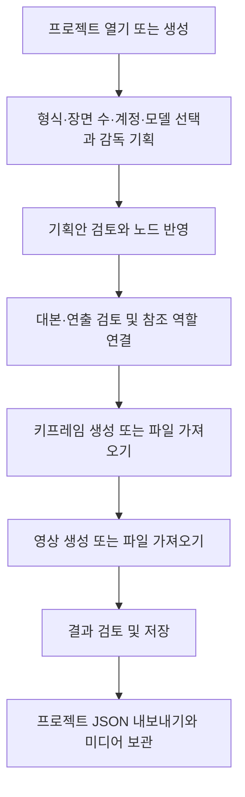
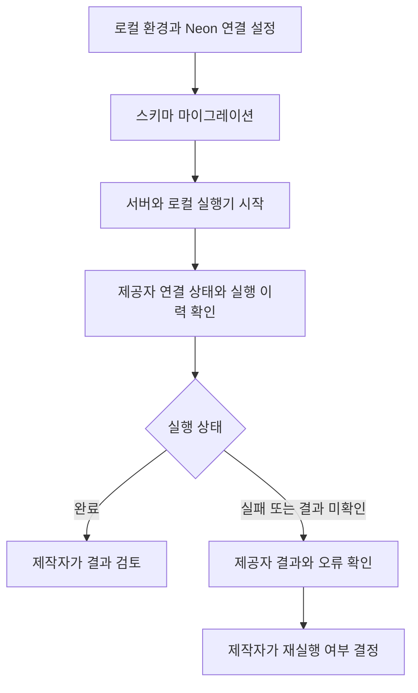

# Omni AI Canvas 프로젝트 개관

> 대본부터 완성 영상까지 여러 AI 모델을 한 보드에서 쓰는 제작실 · [브랜드 규칙](docs/brand.md)

Omni AI Canvas는 작가와 연출자가 드라마의 기획, 대본, 캐릭터와 장면 미디어를 노드로 연결하고 구독 중인 AI 도구와 함께 제작하는 개인용 캔버스다.

## 대상과 가치

- 대상은 단편 드라마를 기획하고 이미지와 영상을 직접 제작하는 작가 겸 연출자다.
- 한 장면의 대본과 인물 참조, 키프레임과 영상의 관계를 같은 작업 공간에 보존한다.
- 제작자는 제공자의 이용 경로를 확인하고 기획 제안과 생성 결과를 검토한 뒤 작업에 반영한다.

## 제작자 흐름

기획·대본·씬·샷 같은 문서는 카드의 책 아이콘으로 연다. 보기에서는 마크다운을 읽고 편집에서 제목과 본문을 저장한다. 개별 문서는 Markdown과 PDF 파일로 바로 내려받을 수 있다. 키프레임·영상·음향은 카드에서 노드 미리보기를 열고 전체 본문과 첨부 미디어를 확인하거나 원본 파일을 내려받는다. 프롬프트를 만들 때 영문과 한국어 버전을 함께 저장한다. 미리보기에서 두 버전을 읽고 어느 쪽이든 편집해 함께 적용하거나 창 크기를 조절한다.

첫 화면에서 〈마지막 상영〉의 예제 영상과 그 컷을 만든 자료를 보고, 원하면 5분 소개 영상을 재생한다. 이어서 제작 과정에서 연결·이미지 연출·타임라인을 확인한다. 제작 형식과 도구, 비용과 보관을 살펴보고 캔버스를 열어 프로젝트를 시작한다. [랜딩 시나리오](docs/landing-page-design.md) · [전체 사용 가이드](docs/user-guide.md)

새 프로젝트는 제작 형식을 먼저 골라 기본 보드를 열거나 빈 캔버스를 열 수 있다. 보드 전체나 선택한 노드를 저장해 새 프로젝트의 프리셋으로 쓸 수도 있다. 이미지가 붙은 노드의 ＋에서 원본을 참조하는 질감·표정·카메라·조명 작업과 스토리보드 시트를 준비한다.

타임라인 창은 편집 화면과 고른 항목의 설정, 컷·음향·자막이 시간을 공유하는 시간축을 함께 보여 준다. 합성하기 전에 흐름을 재생하고 프리비즈와 납품본을 만든다. [타임라인 안내](docs/timeline.md)

광고 형식에서는 Higgsfield 패션 광고 워크플로우를 선택해 제품·인물·공간 참조, 시작 프레임, 영상 테이크와 편집을 이어서 구성한다. 타임라인에서 인접한 두 테이크를 골라 렌즈 안쪽을 한 번 누르면 윤곽을 잡아 원근 변화를 추적하고 안경테 안쪽에서 합성하는 로컬 전환을 만든다. 앞 테이크의 추적 프레임을 한 장씩 보며 윤곽을 보정한 뒤 다시 추적하고 타임라인에 적용할 수 있다. 적용한 전환은 저장된 원본 범위와 윤곽·보정값을 다시 불러와 같은 클립에서 갱신한다. 편집값이 없는 이전 전환도 앞뒤 컷과 원본 연결이 보존돼 있으면 현재 컷 경계에서 원본 범위를 불러온다. 자동 복원이 어려울 때는 원본 영상 두 개를 골라 시작 프레임을 숫자로 입력하거나, 앞뒤 원본을 한 프레임씩 보며 시작점을 지정한다. 선택한 범위와 편집값은 같은 클립에 저장한다. 저장한 전환도 앞뒤 원본을 미리보면서 시작점을 바꿀 수 있다. 앞 시작점이 달라지면 기존 윤곽을 새 기준 프레임까지 자동으로 추적하고, 어긋난 점만 보정한다. 중간에 끊기면 그 원본 프레임을 열고 윤곽점을 수정해 목표 시작점까지 이어서 추적한다. [패션 광고 제작 방식](docs/higgsfield-fashion-ad-workflow.md)

연출 도구를 선택하면 원본에 연결된 노드가 생긴다. 조명·감정·카메라 값을 가이드에서 보며 수정한 뒤 생성 모델로 보낸다. 25컷 시트를 검수하고, 컷 경계를 보정해 선택한 컷을 이미지로 분리한다. 분리한 컷은 행 우선 순서로 하나의 영상 노드에 연결할 수 있다. [연출 노드 설계](docs/character-direction-node-design.md)

이미지를 선택하면 그 위에 감정·조명·다각도·시트 도구가 나타난다. 도구를 고르면 생성 호출 없이 연결된 초안과 전용 편집기를 연다. 편집 노드를 다시 선택하면 저장한 설정을 복원한다. 감정판에서 클릭하거나 드래그해 목표 표정을 고르고 원본 이미지와 가장 가까운 기준 표정 사진을 함께 확인한다. 감정·조명·다각도 등 이미지 연출 설정과 업스케일은 화면 크기에 맞춘 대화상자에서 편집한다. 조명 가이드에서는 주광 기구, 원본을 향하는 광선, 선택한 림라이트를 보며 방향을 조정할 수 있다. 편집 원본, 채택본과 후보는 편집기에서 확대해 확인하고 후보별로 채택한다. [이미지 위 도구와 시각 편집기](docs/image-node-editor-design.md)

이미지 도구에서 레이어를 분리하고 캐릭터 설정도를 준비한다. 업스케일·주석·회전 결과를 원본과 연결된 이미지로 보관하고, 미리보기에서 확인하거나 원본을 다운로드한다.

캔버스 작업 메뉴에서 클릭한 위치에 노드와 파일을 추가하고, 복사한 노드를 붙여넣는다. 노드 메뉴에서 평가·복제·그룹·자산 저장을 사용한다. 캔버스 오른쪽 상단의 배치 최적화는 카드의 실제 크기를 기준으로 겹치거나 가까운 노드 사이에 간격을 만든다. 새 노드가 겹치거나 이미지·영상을 붙인 카드가 커져 이웃과 겹치면 주변 간격을 자동으로 확보한다. 실행 취소로 이전 위치를 복원할 수 있다. 생성 기록과 직접 저장한 자산은 보관함에서 꺼내 쓸 수 있다.

드라마 감독안은 필요한 장면에 내레이션·속마음 `[VO]`와 현장 밖 대사 `[OS]`를 구분해 제안한다. `[VO]`가 들어간 제작안을 적용하면 대본, 녹음할 음향 큐와 샷 시간 기준의 타임라인 배치가 함께 생긴다. 녹음하거나 음성 파일을 첨부한 뒤 발화 길이를 편집할 수 있다. [제작 에이전트 사용 가이드](docs/production-agent-guide.md#드라마의-내레이션과-속마음)

캐릭터 시트의 **외형과 목소리 설정**에서 Soul ID와 목소리 ID를 각각 등록한다. 새 Soul은 사진 5~20장으로 학습하고, 개인 목소리는 지원되는 Higgsfield MCP 연결에서 샘플로 등록한다. 준비된 Soul로 만든 기준 이미지를 영상 입력에 연결하고, VO 음향 큐에서 화자를 골라 같은 목소리로 대사를 합성한다. [캐릭터 연동 설계](docs/character-identity-design.md)

대본·시나리오·음향 큐에서 Fish Audio, ElevenLabs, Typecast, Gemini TTS의 목소리를 한국어 이름과 설명으로 살피고 대사를 합성한다. Fish Audio는 인기순·최신순, 성별, 공급사 태그로 찾는다. 전용 화면에서 만든 TTS 샘플을 캐릭터 시트에 추가해 Higgsfield 개인 목소리 등록에 사용할 수 있다. 로컬에 설치한 Fish S2 Pro·Drama 3를 골라 무료로 합성할 수도 있다. [TTS와 목소리 등록 설계](docs/tts-studio-design.md)

공개 쇼츠의 컷을 분석해 자신의 프리셋을 만들고, 새 주제의 대본·씬·샷 또는 로컬 모션그래픽 제작 명세로 이어갈 수 있다. [컷 분석과 로컬 제작 설계](docs/local-video-production.md)

## 운영자 흐름

첫 버전은 제작자와 운영자가 같은 로컬 컴퓨터를 사용한다. 별도 관리자 계정과 관리자 화면은 후속 범위다.

## 기술 스택

| 영역 | 선택 | 역할 |
| --- | --- | --- |
| 웹 | Next.js App Router, React, TypeScript | 한국어 UI와 서버 경계 |
| 캔버스 | React Flow | 노드, 연결, 선택, 이동과 확대 |
| 데이터 | Neon Postgres, `@neondatabase/serverless` | 그래프와 실행 이력 영속화 |
| 실행 | 로컬 Node.js 실행기와 제공자 CLI | 사용자의 로컬 인증을 이용한 작업 처리 |
| 미디어 | 로컬 파일과 서버 미디어 경로 | 이미지와 영상 원본 보관 |
| 서체 | Pretendard Variable | 한글·영문 UI |

## 앱 URL 구조

- `/api/projects/[id]/runs`의 이력은 기본 30개를 반환한다. 오래된 이력은 커서로 이어 보고 진행 중인 작업은 별도로 갱신한다.
- `/api/settings`에서 로컬 등록 키의 상태와 사용자가 기록한 구독 요금제를 관리한다.

| 경로 | 역할 |
| --- | --- |
| `/` | 제작 기능, 예제와 작업실 진입 안내 |
| `/studio` | 프로젝트 선택과 캔버스 진입 |
| `/api/projects` | 프로젝트 목록 및 생성 |
| `/api/projects/[id]` | 프로젝트 조회 및 저장 |
| `/api/projects/[id]/runs` | 실행 요청과 이력 |
| `/api/projects/[id]/estimate` | 현재 입력과 모델 설정의 예상 크레딧 확인 |
| `/api/providers` | 제공자 가용성 |
| `/api/providers/media-model` | 공급사의 작업별 옵션과 이미지·영상 입력 슬롯 |
| `/studio?project=<UUID>&analysis=<실행 UUID>` | 보존된 프로젝트와 컷 분석 결과 열기. 프로젝트만 지정하면 제작 보드를 열며 기존 `/?project=…` 링크도 사용할 수 있다. |
| `/api/projects/[id]/attachments/range` | 원본에 대한 컷 구간 재표본화와 수동 경계 보정 |
| `/api/guidance` | 노드 지침 화면에서 펼쳐 보는 고정 Higgsfield 공통 지침 |
| `/api/guidance?source=<등록 ID>` | 로컬에 보관한 스킬 원문의 무결성을 확인해 열람 |
| `/api/projects/[id]/blender/assets` | 프로젝트의 GLB 등록·목록, 출처와 모델의 본·동작 확인 |
| `/api/projects/[id]/blender/render` | 샷의 프리비즈·최종 H.264 렌더 및 미등록 출력 조회 |
| `/api/director-references` | 디렉터 스튜디오의 로컬 참고 예제 목록과 파일 조회 |
| `/api/style-presets` | 개인 보관함의 스타일 프리셋 조회·저장·수정 |
| `/api/board-presets` | 프로젝트 전체 또는 선택한 노드에서 만든 보드 프리셋 조회·저장 |
| `/api/saved-assets` | 내 자산 목록 조회와 프로젝트 노드에서 저장 |
| `/api/projects/[id]/motion-short` | 로컬 레시피와 프로젝트 이미지로 숏폼·롱폼 MP4 렌더 |
| `/api/projects/[id]/attachments` | 프로젝트별 파일·공개 링크 첨부와 조회 |
| `/api/projects/[id]/character-identity` · `/api/projects/[id]/character-voice` | Soul 학습·상태·계정 목소리 조회와 MCP 개인 목소리 등록 |
| `/api/projects/[id]/tts/direct` | 대본에 맞는 연기 지시를 작업실 텍스트 에이전트로 선택 |
| `/api/projects/[id]/tts` | TTS 공급사·로컬 모델 상태와 목소리 목록 조회, 대사 음성과 여러 화자 대화 생성, 로컬 생성 취소 |
| `/api/projects/[id]/tts/translations` | 목소리 이름·설명의 한국어 번역과 Fish Audio 검색어 번역 |
| `/api/projects/[id]/tts/catalog` | Fish Audio 공개 목록 동기화·한국어 사전 번역 시작과 진행 상태 조회 |
| `/api/projects/[id]/tts/recommend` | 저장한 캐릭터 설명과 현재 필터로 Fish Audio 목소리 추천 |
| `/api/projects/[id]/lens-transition` | 저장한 타임라인의 기준 프레임, 기준점 기반 윤곽 검출, 프레임별 검토·재추적과 로컬 렌즈 전환 렌더 |
| `/api/projects/[id]/lens-transition/source-frame` | 선택한 영상 테이크의 30fps 원본 프레임 미리보기 |
| `/api/projects/[id]/exports` | 저장된 영상 컷을 순서대로 MP4로 합성 |
| `/api/assets` | 미디어 업로드 |
| `/api/assets/[file]` | 저장된 미디어 접근 |

제작자는 하나의 작업 화면에서 프로젝트와 실행 이력을 전환한다. 외부 에이전트도 같은 API의 버전 검사와 저장 규칙을 사용한다.

## 데이터 모델

| 데이터 | 저장 위치 | 주요 필드 |
| --- | --- | --- |
| 프로젝트 | `drama_canvas.projects` | `id`, `title`, `graph`, `version`, `updated_at`, 선택적 `production_profile_id`와 `production_settings` |
| 공유 분류 | `drama_canvas.project_classifications` | `id`, `kind`, `name` |
| 캔버스 노드 | `projects.graph.nodes` JSON 배열 | `id`, `kind`, `title`, `body`, `x`, `y`, `asset` |
| 참조 연결 | `projects.graph.edges` JSON 배열 | `source`, `target`, 선택적 `role`, `usage` |
| 실행 작업 | `drama_canvas.runs` | `id`, `project_id`, `request_id`, `input`, `status`, `result`, `error`, 시각 |
| 제작 프리셋 | `drama_canvas.style_presets` | `id`, `draft`, `version`, `updated_at`. 한 제작자가 프로젝트 간 재사용 |
| 보드 프리셋 | `drama_canvas.board_presets` | `id`, `name`, `graph`, 선택적 형식·설정, `created_at` |
| 미디어 원본 | 로컬 파일 | 노드의 `asset.url`, `asset.type`, `asset.name`으로 참조 |
| 실행별 첨부 | `.scene-room/attachments/<project-id>/` | 프로젝트별 매니페스트와 추출 내용, 미디어 참조 |

실행 요청은 입력 스냅샷을 보존한다. `(project_id, request_id)`는 중복 요청을 식별하고, 프로젝트의 `version`은 오래된 편집의 덮어쓰기를 막는다.

## 9개 기능

| 기능 | 제공 가치 |
| --- | --- |
| C1 프로젝트 | 예제와 새 프로젝트를 만들고 다시 연다. |
| C2 캔버스 | 노드를 추가, 이동, 삭제한다. 좌측 도구함에서 제작 키트, 노드 목록, 자산을 탐색한다. |
| C3 제작 자료 | 기획, 시나리오, 캐릭터 시트, 키프레임, 영상을 편집한다. 디렉터 스튜디오에서 구도·앵글·화면 배치·시선·카메라 이동을 예제로 비교하고, 초점 거리의 화각과 장면 전개·장르·편집 리듬을 노드에 저장한다. |
| C4 참조 연결 | 노드를 연결해 다음 작업에 필요한 자료를 전달한다. |
| C5 에이전트 기획 | 프로젝트 대화에서 선택한 자료와 지침으로 논의한다. 감독안을 제안받고 노드별 제작 지침을 수정하며 작업 종류별 기본 에이전트를 지정한다. |
| C6 이미지 | 연결된 공급사의 이미지 모델을 선택하고 옵션·참조로 생성하거나 외부 결과를 가져온다. |
| C7 영상 | 씬이나 샷에서 연결된 영상 노드를 열고 공급사·모델·길이·해상도를 고른다. 연결 노드와 첨부 이미지·영상에서 생성한 클립을 기록에서 확인해 적용한다. |
| C8 실행 관리 | 제공자 상태, 작업 진행과 결과를 확인한다. |
| C9 보관과 인계 | 그래프를 저장·내보내고 영상 컷을 선택한 순서대로 MP4로 합성한다. |

## 설계 원칙과 범위

제작 프리셋에서는 콘텐츠 타입, 아이디어, 레퍼런스 영상의 편집 리듬과 촬영 기법을 결합한다. 제작자는 직접 구성하거나 에이전트 추천을 편집한 뒤 연결된 노드와 감독 기획에 반영한다. [레퍼런스 프리셋 설계와 예시](docs/style-preset-workflow.md)

- 사용자가 생성과 결과 반영을 명시적으로 결정한다.
- 편집 내용은 생성 실패와 오래된 버전의 저장 충돌에서 보존한다.
- 제공자별 인증과 청구 경로, 불확실한 연결 가능성을 구분해 표시한다.
- 개인 로컬 사용을 전제로 데이터 접근 범위와 실행 권한을 제한한다.
- MVP 범위 밖은 팀 권한과 공개 공유, 여러 기기의 미디어 동기화, 다중 트랙 편집·자막·전환 효과, 자체 결제다.

기능별 인수 기준은 [PRD](docs/PRD.md), 경계와 실행 설계는 [아키텍처](docs/architecture.md), 용어와 코드 매핑은 [용어집](glossary.md)을 따른다.

## 다음 릴리스 설계 · 대본에서 장면 믹스까지

후속 기능 구현 계획 (로컬 자료)에서 다중 배역 3D, 이미지 시트, 레퍼런스 비교, 단어 자막과 공급사 연동의 진행 상태를 관리한다.

v0.2 제안은 기존 C1~C9를 확장한다. 감독 기획, 씬·샷·레퍼런스 노드, 참조 역할과 연출 확인용 연결은 현재 구현 단계에 반영됐다. 자산 보관함, 보드 검색·복제·그룹, 프리비즈·음향 시간축과 로컬 연출 도구가 연결돼 있다. 단위·렌더와 브라우저 검증 범위는 대응표에 기록한다. 장면 대본 → 샷 → 역할별 이미지·영상 참조 → 프리비즈 → 채택 테이크 → 음향을 포함한 최종 컷 순서로 제작한다. 프리비즈에서 컷 길이와 대사 여백을 먼저 듣고 본 뒤, 같은 샷 명세를 Higgsfield의 생성 입력과 Road Music의 음향 큐로 연결한다. 감독은 같은 샷의 자료에서도 동선을 짜는 데만 쓸 배치도와 외부 모델에 전송할 참조를 구분한다. 1차 인수 시나리오는 〈마지막 상영〉의 12초 장면이다.

[캔버스 기능 대응과 상태](docs/canvas-parity.md) · [연출 설계와 구현 순서](docs/directing-workflow.md) · [촬영·편집 기법 검토](docs/directing-sources.md) · [음악·효과음 CLI 설계](docs/road-music-integration-plan.md)

## 내 프로젝트와 작업실 설정

캔버스 오른쪽 작업실에서 프로젝트 대화, 제작 요청, 노드 편집, 제작 지침과 실행 기록을 연다. 작업실 **가이드**에서 첫 제작 흐름과 예시를 읽고, 각 탭의 **탭 사용법**에서 조작 순서와 결과 확인 방법을 살펴볼 수 있다. 상단 **사용 가이드**는 33개 장에서 여는 곳, 순서, 설정값, 한도, 화면 문구별 해결을 실제 화면과 도식으로 설명하고 검색한다(`components/guide/`, 사실 대조는 `tests/guide.test.ts`).

작업별 기본 에이전트와 작업 공간 배치는 서버에 저장해 새 브라우저에서 복원한다. 이미지 기본값은 Codex의 구독형 `image_gen`이다. OpenAI·Gemini·Seedream 이미지 API는 작업실 설정에서 해당 API를 허용해 저장한 뒤 제작 노드에서 선택할 수 있다.

프로젝트 목록은 최근 활동순으로 표시한다. 제목, 카테고리, 태그로 검색하고 작업 중·보관함·휴지통을 전환한다. 목록의 설정과 우측 프로젝트 패널의 설정에서 같은 프로젝트 모달을 연다. 모달에서 프로젝트 이름과 분류를 변경하고, 공용 목록의 카테고리와 태그를 선택한다. 선택 목록 옆의 카테고리 설정과 태그 설정, 관리 상단의 카테고리·태그 전체 관리에서 공용 분류를 등록하거나 이름을 변경하고 삭제할 수 있다. 캔버스와 타임라인은 새 프로젝트로 복제할 수 있다. 보관하거나 삭제한 프로젝트는 원래 상태로 되돌릴 수 있다.

| 경로 | 역할 |
| --- | --- |
| `GET/POST /api/projects` | 내 프로젝트 요약 조회·생성 |
| `PATCH /api/projects/:id` | 열기, 분류 편집, 복제, 보관, 휴지통 이동, 복구 |
| `GET/POST/PATCH/DELETE /api/projects/classifications` | 공용 분류 조회·추가·이름 변경·삭제 |
| `GET/PUT /api/settings` · `POST /api/settings/test` | 로컬 키 조회와 변경, 읽기 전용 인증 검사 |
| `GET /api/providers` | 공식 연결 경로에서 확인한 계정·모델 정보 |

[제작 참고자료의 기능 대응표](docs/production-reference-map.md) · [프로젝트 상태 도식](docs/diagrams/project-lifecycle.html)

설계 제안 · [형식 지정·무형식 캔버스와 캐릭터 이미지 편집](docs/format-first-character-editing-proposal.md)
